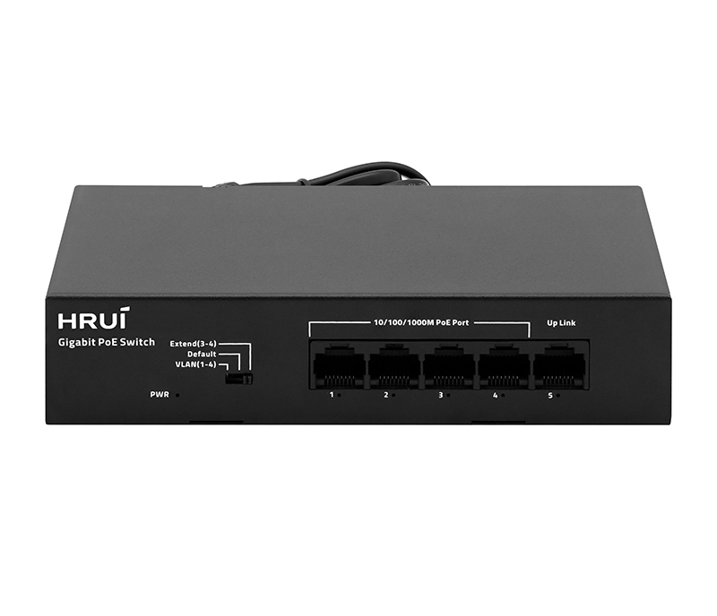
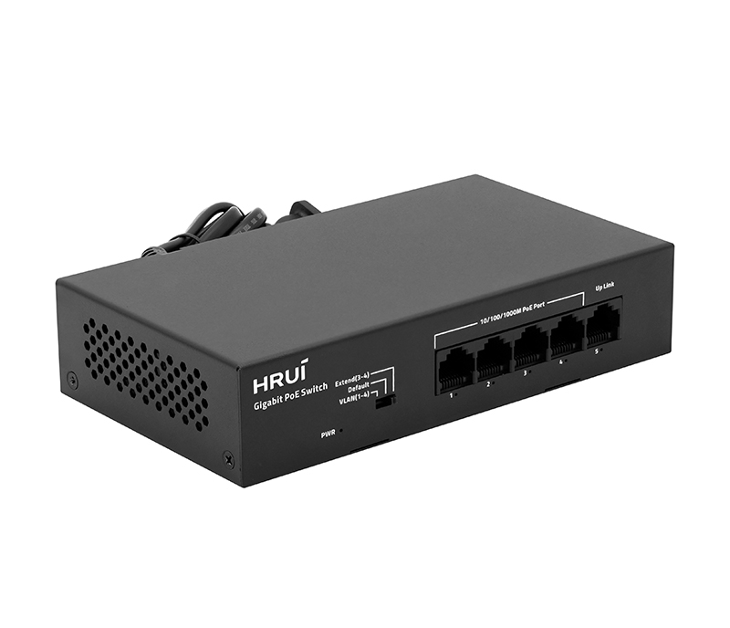
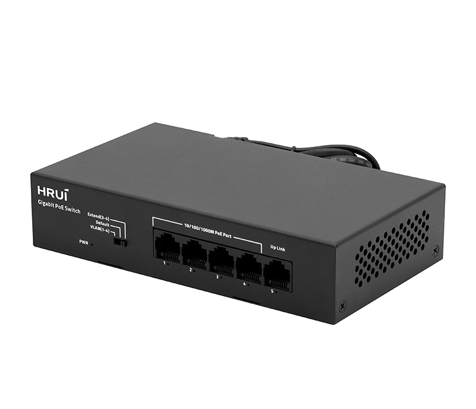
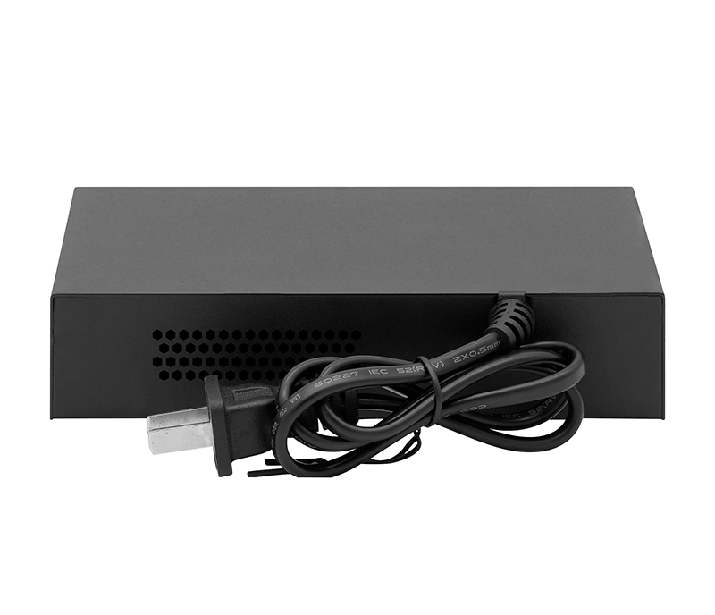

# HR903-AFG-41Y

> 来源：<https://www.hruitech.com/poe-switch/307.html>（抓取 2026-10-21T04:35:17Z；英文原文照录，中文仅为栏目名）  
> 官网描述：4-Port 10/100/1000T 802.3af/at PoE + 1-Port 10/100/1000T Ethernet Switch (55 Watts)   
> 类目：PoE Switch（site id 307）  
> 接口：4 *1Gbps PoE ports / 1 *1 Gbps uplink RJ45 port；PoE 预算 50W；交换带宽 —；电源 AC 100-110V 35.2W / AC 110-200V 44 W / AC 200-240V 55 W / DC 52V 1.05A

**Brief:** Gigabit PoE switch, with 4*Gigabit PoE ports + 1*Gigabit uplink RJ45 port, IEEE 802.3af/at standard, bandwidth 10Gbps, total power 55W, supports VLAN/Default/Extend modes (250m transmission at 10Mbps), operating temperature 0~40°C, surge protection 4KV, ESD 8KV, fanless desktop design.

## 产品图





## Datasheet
- [HR903-AFG-41Y-28EN-29_3UHhh.pdf](https://www.hruitech.com/web/userfiles/productfile/HR903-AFG-41Y-28EN-29_3UHhh.pdf) （本地：`data/hrui_site_raw/datasheets/HR903-AFG-41Y-28EN-29_3UHhh.pdf`；文本：`data/hrui_site_raw/datasheet_text/HR903-AFG-41Y-28EN-29_3UHhh.txt`）

## Feature and Benefits（原文）
```
A compact 5-port Gigabit PoE switch featuring 4×Gigabit PoE ports and 1×Gigabit uplink RJ45 port. Compliant with IEEE 802.3/802.3u/802.3x standards, it supports 10/100/1000Mbps auto-negotiation and provides total power budget of 55W (IEEE 802.3af/at). Ideal for small to medium network deployments.
Product Features:
Port Configuration:
4×1G PoE ports + 1×1G uplink RJ45 port.
Switching Bandwidth:
10Gbps
PoE Standard:
IEEE 802.3af/at (≤30W per port).
Operating Modes:
VLAN, Default, Extend (extends transmission to 250m at 10Mbps on ports 3–4).
Protection:
Surge 4KV, ESD 8KV.
Flow Control:
IEEE 802.3x (full duplex), Back Pressure (half duplex).
Switching Mechanism:
Store-and-forward.
Operating Temperature:
0°C to 40°C.
Design:
anless, desktop installation
```

## Parameter（规格表逐行）
| 项 | 值 |
|---|---|
| Description | Specification |
| Model | HR903-AFG-41Y |
| Interface | 4 *1Gbps PoE ports |
| Interface | 1 *1 Gbps uplink RJ45 port |
| Port Standard | IEEE802.3 (Ethernet) |
| Port Standard | IEEE802.3u (Fast Ethernet) |
| Port Standard | IEEE802.3x (Flow Control) |
| Bandwidth | 10Gbps |
| Packet Forwarding Rate | 7.44Mpps |
| Packet Buffer | 3Mbit |
| MAC Address Table | 2K |
| Transmission Method | Store and Forward |
| PoE Standard | IEEE802.3af (15.4W) |
| PoE Standard | IEEE802.3at (30W) |
| PoE Port Output Voltage | DC 44-57V |
| PoE Ports | Ports 1-4 PoE power output <30W |
| PoE Power Budget | 50W |
| Power Supply | AC 100-110V 35.2W |
| Power Supply | AC 110-200V 44 W |
| Power Supply | AC 200-240V 55 W |
| Power Supply | DC 52V 1.05A |
| Mainboard Power Consumption | 2.1W |
| Structure Information | Product Dimensions :160*90*35mm |
| Structure Information | Packaging Dimensions :203*130*45mm |
| Structure Information | Product Net Weight:0.401Kg |
| Structure Information | Product Gross Weight:0.47Kg |
| Packing Information | Carton Dimensions :470*426*280mm |
| Packing Information | Packing Quantity: 40PCS |
| Packing Information | Packing Weight: 19.8KG |
| Package Contents | Switch 1pcs, Manual 1pcs,Certificate of Inspection 1pcs |
| Fan Quantity | 0 |
| Installation | Desktop |
| Surge Protection | Port Surge: common mode 4KV,Differential mode 2KV(Class C) |
| Surge Protection | Electrostatic ESD: Air 8KV, Contact 6KV(Class C) |
| Operating Temperature | 0~40°C |
| Storage Temperature | -40 °C to 70 °C |
| Operation Humidity | 10%~90%,non condensing |
| Storage Humidity | 5%~95%,non condensing |
| PWR Green LED | On: Powered on |
| PWR Green LED | Off: Powered off |
| Ports 1-5 Green LED | On: Link normal |
| Ports 1-5 Green LED | Off: Link blocked |
| Ports 1-5 Green LED | Flashing: Data transmitting |
| VLAN/Default/Extend Modes Buttons | VLAN: VLAN mode, ports 1-4 are isolated from each other, communicating with ports 5 ,and automatically activate the PoE watchdog mode |
| VLAN/Default/Extend Modes Buttons | Default: Normal mode, all ports can communicate with each other, transmission distance is within 100 meters, transmission rate is 10/100 /1000 Mbps adaptive(PoE Watching off) |
| VLAN/Default/Extend Modes Buttons | Extend: Extend mode,when the PoE is in Extend mode,ports 3-4 force 10 Mbps the transmission distance to 250 meters, and automatically activate the PoE waching mode |

## Product structure / Application topology（图）
- https://www.hruitech.com/web/userfiles/image/20250827/1756290033784544.png
