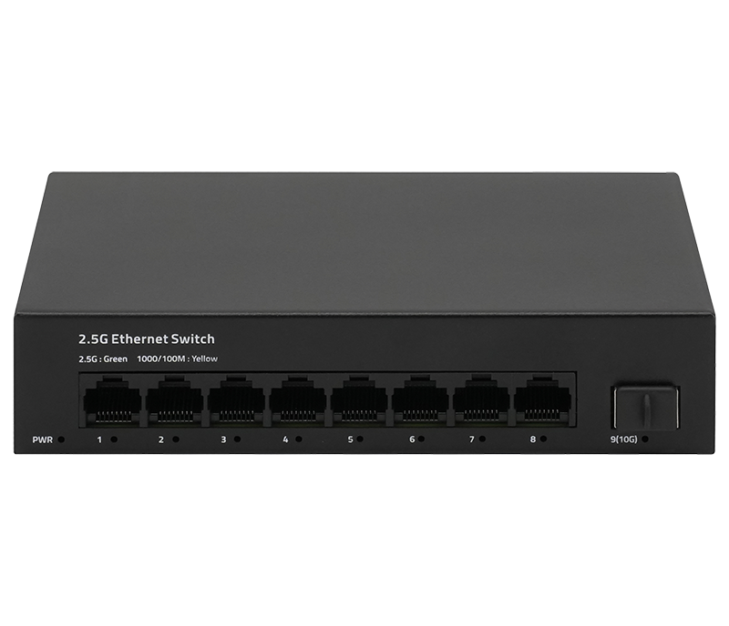
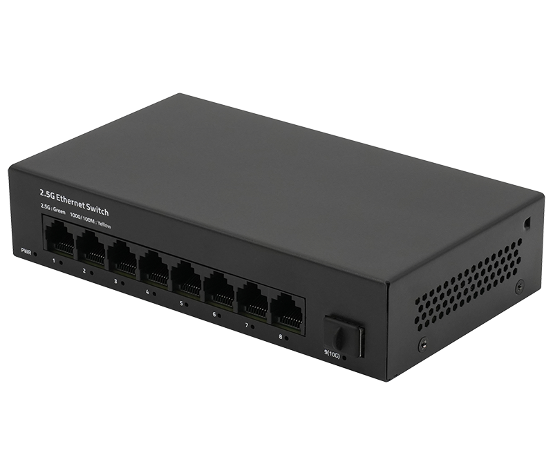
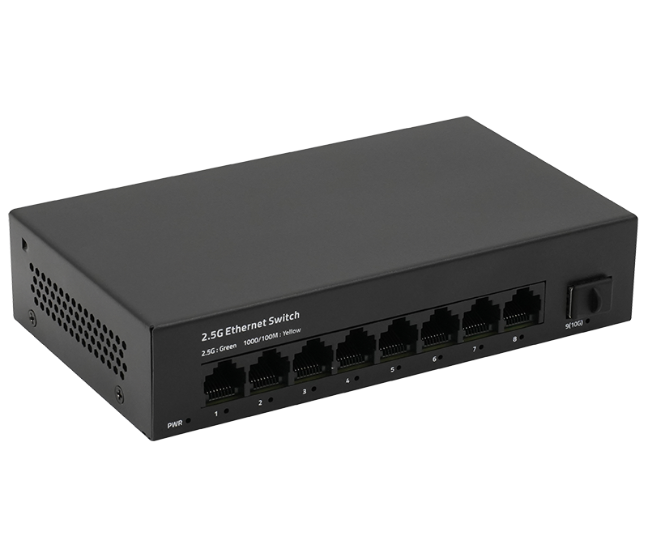
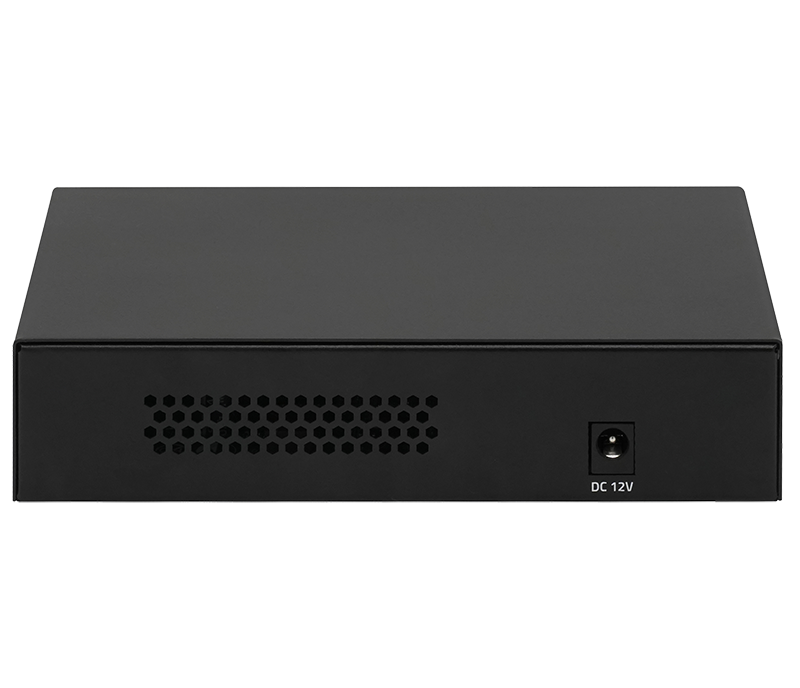

# HR903-SWTG018AS

> 来源：<https://www.hruitech.com/ethernet-switch/279.html>（抓取 2026-10-21T03:47:29Z；英文原文照录，中文仅为栏目名）  
> 官网描述：HR903-SWTG018AS - 8-Port 2.5G and 1-Port 10G SFP+ Ethernet Switch  
> 类目：Ethernet Switch（site id 279）  
> 接口：8 * 2.5G RJ45 ports / 1 * 10G SFP+ port；PoE 预算 —；交换带宽 —；电源 AC 100-240V , 50/60Hz / DC 12V 1A

**Brief:** The HR903-SWTG018AS is a high-performance, managed Ethernet switch designed for demanding network environments. It provides eight 2.5 Gigabit Ethernet ports and a single 10 Gigabit SFP+ uplink, offering a flexible and powerful solution for high-bandwidth applications.

## 产品图





## Datasheet
- [HR903_SWTG018AS.pdf](https://www.hruitech.com/web/userfiles/productfile/HR903_SWTG018AS.pdf) （本地：`data/hrui_site_raw/downloads/HR903_SWTG018AS.pdf`；文本：`data/hrui_site_raw/datasheet_text/HR903_SWTG018AS.txt`）

## Feature and Benefits（原文）
```
The HR903-SWTG018AS is a high-performance, managed Ethernet switch designed for demanding network environments. It provides eight 2.5 Gigabit Ethernet ports and a single 10 Gigabit SFP+ uplink, offering a flexible and powerful solution for high-bandwidth applications.
Product Features:
High-Speed Connectivity:
8 x 2.5G RJ45 ports and 1 x 10G SFP+ port for versatile network integration.
Versatile Standards Compliance:
Fully compliant with IEEE 802.3, 802.3u, 802.3ab, 802.3bz, 802.3z, 802.3ae, and 802.3x standards, ensuring interoperability.
Auto-Negotiation & Auto MDI/MDIX:
Supports auto-negotiation for 10M/100M/1G/2.5Gbps speeds on Ethernet ports, and automatic port flipping (Auto MDI/MDIX) simplifies cabling.
LED Indicators:
Integrated LED indicators provide real-time monitoring of the switch's operating status, aiding in quick troubleshooting.
Flow Control:
Implements flow control mechanisms based on IEEE 802.3x for full-duplex and Backpressure for half-duplex operation, preventing data loss and ensuring stable data transmission.
Centered Content
2.5G + 10G Port Combination
Provides 2.5G RJ-45 and 10G SFP+ ports to meet the needs of different users. Whether for regular users or business users, this device offers flexible network solutions to ensure a stable and fast connection experience.
HR903-SWTG024AS：
4*2.5G + 2*10G SFP+
HR903-SWTG015AS：
4*2.5G + 1*10G SFP+
HR903-SWTG018AS：
8*2.5G + 1*10G SFP+
Easily Connect High-speed Devices and Reduce Upgrade Costs
Utilizing existing wiring allows for easy connection of high-speed devices like WiFi 6 routers, AP, NAS, and gaming equipment, meeting growing network demands while reducing upgrade costs and ensuring efficient data transmission.
Large Cache Capacity for Lossless Transmission
Uses a store-and-forward mechanism with high bandwidth processing and large cache capacity to minimize data forwarding delays, enhance efficiency, and prevent data loss.
Metal Casing, Compact Design
The compact design with a metal casing saves space while providing durability and robustness, and it allows for efficient heat dissipation, ensuring stable operation of the device.
Plug and Play
Support automatic port flipping, easy to use, plug and play, no configuration needed.
APPLICATION
SPECIFICATION
```

## Parameter（规格表逐行）
| 项 | 值 |
|---|---|
| **SPECIFICATION** | |
| Description | Specification |
| Model | HR903-SWTG018AS |
| Interface | 8 * 2.5G RJ45 ports |
| Interface | 1 * 10G SFP+ port |
| Port Standard | IEEE802.3 (Ethernet) |
| Port Standard | IEEE802.3u (Fast Ethernet) |
| Port Standard | IEEE802.3ab (Gigabit Ethernet) |
| Port Standard | IEEE802.3z (Gigabit Ethernet Fiber Standard) |
| Port Standard | IEEE802.3bz (2.5G Ethernet) |
| Port Standard | IEEE 802.3ae (10G Ethernet) |
| Port Standard | IEEE802.3x (Flow Control) |
| Bandwidth | 60Gbps |
| Packet Forwarding Rate | 44.64Mpps |
| Packet Buffer | 8Mbit |
| MAC Address Table | 4K |
| Transmission Method | Store and Forward |
| Power Supply | AC 100-240V , 50/60Hz |
| Power Supply | DC 12V 1A |
| Mainboard Power Consumption | 8.75W |
| Structure Information | Product Dimensions :160*90*35mm |
| Structure Information | Packaging Dimensions : 175*120*73mm |
| Structure Information | Product Net Weight: 0.32KG |
| Structure Information | Product Gross Weight:0.46KG |
| Packing Information | Carton Dimensions :520*335*205mm |
| Packing Information | Packing Quantity: 20PCS |
| Packing Information | Packing Weight: 10.2KG |
| Package Contents | Switch 1pcs, Power adapter 1pcs, manual 1pcs,certificate of qualification 1pcs |
| Fan Quantity | 0 |
| Installation | Desktop |
| Surge Protection | / |
| Operating Temperature | 0~40°C |
| Storage Temperature | -40 °C to 70 °C |
| Operation Humidity | 10%~90%,non condensing |
| Storage Humidity | 5%~95%,non condensing |
| PWR Green LED | On: Powered on |
| PWR Green LED | Off: Powered off |
| 1-8 | Green LED On:2.5G Link normal |
| 1-8 | Yellow LED On:10M/100M/1G Link normal |
| 1-8 | Off: Link blocked |
| 1-8 | Flashing: Data transmitting |
| 9 | Blue LED On:10G Link normal |
| 9 | Green LED On:2.5G Link normal |
| 9 | Off: Link blocked |
| 9 | Flashing: Data transmitting |

## Product structure / Application topology（图）
- https://www.hruitech.com/web/userfiles/image/20250217/1739771835632647.png
- https://www.hruitech.com/web/userfiles/article/EDM/2025/0217/top7.jpg
