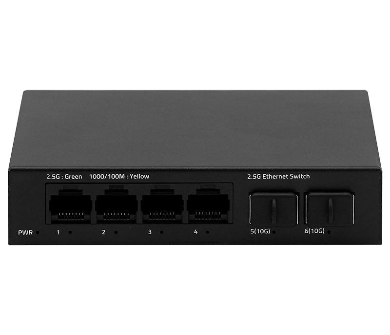
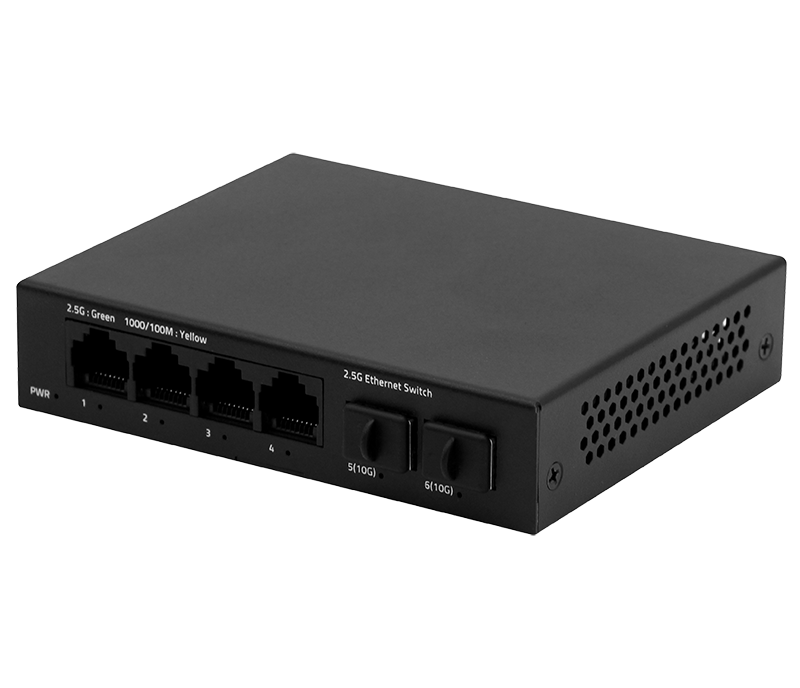
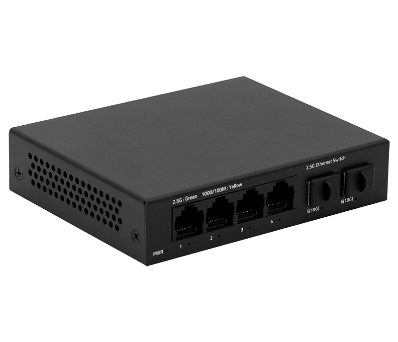
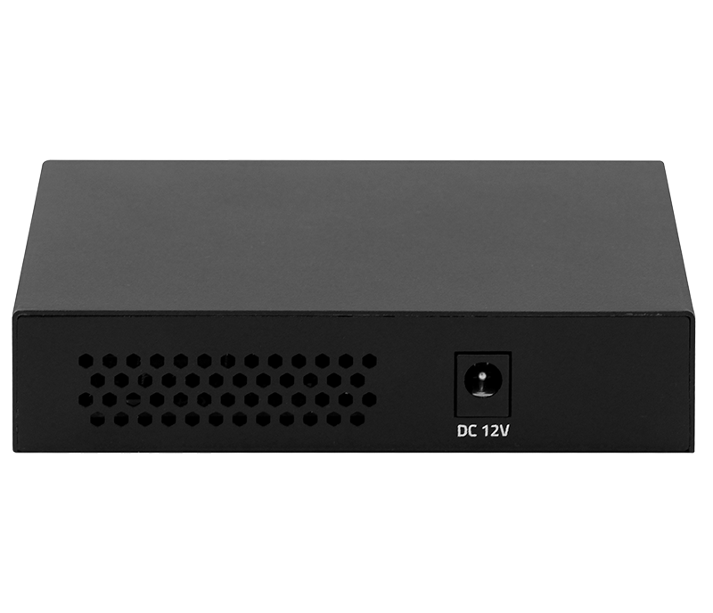

# HR903-SWTG024AS

> 来源：<https://www.hruitech.com/ethernet-switch/280.html>（抓取 2026-10-21T03:47:28Z；英文原文照录，中文仅为栏目名）  
> 官网描述：4-Port 10/100/1000/2500T + 2-Port 10G SFP+ Ethernet Switch   
> 类目：Ethernet Switch（site id 280）  
> 接口：4-Port 10/100/1000/2500T + 2-Port 10G SFP+ Ethernet Switch ；PoE 预算 —；交换带宽 —；电源 —

**Brief:** The HR903-SWTG024AS is a versatile and powerful Ethernet switch designed for demanding network environments. It combines the speed of 2.5 Gigabit Ethernet with the flexibility of 10 Gigabit SFP+ connectivity. This switch provides a cost-effective solution for boosting network performance, handling bandwidth-intensive applications, and future-proofing your infrastructure.

## 产品图





## Datasheet
- [HR903_SWTG024AS.pdf](https://www.hruitech.com/web/userfiles/productfile/HR903_SWTG024AS.pdf) （本地：`data/hrui_site_raw/datasheets/HR903_SWTG024AS.pdf`；文本：`data/hrui_site_raw/datasheet_text/HR903_SWTG024AS.txt`）

## Feature and Benefits（原文）
```
The HR903-SWTG024AS is a versatile and powerful Ethernet switch designed for demanding network environments. It combines the speed of 2.5 Gigabit Ethernet with the flexibility of 10 Gigabit SFP+ connectivity. This switch provides a cost-effective solution for boosting network performance, handling bandwidth-intensive applications, and future-proofing your infrastructure.
Product Features:
High-Speed Connectivity:
4 x 2.5G RJ45 ports, supporting auto-negotiation for 100M, 1G, and 2.5G speeds, along with 2 x 10G SFP+ ports for high-speed fiber optics connectivity.
Versatile Standards Compliance:
Meets and exceeds the standards of IEEE 802.3, IEEE 802.3u, IEEE 802.3ab, IEEE 802.3bz, IEEE 802.3z, IEEE 802.3ae, and IEEE 802.3x for seamless integration with other network devices.
Auto-Negotiation & Auto MDI/MDIX:
Supports auto-negotiation for 10M/100M/1G/2.5Gbps speeds on Ethernet ports, and automatic port flipping (Auto MDI/MDIX) simplifies cabling.
LED Indicators:
Integrated LED indicators provide real-time monitoring of the switch's operating status, aiding in quick troubleshooting.
Flow Control:
Implements flow control mechanisms based on IEEE 802.3x for full-duplex and Backpressure for half-duplex operation, preventing data loss and ensuring stable data transmission.
Centered Content
2.5G + 10G Port Combination
Provides 2.5G RJ-45 and 10G SFP+ ports to meet the needs of different users. Whether for regular users or business users, this device offers flexible network solutions to ensure a stable and fast connection experience.
HR903-SWTG024AS：
4*2.5G + 2*10G SFP+
HR903-SWTG015AS：
4*2.5G + 1*10G SFP+
HR903-SWTG018AS：
8*2.5G + 1*10G SFP+
Easily Connect High-speed Devices and Reduce Upgrade Costs
Utilizing existing wiring allows for easy connection of high-speed devices like WiFi 6 routers, AP, NAS, and gaming equipment, meeting growing network demands while reducing upgrade costs and ensuring efficient data transmission.
Large Cache Capacity for Lossless Transmission
Uses a store-and-forward mechanism with high bandwidth processing and large cache capacity to minimize data forwarding delays, enhance efficiency, and prevent data loss.
Metal Casing, Compact Design
The compact design with a metal casing saves space while providing durability and robustness, and it allows for efficient heat dissipation, ensuring stable operation of the device.
Plug and Play
Support automatic port flipping, easy to use, plug and play, no configuration needed.
APPLICATION
SPECIFICATION
```

## Parameter（规格表逐行）
| 项 | 值 |
|---|---|
| **SPECIFICATION** | |

## Product structure / Application topology（图）
- https://www.hruitech.com/web/userfiles/image/20250217/1739772508410921.png
- https://www.hruitech.com/web/userfiles/article/EDM/2025/0217/top7.jpg
