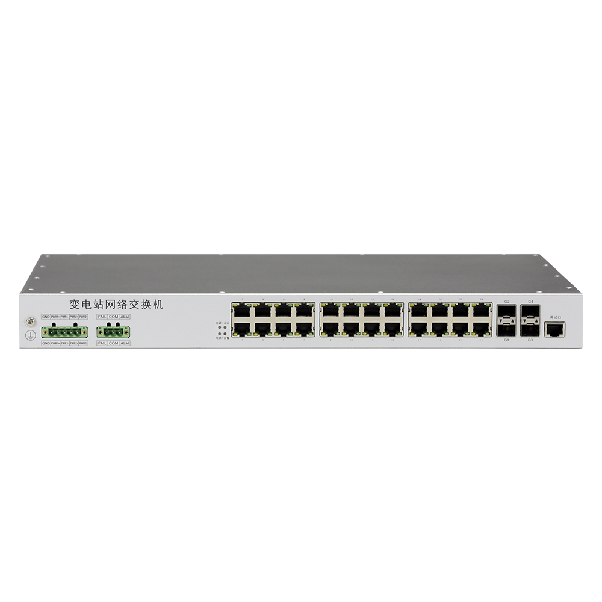
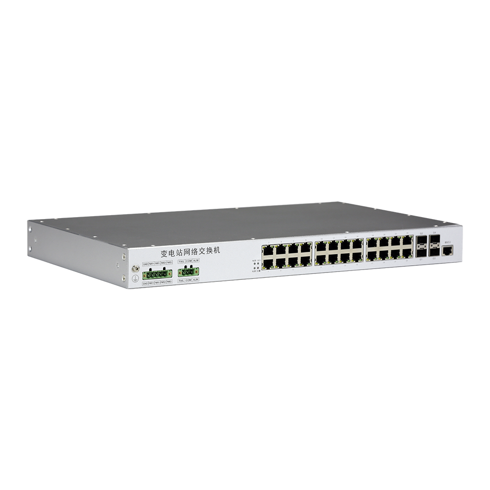
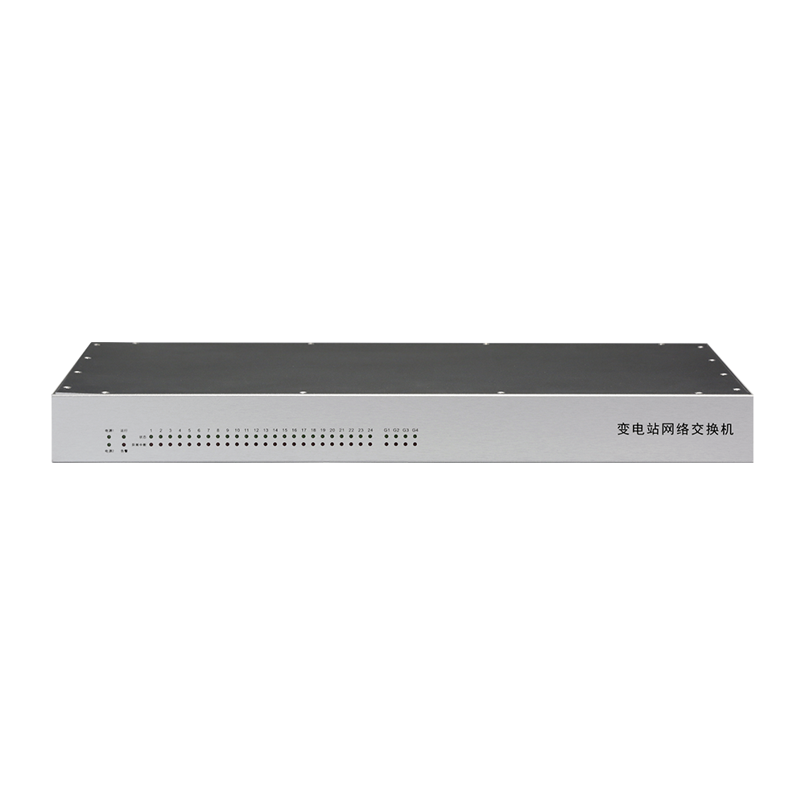

# IS2624

> 来源：<https://hohunet.com/product/is2624-industrial-switch-gigabit/>（抓取 2026-10-21T04:14:22Z；英文原文照录，中文仅为栏目名）  
> 官网标题：IS2624 Gigabit Transformer Substation Ethernet Industrial Switch, with 24*1G Base-T and 4*1G Base-X SFP  
> 类目：Industrial Switch  
> 端口：24×1G；交换容量 —；转发 —；电源 —；芯片平台 —

## 产品图




## Highlights（官网短描述）
- IS2624 Gigabit Transformer Substation Ethernet Switch, with 24*1G Base-T and 4*1G Base-X SFP
- Comply with IEC 61850-3 and IEEE1613
- Supports dual power supply redundancy backup
- Power module alarm and switch alarm function
- Fanless, low-power design
- Ultra-wide operating temperature of -40℃ ~ +85℃
- Highlight Features:
- VLAN
- GMRP
- SNTP
- QoS
- STP、RSTP
- Application Scenarios:
- Power monitoring system
- Telecommunication networks

## HARDWARE SPECIFICATION
| 项 | 值 |
|---|---|
| Product Name | IS2624-4S |
| Standard | IEEE802.3; IEEE802.3u; IEEE802.3z; IEEE802.3ab |
| Ethernet Ports | 24*10/100/1000 Base-T RJ45 4*1000Mbps Base-X SFP |
| Management Ports | 1*Console (RJ45) |
| Power Supply | 2* AC 100～240V 50/60Hz |
| Power Consumption | ≤ 40W |
| Alarm | 50VA, Max volt 300VDC，max current: 8A |
| Switching Capacity | 52Gbps |
| Packet Forwarding Rate | 38.6Mpps |
| MAC | 16K |
| Jumbo Frame | 9K bytes |
| Operating Temperature | -40℃～+85℃ |
| Operating Humidity | 5％～95％ |
| Size | 442mm×44mm×320mm |
| Weight | 2.86kg |

## Software Specification
见 [software/software-spec-eee76923bd.md](../software/software-spec-eee76923bd.md)（35 行，EB / MS / MA 三档）

## Description（原文）
```
Description
24-port Layer 3 management industrial switch, providing 24*10/100/1000Mbps Base-T, 4*1000Mbps SFP, and 1*console port. The switch supports auto DoS attack defense and SNMP, IEEE 802.1, STP/RSTP, and link aggregation. The IS2624-4S can be used as core switch, distributed or access switch.
Overview:
IS2624-4S industrial Ethernet switch is suitable for transformer substation system, power plant monitoring system, industrial control system and other fields.
IS2624-4S industrial Ethernet switch is designed with robust materials to improve the reliability, the working temperature -40℃～+85℃ to ensure great data transmission in harsh environment.
Features:
Complies with IEC 61850-3 and IEEE1613 standards for substation communication equipment；
Fully comply with IEEE802.3, IEEE802.3U, IEEE 802.3z and other standards and support VLAN (802.1Q), GMRP, SNTP and other functional protocols;
It provides rich QoS (802.1p) features and flexible service security features to meet the requirements of industrial Ethernet services with low latency and jitter and high reliability；
Provide a variety of network redundancy solutions: support STP (802.1D), RSTP (802.1w) network protocol, support link aggregation function;
Support redundant operation of dual power modules; Provides multiple groups of alarm contact, providing power module alarm and switch alarm functions.
Adopt fanless, low-power design, the power consumption does not exceed 40W; The whole machine can reach the ultra-wide operating temperature range of -40℃ ~ +85℃.
```
