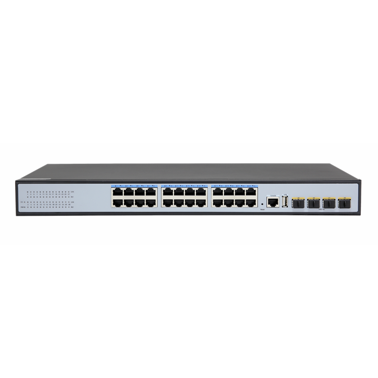
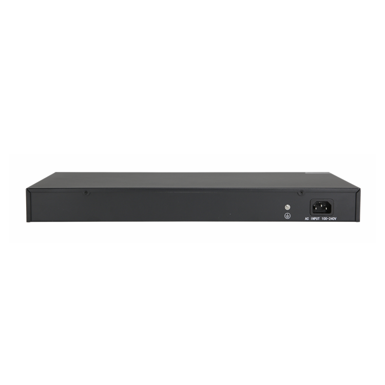
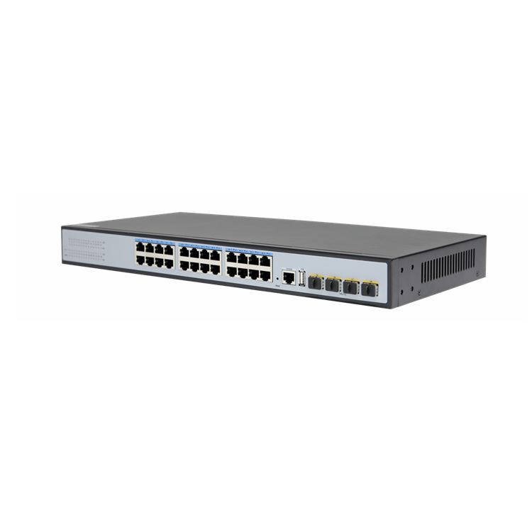
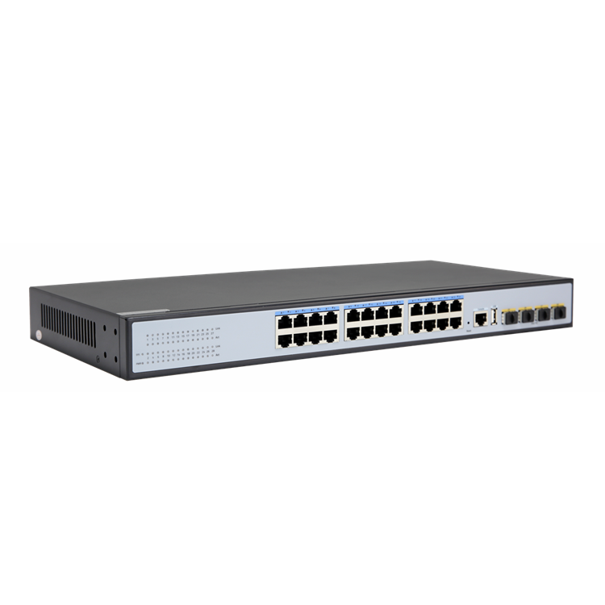

# S2624-4X

> 来源：<https://hohunet.com/product/s2624-4x-10gb-uplink-24-port-gigabit-managed-ethernet-switch/>（抓取 2026-10-21T04:14:17Z；英文原文照录，中文仅为栏目名）  
> 官网标题：S2624-4X 10Gb Uplink 24 Port Gigabit Managed Ethernet Switch(24*Gb Base-T and 4*10Gb SFP+)  
> 类目：SMB Network / S2600 Gigabit Downlink 10G Uplink  
> 端口：24 * 10/100/1000Mbps RJ45 Port 4 * 10G SFP+ Port 1 * RJ45 Console Port 1 * USB Port；交换容量 128Gbps；转发 —；电源 —；芯片平台 —

## 产品图





## Highlights（官网短描述）
- Provide 24 Gb Base-T and 4 10Gb Uplink ports
- Multiple management modes include CLI, web, and SNMP
- Line speed swap capacity, low jitter, low delay
- Rich L3 features
- Highlight Features:
- QinQ
- LAG
- MSTP
- OSPF
- Layer 3 Basic-function
- Application Scenarios:
- Enterprise /Campus Networks
- Telecommunication Operators Networks

## HARDWARE SPECIFICATION
| 项 | 值 |
|---|---|
| **Input/output Port** | |
| AC INPUT | AC100-240V，50/60Hz |
| Ethernet Port | 24 * 10/100/1000Mbps RJ45 Port 4 * 10G SFP+ Port 1 * RJ45 Console Port 1 * USB Port |
| **Performance** | |
| Bandwidth | 128Gbps |
| Packet Buffer Memory | 95.23Mpps |
| DDR SDRAM | 128MB |
| Flash Memory | 16MB |
| Package cache | 12Mbit |
| MAC Address | 16K |
| Jumbo frame | 12Kbytes |
| VLANs | 4096 |
| MTBF | 100000 hour |
| **Standard** | |
| Network Protocols | IEEE 802.3：Ethernet MAC Protocol IEEE 802.3i：10BASE-T Ethernet IEEE 802.3u：100BASE-TX Fast Ethernet IEEE 802.3ab：1000BASE-T Gigabit Ethernet IEEE 802.3z：1000BASE-X Gigabit Ethernet (optical fiber) IEEE 802.3ae：10G Ethernet (optical fiber) IEEE 802.3az：Energy Efficient Ethernet IEEE 802.3ad：Standard method for performing link aggregation IEEE 802.3x：Flow control IEEE 802.1ab： LLDP/LLDP-MED (Link Layer Discovery Protocol) IEEE 802.1p：LAN Layer QoS/CoS Protocol Traffic Prioritization(Multicast filtering function) IEEE 802.1q：VLAN Bridge Operation IEEE 802.1x：Client/Server Access Control and Authentication Protocol IEEE 802.1d：STP IEEE 802.1s：MSTP IEEE 802.1w：RSTP |
| Industry Standard | EMI: FCC Part 15 CISPR (EN55032) class A EMS: EN61000-4-2 (ESD)、EN61000-4-4 (EFT)、EN61000-4-5 (Surge) |
| Network Media | 10BASE-T: Cat3、4、5 or above UTP(≤100 M) 100BASE-TX: Cat5 or above UTP(≤100 M) 1000BASE-TX: Cat5 or above UTP(≤100 M) Multi-mode Fiber: 50/125、62.5/125、100/140um Single-mode Fiber: 8/125、8.7/125、9/125、10/125um |
| **Certification** | |
| Safety Certificate | CE、FCC、RoHS |
| **Environmental standards** | |
| Working Environment | Operating temperature: -10~50°C Storage temperature: -40~70°C Operating Humidity: 10%~90%, No condensation Storage Humidity: 5%~90%, No condensation |
| **Function indication** | |
| PWR(Power indicator) | Lighting：Powered , Un-Light：No Power |
| SYS(System lights) | Lighting： System is normal , Flashing：system startup |
| Link(Link light) | Lighting：Connecting , Un-Light：Disconnect |
| Act(data light) | Flashing：Data Transmit , Un-Light：Disconnect |
| **Physical specifications** | |
| Product Information | Product Dimensions: 440*205*44mm Package Dimensions: 500*290*85mm Product N.W: 2.53KG Product G.W: 3.14KG |
| Packing Information | Carton Dimensions: 520*445*300mm Packing Qantity: 5 PCS Packing weight: 16.7KG |
| Voltage | Input Voltage: AC100-240V/50-60Hz Power supply: 12V3A |
| Packing list | Ethernet switch 1 Set , Instruction manual 1 PCS , Certificate 1 PCS , Power cord 1PCS Serial cable 1PCS , Rack ear: 1 Pairs |

## Software Specification
见 [software/software-spec-4bd4c3f3c6.md](../software/software-spec-4bd4c3f3c6.md)（67 行，EB / MS / MA 三档）

## Download
- [S2624-4X_datasheet_EV1.0](https://hohunet.com/wp-content/uploads/2022/10/S2624-4X_datasheet_EV1.0.pdf) （本地：`data/hohunet_site_raw/datasheets/S2624-4X_datasheet_EV1.0.pdf`）

## Description（原文）
```
Description
Product Description
28-port 10 Gigabit uplink 24-port Gigabit managed Ethernet switch. Support 24 * 10/100/1000 adaptive electrical ports, 4 * 10 Gb uplink SFP+ ports, 1 console port, and 1 USB serial port. Perfect security control strategy and CPU protect policy improve fault tolerance and ensure stable operation of the network and load balancing of the interconnection; The device supports automatic DoS attack defense and SNMP, IEEE 802.1, STP, RSTP, Link aggregation, and other functions. With advanced security functions and quality of service (QoS), it can be used as core layer, distribution layer, and access layer switch with high density port and easy management, is an ideal choice for various business network applications.
Features
Support IEEE 802.1d、IEEE 802.1w、IEEE 802.1s、IEEE 802.1p、IEEE 802.3、IEEE 802.3u、IEEE 802.3x、IEEE 802.3z、IEEE 802.3ab、IEEE 802.3ae standards ;
L3 management, support DHCP Server, QoS, ACL, SNMP V1/V2/V3, IGMP Snooping v1/v2；
Support STP/RSTP/MSTP (ERPS), Support loop detection and self-healing, support remote loopback monitoring and control（802.3ah OAM）; Support IPV4/IPV6,RIP,OSPF
Support multiple VLAN division, MAC VLAN, Protocol VLAN, Private VLAN;
Support IP address + MAC address + VLAN+Port binding, DHCP Snooping, support IP source and DAI protection.
Application Environment
Metropolitan area fiber broadband network: telecommunications, cable TV, network system integration, etc., network operators.
Broadband private network: Suitable for financial, government, oil, railway, electric power, public security, transportation, education and other industries.
Multimedia transmission: image, voice, data integrated transmission, suitable for remote teaching, conference TV, videophone and other applications.
Real-time monitoring: simultaneous transmission of real-time control signals, images, data
```
