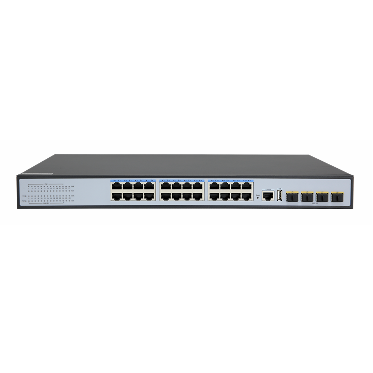
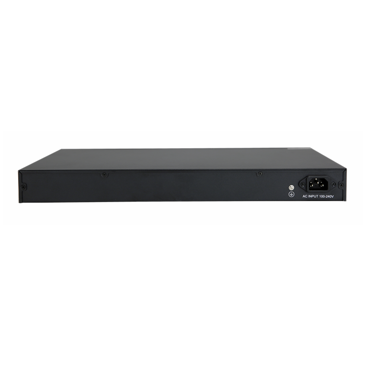
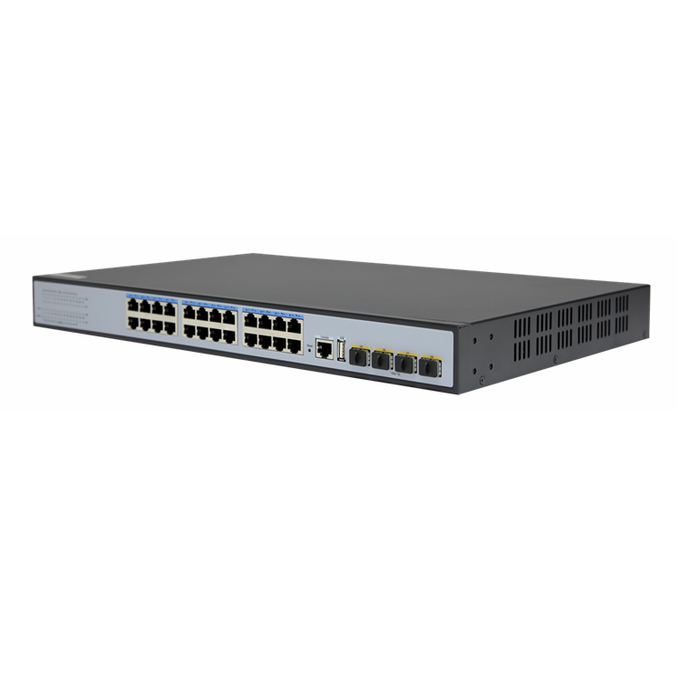
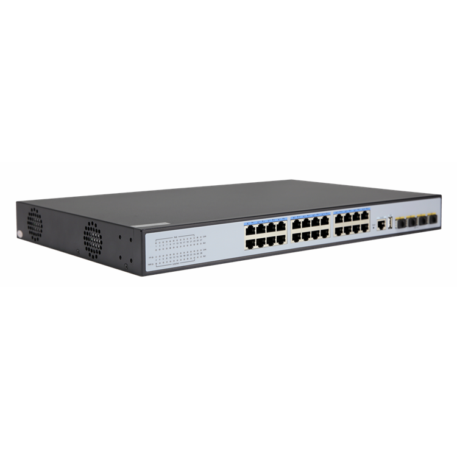

# S2624P-4X

> 来源：<https://hohunet.com/product/s2624p-4x-10g-uplink-24-port-gigabit-l3-managed-ethernet-poe-switch/>（抓取 2026-10-21T04:14:18Z；英文原文照录，中文仅为栏目名）  
> 官网标题：S2624P-4X 10Gb Uplink 24 Port Gigabit L3 Managed Ethernet POE Switch  
> 类目：SMB Network / S2600 Gigabit Downlink 10G Uplink  
> 端口：4×10G；交换容量 —；转发 —；电源 —；芯片平台 —

## 产品图





## Highlights（官网短描述）
- Provides 24 Gb POE Ports and 4 10Gb SPF+
- POE Budget 390W
- Multiple management modes include CLI, web, and SNMP
- Line speed swap capacity, low jitter, low delay
- Rich L3 features
- Highlight Features:
- POE
- QinQ
- LAG
- MSTP
- OSPF
- Layer 3 Basic-function
- Application Scenarios:
- Enterprise /Campus Networks
- Telecommunication Operators Networks

## HARDWARE SPECIFICATION
| 项 | 值 |
|---|---|
| **I/O Interface** | |
| Power | AC100-240V/50-60Hz |
| Ethernet | 24*10/100/1000Mbps POE Port 4*10G SFP+ Port 1*RJ45 Console Port 1*USB Port |
| **Performance** | |
| Capacity | 128Gbps |
| Packet Forwaring Rate | 95.23Mpps |
| DDR SDRAM | 128MB |
| Flash Memory | 16MB |
| Packet Buffer Memory | 12Mbit |
| MAC Address | 16K |
| Jumbo Frame | 12Kbytes |
| VLANs | 4096 |
| MTBF | 100000 hours |
| **Standard** | |
| Network Protocol | IEEE 802.3: Ethernet MAC Protocol IEEE 802.3i: 10BASE-T Ethernet IEEE 802.3u: 100BASE-TX Fast Ethernet IEEE 802.3ab: 1000BASE-T Gigabit Ethernet IEEE 802.3z: 1000BASE-X Gigabit Ethernet (optical fiber) IEEE 802.3ae: 10G Ethernet（optical fiber） IEEE 802.3az: Energy-efficient Ethernet IEEE 802.3ad: Standard method of performing link aggregation IEEE 802.3x: flow control IEEE 802.1ab: LLDP/LLDP-MED（Link Layer Discovery Protocol） IEEE 802.1p: LAN Layer 2 Qos/Cos protocol (multicast filtering function) related to traffic priority IEEE 802.1q: VLAN Bridge Operation IEEE 802. 1x: Client/Server Access Control and Authentication Protocol IEEE 802.1d: STP IEEE 802.1s: MSTP IEEE 802.1w: RSTP |
| PoE Protocol | IEEE802.3af（15.4W） IEEE802.3at （30W） |
| Industry Standard | EMI: FCC Part 15 CISPR (EN55032) class A EMS: EN61000-4-2 (ESD) |
| Network Medium | 10Base-T: Cat3, 4, 5 or above UTP/STP(≤100m) 100Base-TX: Cat5 or above UTP/STP(≤100m) 1000Base-TX: Cat5 or above UTP/STP(≤100m) Multi-mode Fiber: 50/125, 62.5/125, 100/140um Single-mode Fiber: 8/125、8.7/125、9/125、10/125um |
| **Certification** | |
| Safety Certificate | CE、FCC、RoHS |
| **Environment** | |
| Working Environment | Working Temperature: -10~50°C Storage Temperature: -40~70°C Working Humidity ：10%~90%，non-condensing Storage Temperature：5%~90%，non-condensing |
| **Function Indication** | |
| PWR (Power Indicator) | Lighting：Powered Un-Light：No Power |

## Software Specification
见 [software/software-spec-b4e1b9cbcf.md](../software/software-spec-b4e1b9cbcf.md)（10 行，EB / MS / MA 三档）

## Download
- [S2624P-4X_datasheet_EV1.0](https://hohunet.com/wp-content/uploads/2022/10/S2624P-4X_datasheet_EV1.0.pdf) （本地：`data/hohunet_site_raw/datasheets/S2624P-4X_datasheet_EV1.0.pdf`）

## Description（原文）
```
Description
Product Description
28 Port 10G Uplink 24 Port Gigabit L3 Managed Ethernet POE Switch, which provide 24*10/100/1000 adaptive POE electrical port, 4*10G SFP+ Port,1*Console port, 1*USB series port. Used the high quality high speed network IC and the most stable POE chips, POE port satisified IEEE 802.3 af/at standard, this series POE Switch can provide no gap link for 10/100/1000M ethernet, and the PoE power supply port can automatically detect and supply power to the power receiving device that meets the standard, intelligent detection of non-PoE devices does not supply power, only transmits data. Completed security control strategy and CPU protect policy improve fault tolerance, ensure stable network operation and link load balance; equipment supports automatic DoS attack prevention and SNMP, IEEE 802.1, spanning tree and rapid spanning tree protocol, link aggregation and other functions . With advanced security functions and quality of service (QoS), it can be used as core layer, distribution layer, and access layer switch with high density port and easy management, is an ideal choice for various business network applications.
Main Features
Compatible with IEEE 802.1d、IEEE 802.1w、IEEE 802.1s、IEEE 802.1p、IEEE 802.3、IEEE 802.3u、IEEE 802.3x、IEEE 802.3z、IEEE 802.3ab、IEEE 802.3ae standard;
L3 Management,support DHCP Server, QoS, ACL control, support SNMP V1/V2/V3, 支持 IGMP Snooping v1/v2；
Support Spanning Tree Protocol STP/RSTP/MSTP （ERPS), Support loop detection and self-healing, support remote loopback monitoring and control (802.3ah OAM);
Support multiple VLAN divisions, mac VLAN, protocol VLAN, private VLAN;
Support IP address + MAC address + VLAN + port binding, support DHCP Snooping, support IP source and DAI protection;
Support IPV4/IPV6,RIP,OSPF
Compatible with IEEE802.3at (30W) and IEEE802.3af (15.4w) power supply standards
Support PoE management, PoE watchdog
Application Environments
Metropolitan fiber broadband network: telecommunications, cable television, network system integration, etc., data network operators
Broadband private network: applicable to private networks in finance, government, petroleum, electric power, public security, education and other industries
Multimedia transmission: Image, Voice, Data transmission, for distance learning, conference television, video phones and other applications
Real-time monitoring: real-time control signal, image and data transmission at the same time
```
