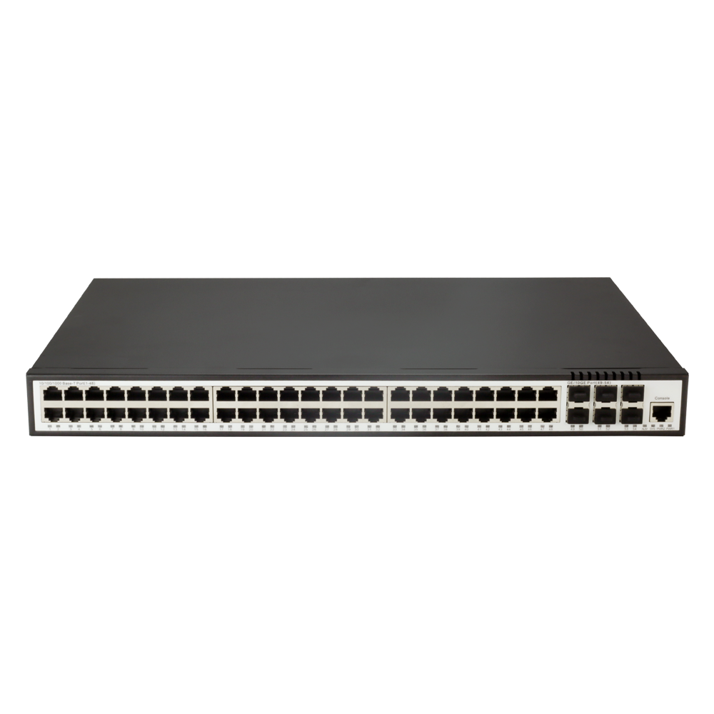
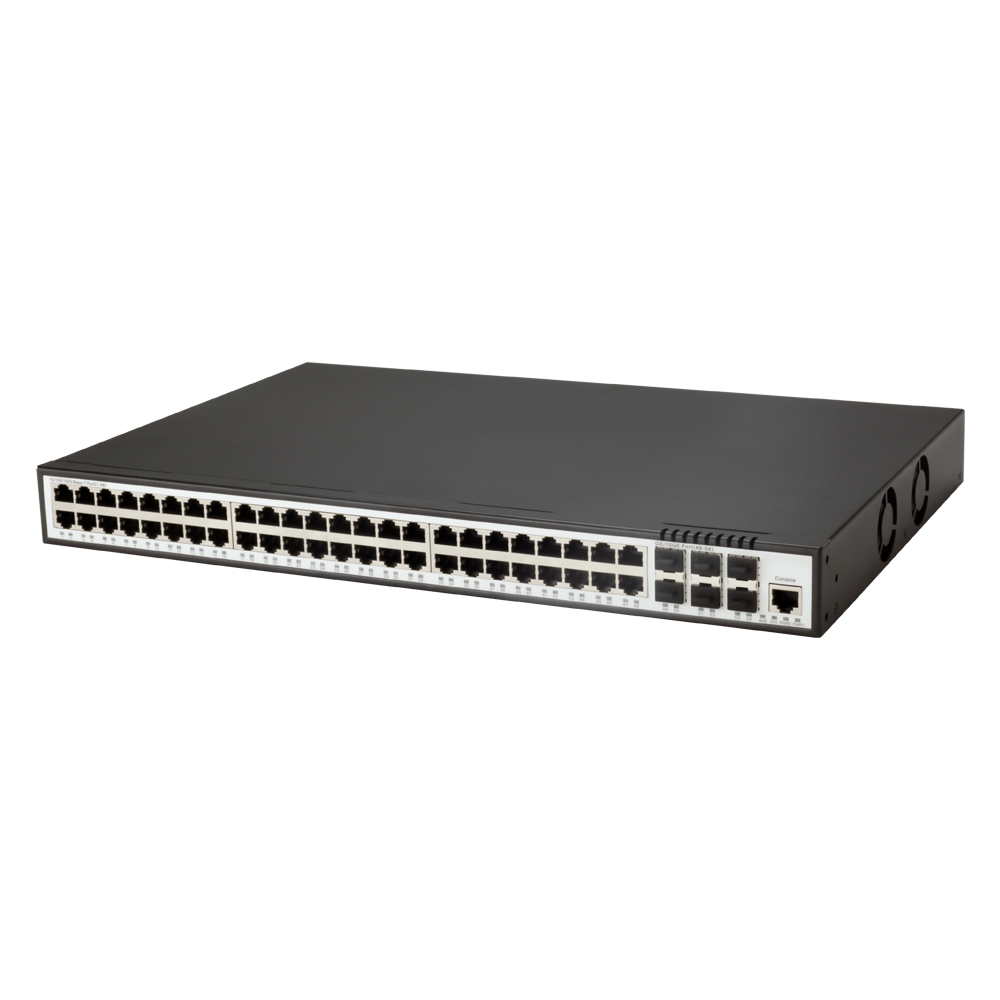
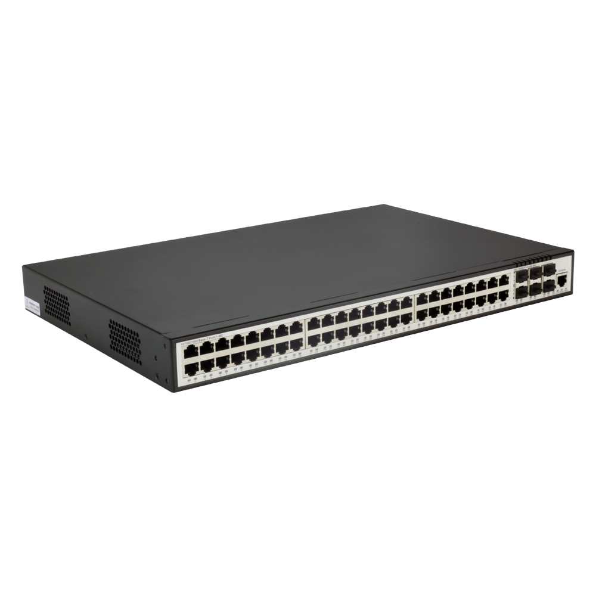
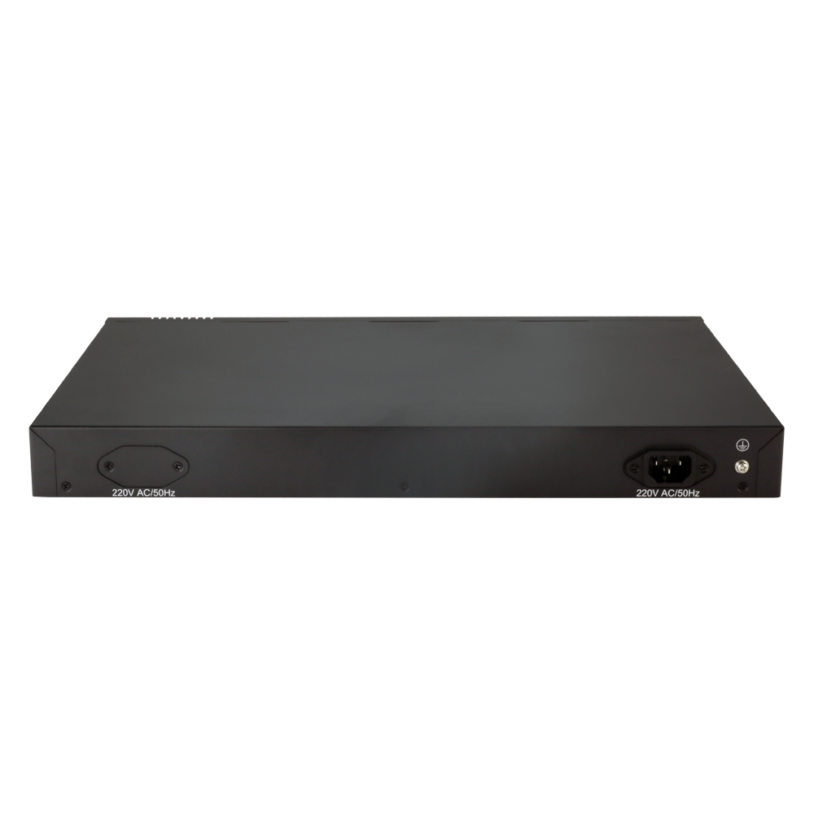

# S2648-6X

> 来源：<https://hohunet.com/product/s2648-6x-1g-10g/>（抓取 2026-10-21T04:14:16Z；英文原文照录，中文仅为栏目名）  
> 官网标题：S2648-6X L3 Managed switch, with 48*1G Base-T，6*10GE uplink, Dual Power(fixed), Smart Fan  
> 类目：SMB Network / S2600 Gigabit Downlink 10G Uplink  
> 端口：48×1G；交换容量 —；转发 —；电源 —；芯片平台 —

## 产品图





## Highlights（官网短描述）
- S2648-6X 48-Port Ethernet L3 Fully Managed Switch, with 48*1Gb Base-T，6*10Gb uplink , Dual Power(fixed)
- 60Gbps Uplink Capacity for Big Bandwidth Application
- 1+1 Dual Power for high reliability(Non-pluged)
- Robust L3 Features
- Enhanced Security and Traffic Control
- Solution for IPv6 Networking
- Highlight Features:
- QinQ
- LAG
- MSTP
- OSPF
- Layer 3 Basic-function
- Application Scenarios:
- Enterprise /Campus Networks
- Telecommunication Operators Networks

## HARDWARE SPECIFICATION
| 项 | 值 |
|---|---|
| **1. Basic** | |
| Product Name | S2648-6X / S2624-4X |
| Product Positioning | Enterprise / Metro / HCI (Hyper-Converged Infrastructure) network access or aggregation |
| Switching Method | Store and Forwarding / Cut Through |
| Packet Buffer | 16Mbit / 12Mbit |
| CPU Model/ Frequency | SOC(MIPS-Dual Core Up to 1GHz) / SOC(MIPS-34Kc Up to 800MHz) |
| Flash | 32MB(FLASH) |
| Memory | 512MB(DDR3) |
| Hardware Configuration | Main Board Spec / 48*10/100/1000M Base-T 6*1000M Base-X SFP/10GE SFP+ / 24*10/100/1000M Base-T 4*1000M Base-X SFP/10GE SFP+ |
| Hardware Configuration | Console Type / RJ45 |
| Hardware Configuration | Outband Eth Management Port / Support |
| Hardware Configuration | Inband Eth Management Port / Support |
| **2. Performance Spec** | |
| Switching Capacity | Switching Capability / 216 Gbps / 128 Gbps |
| Switching Capacity | Throughput / 160.704 Mpps / 95.232 Mpps |
| Switching Capacity | Latency / Min: 660ns |
| **3. Hardware and Software Description** | |
| Hardware Summary | Standard 1U 19” Rack Mountable 48*10/100/1000M Base-T 6*1000M Base-X SFP/10GE SFP+ / Standard 1U 19” Rack Mountable 24*10/100/1000M Base-T 4*1000M Base-X SFP/10GE SFP+ |
| Software Upgrade Method | TFTP/FTP |
| Service interruption time when reboot system for software update | Less Than 120s |
| **4. The Power Supply and Power Requirements** | |
| Type of Power Supply | AC / Support |
| Type of Power Supply | DC / Support |
| Power Supply Range | AC / Operating Voltage: 100 ~ 240V; 50/60Hz Maximum Voltage: 90 ~ 264V; 47~63Hz |
| Power Supply Range | DC / Operating Voltage: -48V ~ -75V |
| Double Power Input | Support(Fixed) / NO Support |
| Max Power Draw | 53W / 22W |
| **5. Overcurrent and overvoltage protection** | |
| Overcurrent/Overvoltage Protection | Yes |
| Surge Protection Level | 2 KV |
| **6. Others** | |
| Hardware Size (H×W×D) in. | 440 x 290 x 44mm / 440 x 210 x 44mm |
| Weight (kg) | 5kg / 3kg |
| Cooling Mode | Fan Cooling (Front-to-Rear Airflow) |
| Quantity of Fans | 2 / 1 |
| Fan Module Pluggable | Not support (Fixed fan) Not Support (Fixed Fan) |
| Fan Module Intelligent Speed Control | NO Support Support |
| Operating Temperature Range | -10℃～55℃ |

## Software Specification
见 [software/software-spec-fcf378f437.md](../software/software-spec-fcf378f437.md)（170 行，EB / MS / MA 三档）

## Download
- [S2600 SERIES Datasheet_EN](https://hohunet.com/wp-content/uploads/2021/12/S2600-SERIES-Datasheet_EN.pdf) （本地：`data/hohunet_site_raw/downloads/S2600-SERIES-Datasheet_EN.pdf`）

## Description（原文）
```
Description
VERVIEW
The S2600 series switch is a layer 3 Ethernet switch, which can meet the needs of cost-effective Gigabit access and 10 Gigabit uplink for enterprise networks and operator customers.S2600 uses a high-performance low-power network processor, provides Gigabit line-speed forwarding performance, supports green Ethernet line sleep capability, has the lowest power consumption of the same-level equipment in the industry, supports powerful QoS and ACL functions, and supports IP+MAC+ Security features such as port binding support service flow classification and packet priority marking. Support static data packet sampling, SFLOW function, support multi-port mirroring analysis function, support static and flexible QinQ function, support Ethernet OAM 802.3ag (CFM), 802.3ah (EFM), support strategy-based IPV4/6 unicast routing, support Flexible forwarding strategy.
Product Feature:
Carrier-level equipment stability
Based on Linux operating system, support IPv4/IPv6 dual protocol stack platform
Support multiple link redundancy and network redundancy protocols such as STP/RSTP/MSTP/ERPS/LACP
Perfect safety mechanism
Support ACL security filtering mechanism, which can provide security control functions based on MAC, IP, L4 port
Support ARP attack automatic protection and user blocking functions
Support DHCP attack automatic protection based on Mac Address and user blocking functions
Support DDOS and virus attack protection
Support DHCP-snooping/IP-source-Guard/802.1X and other security features
Support link protection functions such as BFD, FlexLink, LACP and ERRP
Support remote loop detection function
Support CFM、EFM
Support remote user authentication based on Tacacs+, Radius, and Local user authentication
Powerful QoS capabilities
Support port speed and flow speed limit function
Support classification based on service flow and Qos flow control function
Support queue scheduling algorithms such as SP/WRR/SP+WRR
Support port-based and service flow-based mirroring functions
Enhanced multi-service capabilities
Support DHCP Server and DHCP Relay
Support L2-Tunnel
Support Ethernet OAM protocol such as CFM、EFM
Rich routing protocol
Support static route
Support dynamic route such as RIP, OSPF,BGP, ISIS
Support IPV4/IPV6 dual protocol stack，Support RIPng、OSPFv3
Simple and easy-to-use network management function
Support CLI based on RS232 serial port, Telnet and SSHv2
Support WEB-based configure operation management, support SNMP V1/V2/V3
Support remote upgrade or equipment through FTP and TFTP
```
