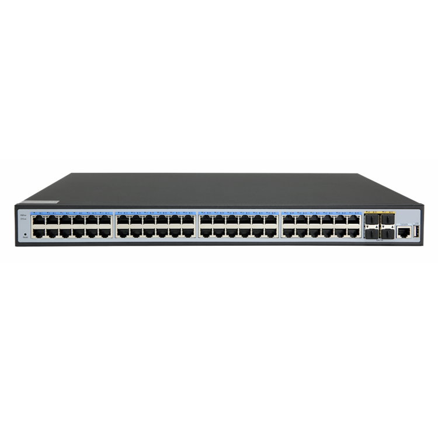
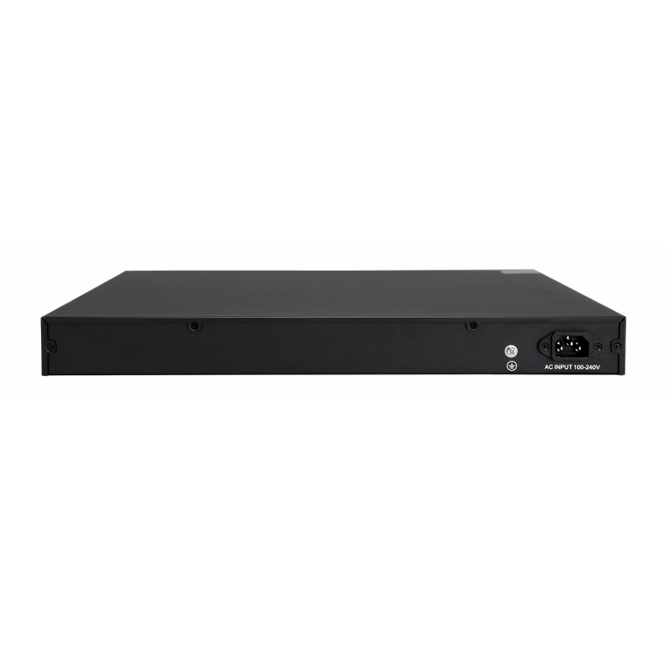
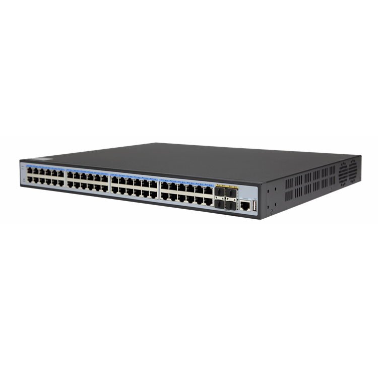
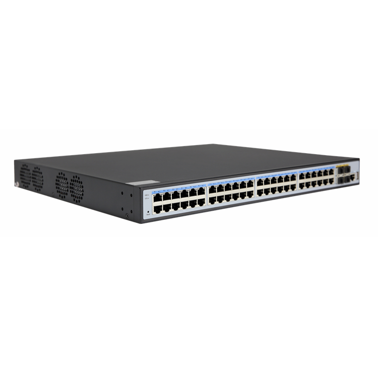

# S2648P-4X

> 来源：<https://hohunet.com/product/s2648p-4x-10g-uplink-48-ports-gigabit-l3-management-ethernet-poe-switch/>（抓取 2026-10-21T04:14:21Z；英文原文照录，中文仅为栏目名）  
> 官网标题：S2648P-4X 10G Uplink 48 Ports Gigabit L3 Management Ethernet POE switch  
> 类目：SMB Network / S2600 Gigabit Downlink 10G Uplink  
> 端口：4×10G；交换容量 176Gbps；转发 —；电源 —；芯片平台 —

## 产品图





## Highlights（官网短描述）
- Provides 48 Gb POE Base-T Ports
- Provides 4 10Gb SPF+ uplinks
- Multiple management modes include CLI, web, and SNMP
- Line speed swap capacity, low jitter, low delay
- Rich L3 features
- Highlight Features:
- POE
- QinQ
- LAG
- MSTP
- OSPF
- Layer 3 Basic-function
- Application Scenarios:
- Enterprise /Campus Networks
- Telecommunication Operators Networks

## HARDWARE SPECIFICATION
| 项 | 值 |
|---|---|
| **I/O Interface** | |
| Power Input | AC100-240V/50-60Hz |
| Ethernet | 48* 10/100/1000Mbps POE Ports (Ports 1-4 support BT Power Supply) 4* 10G SFP+ Port 1* RJ45 Console Port 1* USB serial Port |
| **Performance** | |
| Bandwidth | 176Gbps |
| Packet Forwarding Rate | 131Mpps |
| Buffer Memory | 512MByte |
| Flash Memory | 32MByte |
| DDR SDRAM | 16Mbit |
| MAC Address | 32K |
| Jumbo Frame | 12Kbytes |
| VLANs | 4096 |
| MTBF | 100000 Hours |
| **Standard** | |
| Network Protocol | IEEE802.3 Ethernet MAC Protocol IEEE802.3u 100BASE-TX Fast Ethernet IEEE 802.3ab 1000BASE-T Gigabit Ethernet IEEE 802.3z 1000BASE-X Gigabit Ethernet (optical fiber) IEEE 802.3ae 10G Ethernet IEEE802.3x Flow Control IEEE 802.3az Energy-efficient Ethernet IEEE 802.3ad Standard method for performing link aggregation IEEE 802.1AB LLDP/LLDP-MED (Link Layer Discovery Protocol) IEEE 802.1D Spanning Tree Protocol(STP) IEEE 802.1w Rapid Spanning Tree Protocol (RSTP) IEEE 802.1s Multiple Spanning Tree Protocol (MSTP) IEEE 802.1Q （VLAN Bridge Operation） IEEE 802.1p （VLAN Label） IEEE 802.1X Client/Server Access Control and Authentication Protocol |
| POE Standard | IEEE802.3af (15.4W). IEEE802.3at (30W), IEEE802.3bt (90W) |
| Industry Standard | EMI: FCC Part 15 CISPR (EN55032) class A EMS: EN61000-4-2 (ESD), EN61000-4-4 (EFT), EN61000-4-5 (Surge) |
| Network Medium | 10Base-T : Cat3, 4, 5 or above UTP(≤100m) 100Base-TX : Cat5 or above UTP(≤100m) 1000Base-TX : Cat5 or above UTP(≤100m) |
| **Certification** | |
| Safety Certificate | CE, FCC, RoHS |
| **Environment Standard** | |
| Working Environment | Working Temperature：-10~50°C Storage Temperature：-40~70°C Working Humidity ：10%~90%，non-condensing Storage Temperature：5%~90%，non-condensing |
| **Function Indicator** | |
| Indicator | PWR (Power Indicator), SYS (system Indicator), Link (Link Indicator), ACT (ACT Indicator) |
| PWR | On: Powered On Off: Powered Off |
| SYS | On: System On Flashing: System Off or Failed |
| Link/ACT | On: Link Connecting Flashing: Data Transmitting Off: Link Off |
| **Physical Specification** | |
| Structure Size | Product Dimensions: 440*360*44.5mm Package Dimensions: 580*440*120mm Product N.W: 5.30KG Product G.W: 6.58KG |
| Packing Info | Carton Dimensions: 600*460*260mm Packing Quantity: 2Pieces Packing weight:14.2 KG |
| Power Voltage | Working Voltage: AC100-240V 50/60Hz Power Supply: 52V 11.5A/ 12V 6A |
| Power Consumption | POE: POE Total Power<600W Power Consumption: Machine<67.5W |
| Package List | Switch: 1 set; instruction manual: 1 set; certificate of quality: 1 set; power cord: 1 set; serial cable: 1 set; mounting ear: 1 pair |

## Software Specification
见 [software/software-spec-8eabe8740a.md](../software/software-spec-8eabe8740a.md)（70 行，EB / MS / MA 三档）

## Download
- [S2648P-4X_datasheet_EV1.0](https://hohunet.com/wp-content/uploads/2022/10/S2648P-4X_datasheet_EV1.0.pdf) （本地：`data/hohunet_site_raw/downloads/S2648P-4X_datasheet_EV1.0.pdf`）

## Description（原文）
```
Description
Product Description
52 Port 10G Uplink 48 Ports Gigabit L3 Management Ethernet POE switch, provides 48* 10/100/1000M POE Ethernet Ports, 4* 10G SFP+ Ports, 1* console Port, 1* USB Serial Port. With perfect security control policy and CPU Protect Policy, it can improve fault tolerance and ensure the stable operation of the network and load balance of links. The switch supports automatic DoS attack defense, SNMP, IEEE 802.1, STP, RSTP, and link aggregation. With advanced security features and advanced quality of Service (QoS), it can be used as a core, distribution or access layer switch with high-end port density, ease of management, it is an ideal choice for a variety of business networking applications.
Main Feature
Support IEEE 802.1d, IEEE 802.1w, IEEE 802.1s, IEEE 802.1p, IEEE 802.3. IEEE 802.3u, IEEE 802.3x, IEEE 802.3z, IEEE 802.3ab, IEEE 802.3ae standard;
L3 management，support DHCP Server, QoS, ACL Control, SNMP V1/V2/V3, IGMP Snooping v1/v2；
Support STP/RSTP/MSTP (ERPS), Support loop detection and self-healing, remote loop back monitoring and control (802.3ah OAM);
Support multiple VLAN divisions, MAC VLAN, protocol VLAN, and Private VLAN;
Support IP address +MAC address +VLAN+ port binding, DHCP Snooping, IP source and DAI protection;
Support IPV4/ IPV6, RIP, OSPF
Surge Protection: Common mode≥6KV, ESD：Contact≥6KV. air≥8KV;
Support WEB, TELNET, CLI, SSH, SNMP, RMON management;
Support IEEE802.3at (30W) and IEEE802.3bt (90W);
Support PoE watchdog, PoE Port power supply, Power configuration and PoE time management.
Application Environment
Metro Optical Broadband Network: Data network operators such as telecommunications, cable TV, and network system integration,etc.
Broadband private network: Suitable for financial, government, oil, railway, electric power, public security, transportation, education and other industries.
Multimedia transmission: Integrated transmission of images, voice and data, suitable for remote teaching, conference TV, videophone and other applications
Real-time monitoring: Simultaneous transmission of real-time control signals, images and data
```
