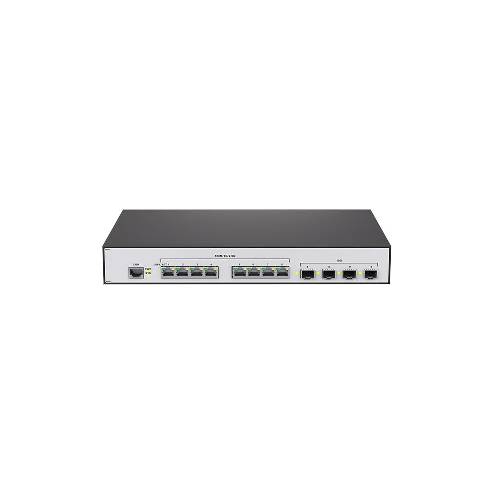
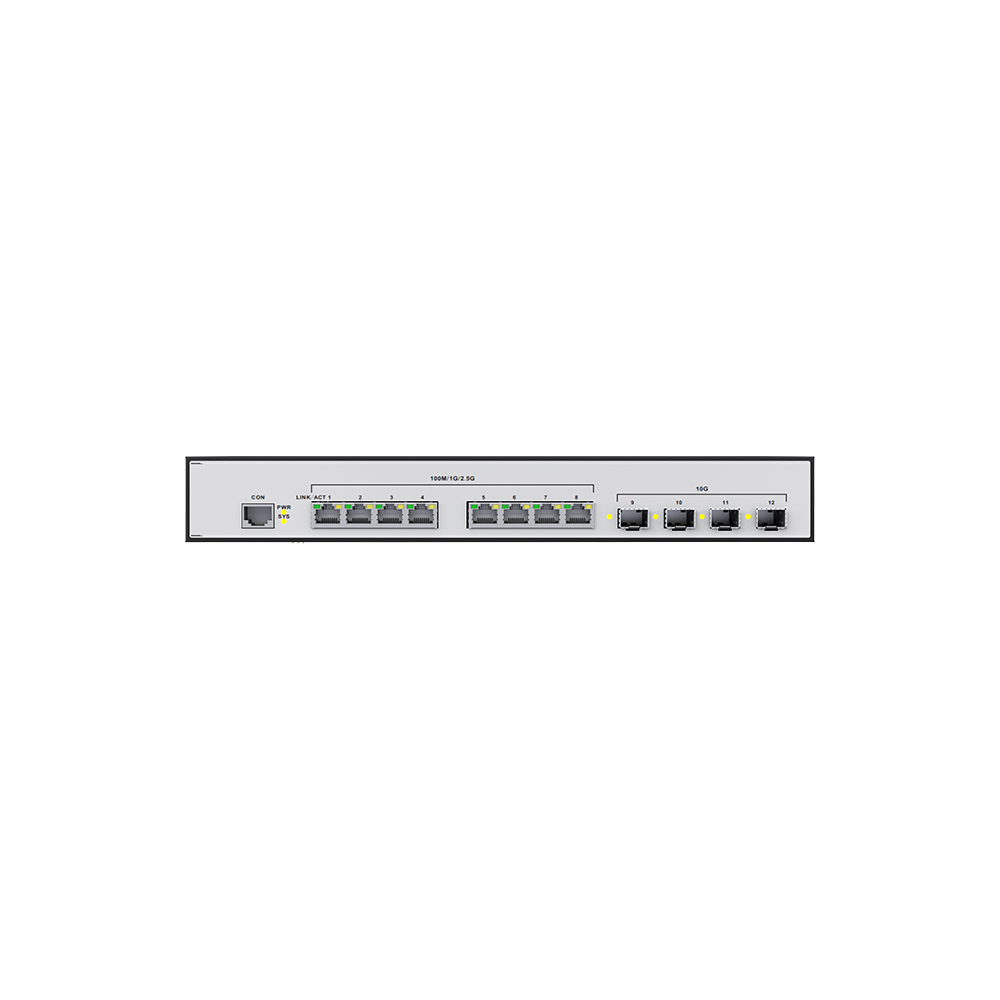
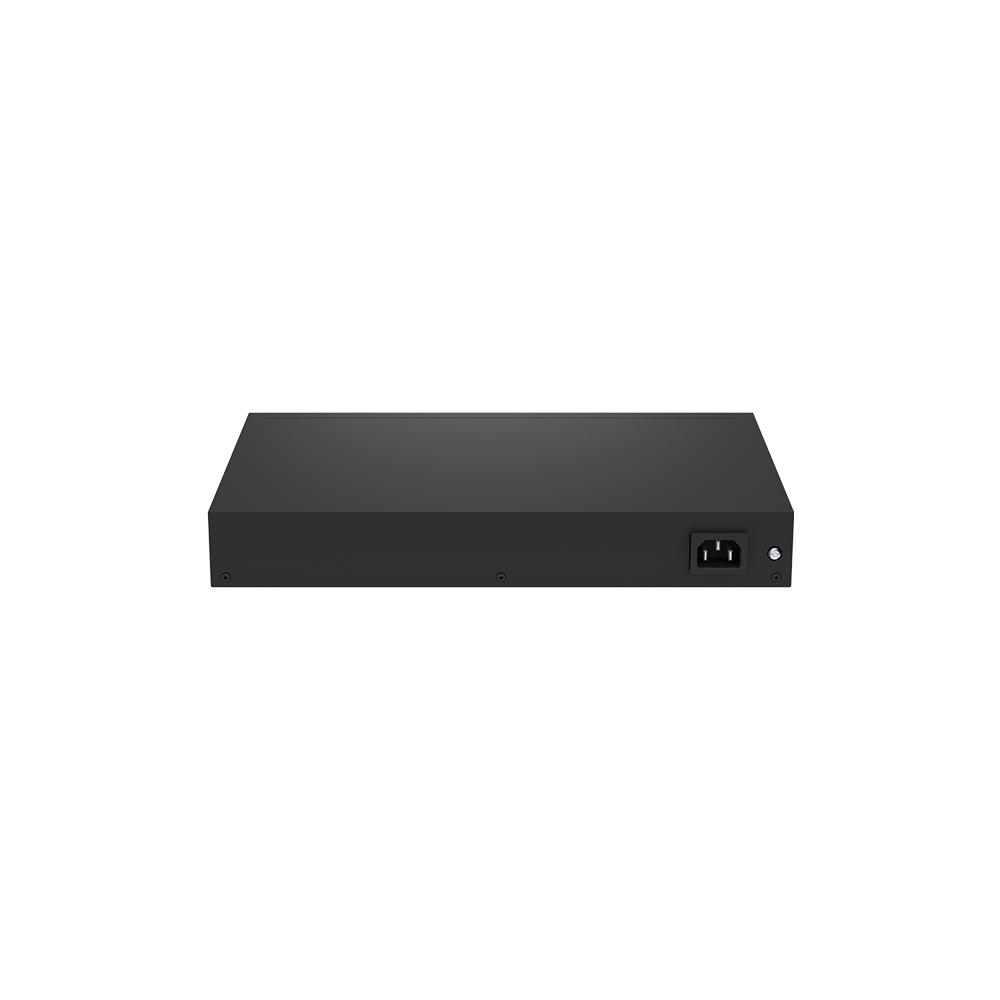
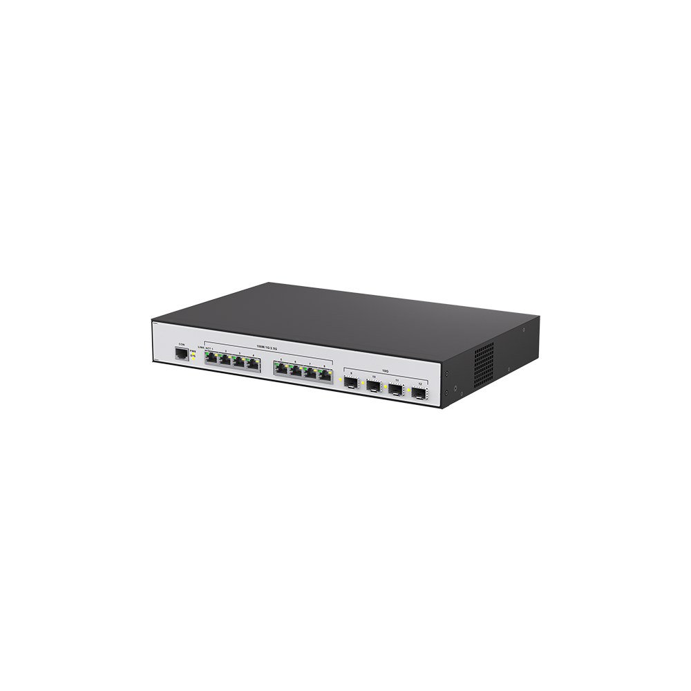

# S3508-4X

> 来源：<https://hohunet.com/product/s3508-4x-10g/>（抓取 2026-10-21T04:14:06Z；英文原文照录，中文仅为栏目名）  
> 官网标题：S3508-4X L3 Managed Switch, with 8*2.5G BASE-T and 4*10G SFP+ Uplinks  
> 类目：S3500 2.5G Downlink 10G Uplink / SMB Network  
> 端口：8×2.5G；交换容量 —；转发 —；电源 —；芯片平台 —

## 产品图






## Highlights（官网短描述）
- Support 8*100M/1000M/2.5G BASE-T with 4*10G SFP+ Uplinks
- Support LAG, MSTP
- Support QinQ, OSPF
- Highlight Features:
- QinQ
- LAG
- MSTP
- OSPF
- Layer 3 Basic-function
- Application Scenarios:
- Enterprise /Campus Networks
- SMB / Home Networks

## HARDWARE SPECIFICATION
| 项 | 值 |
|---|---|
| Product Name | S3508 / S3508PB-4X / S3524-6X / S3524-6X-D / S3524P-6X / S3524P B -6X |
| Ethernet Ports | 8 *100M/1000M/2.5G BASE-T 4*10G SFP+ / 24 *100M/1000M/2.5G BASE-T 6*10G SFP+ |
| PoE Ports | N/A / 8*AF/AT/BT(45W Max) / N/A / N/A / 24*AF/AT/BT(90W Max) |
| Power Supply | 1*AC 100-240V / 1*96W AC / 2*150W AC / 1*450W AC / 1*880W AC |
| Management Ports | 1*Console Port (RJ45) |
| Fans | N/A / N/A / 3*Fixed fan / 4*Fixed fan / 5*Fixed fan / 5*Fixed fan |
| Airflow | Front to Rear |
| Flash Memory | 128Mb |
| DRAM | 4Gb |
| Switching Capacity | 120Gbps / 240Gbps |
| MAC address | 32K |
| Size (W*D*H) | 320mmx207mmx43.6mm / 440mmx290mmx43.6mm |
| Weight(kg) | 3 / 3 / 4.06 / 4.41 / 4.55 / 4.46 |
| Operating Temperature | -10℃ to 50℃ |
| Storage Temperature | -40℃ to 70℃ |
| Operating Humidity | 10% to 90% (Non-condensing) |
| Storage Humidity | 0 to 95% (Non-condensing) |
| Temperature Alarm | 55℃ |

## Download
- [S3508-4X L3 Managed Switches Datasheet_EN](https://hohunet.com/wp-content/uploads/2021/12/S3508-4X-L3-Managed-Switches-Datasheet_EN.pdf) （本地：`data/hohunet_site_raw/downloads/S3508-4X-L3-Managed-Switches-Datasheet_EN.pdf`）

## Description（原文）
```
Description
OVERVIEW
S3500 Series routing switches, high-performance Layer 3 Ethernet switch with 2.5G Multi-Gigabit and 10G SFP+ Ports compact 1U form factor. The FOS delivers robust feature support，Provide Layer 3 network features.
Built from the ground up with the combination of advanced hardware and software, the switch provides a Layer 3 routing solution for next generation HOME / SMB / Enterprise / Wi-Fi 6 AX Access/ high speed NAS networks.
Varied Port Types
Support 10M/100M/1G /2.5G /10G ports to meet different network requirements.
```
