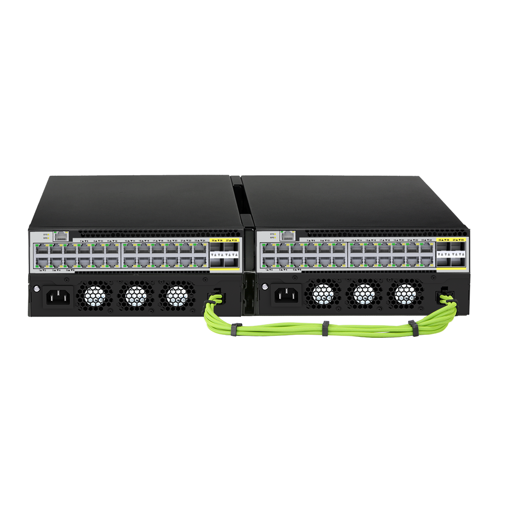
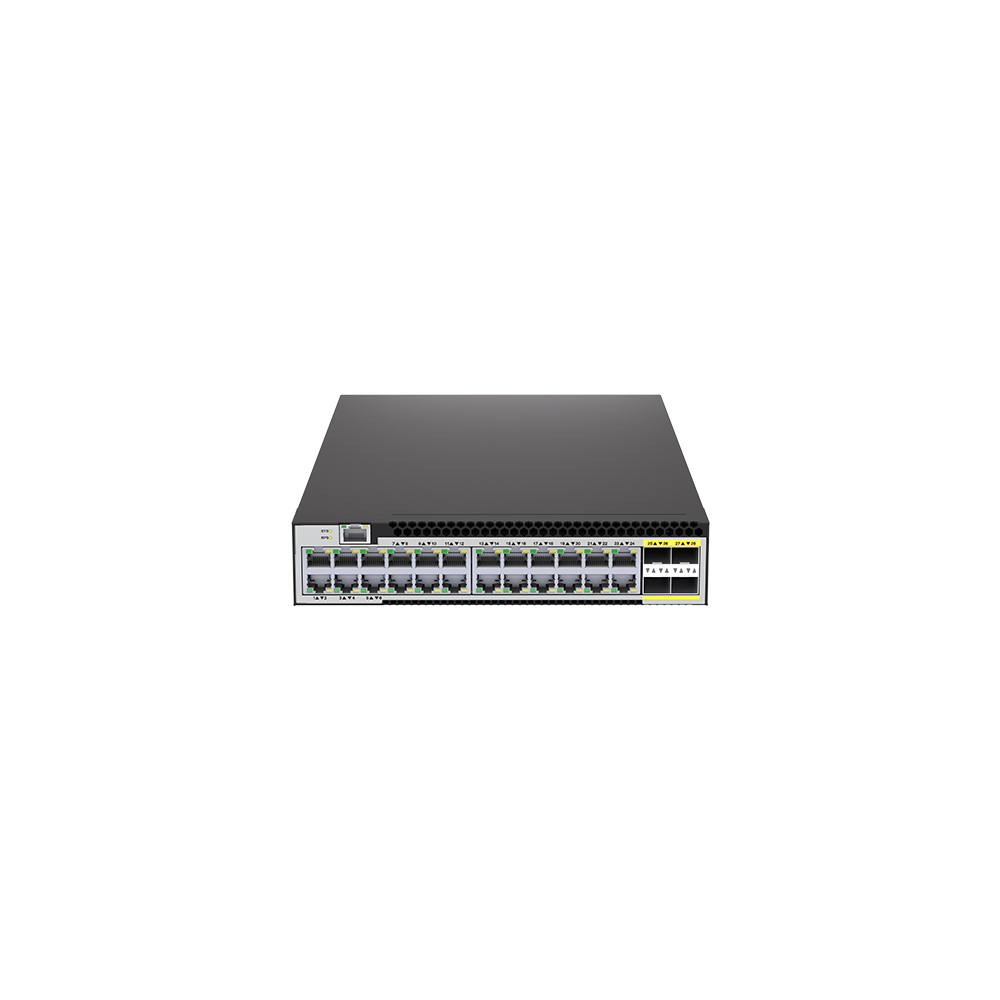
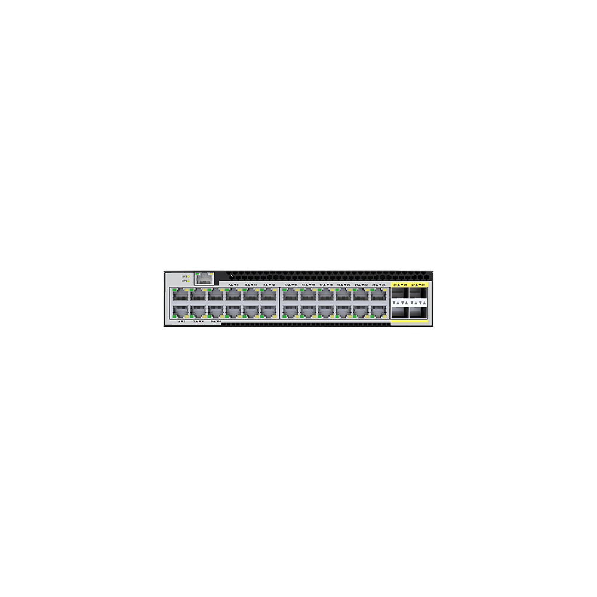
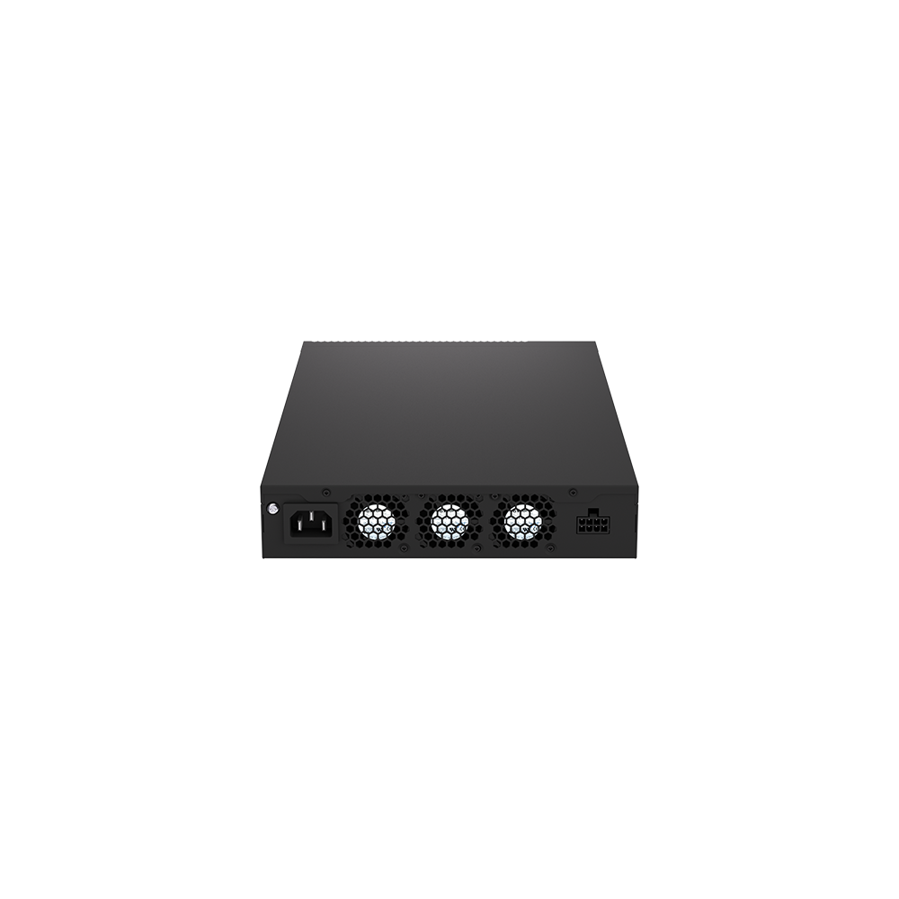
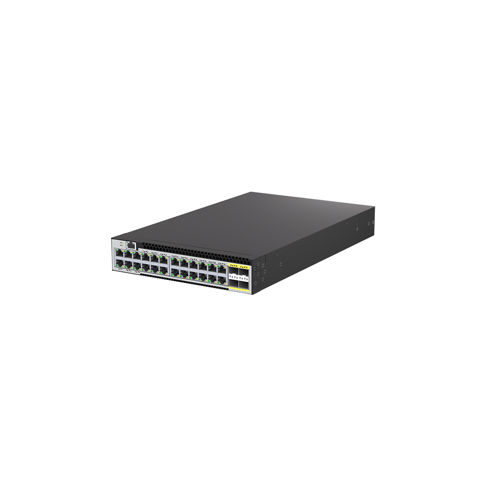
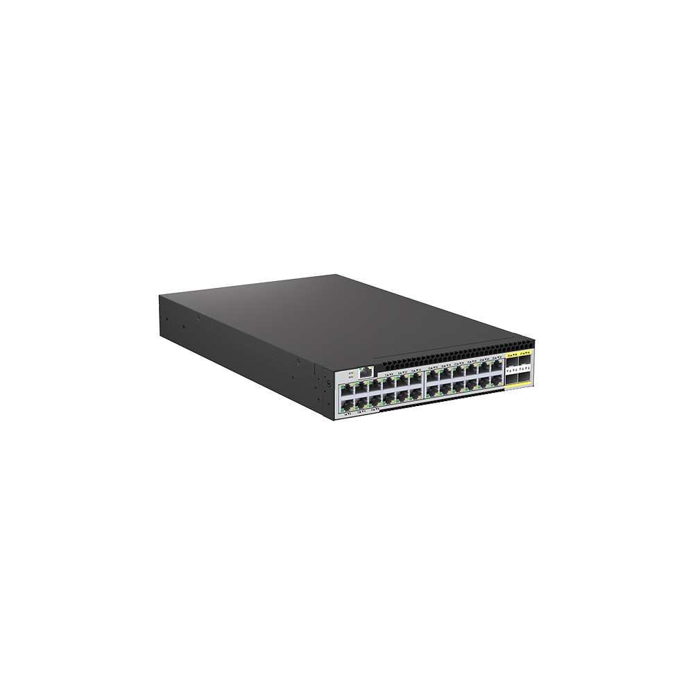

# S3524H-4X

> 来源：<https://hohunet.com/product/s3524h-4x-2-5g-24-port-l3-switch/>（抓取 2026-10-21T04:14:04Z；英文原文照录，中文仅为栏目名）  
> 官网标题：S3524H-4X 2.5G L3 managed switch 24*10/100/1000M/2.5G, 4*10GE SFP+Half-width, two-node deployment  
> 类目：SMB Network / S3500 2.5G Downlink 10G Uplink  
> 端口：4×2.5G + 4×10G；交换容量 —；转发 —；电源 —；芯片平台 —

## 产品图







## Highlights（官网短描述）
- Support 24*100M/1000M/2.5G BASE-T with 4*10G SFP+ Uplinks
- Support STP, MSTP
- Support IPv6, OSPF
- Highlight Features:
- IPv6
- STP
- MSTP
- OSPF
- Layer 3 Basic-function
- Application Scenarios:
- Enterprise /Campus Networks
- SMB / Home Networks

## HARDWARE SPECIFICATION
| 项 | 值 |
|---|---|
| Product Name | S3524H-4X / S3524PH-4X |
| Ethernet Ports | -24 *10/100/1000/2.5G RJ45 -4*10G SFP + / -24 *10/100/1000/2.5G RJ45 -4*10G SFP + |
| PoE+ (IEEE802.3af/at30W) | Yes / Yes |
| AC Power Supply | 150W / 460W |
| Manage Port | 1* Console Port (RJ45) / 1* Console Port (RJ45) |
| Fans | 3*Fixed Fan / 3*Fixed Fan |
| Airflow | Front-to-Rear / Front-to-Rear |
| Switching Capacity | 128Gbps / 128Gbps |
| MAC address | 16K / 16K |
| Size(W*D*H) | 215*356*44mm / 215*356*44mm |
| Weight | 2.9KG / 2.9KG |
| Operating Temperature | -10~45°C / -10~45°C |
| Storage Temperature | -40~70°C / -40~70°C |
| Operating Humidity | 10% to 90% (Non-condensing) / 10% to 90% (Non-condensing) |
| Storage Humidity | 0 to 95% (Non-condensing) / 0 to 95% (Non-condensing) |
| Temperature Alarm | 50ºC / 50ºC |

## Software Specification
见 [software/software-spec-7d01b65d60.md](../software/software-spec-7d01b65d60.md)（167 行，EB / MS / MA 三档）

## Description（原文）
```
Description
OVERVIEW
Half-width L3 manage series switches routing switch, support Gigabit and 2.5GE, uplink 10G SFP+ port, compact 1U shape. With perfect security control policy and CPU Protect Policy, it can improve fault tolerance and ensure the stable operation of the network and load balance of links. The switch supports automatic DoS attack defense, SNMP, IEEE 802.1, STP, RSTP, and link aggregation. With advanced security features and advanced quality of Service (QoS), it can be used as a core, distribution or access layer switch with high-end port density, ease of management, it is an ideal choice for a variety of business networking applications.
The switch combines advanced hardware and software to provide a Layer 3 routing solution for the next generation of home /SMB/ enterprise /Wi-Fi6AX access/high-speed NAS networks.
Flexible and
iverse
eployment modes, with 1U for
ual
hysical
edundancy
Flexibility
Traditional network switches, the product form is almost based on the standard 1U(19 inches width) physical space as a unit, once the device shape is determined, there can be no change, and we plan the smart series of products, it is Half size(half width size) as a unit, each device occupies half the width of the standard 1U space. At the same time, we provide a wide range of products to provide customers with very flexible choices when planning the network, so as to effectively meet the different demands of users on the network port form/scale.
System Design for Green and Energy Saving
Intelligent FAN adjustment and real-time power consumption monitoring technology are provided for the cost of maintenance redundancy and help to build a green and energy saving networks.
Save space
Traditional network equipment, the standard size of 1U as the space unit deployment network, many times the density of network equipment is not high, such as 8/16/24 port form, but they still occupy 1U space, which will lead to limited cabinet space is not effectively used, smart product line can effectively avoid this problem.
Lower the cost, great value
Reduce costs Many times, due to the small size of the network, the user site needs high-speed ports (such as 100G) while not requiring too many ports. The smart product line provides users with this option, which can be flexibly deployed according to the actual network demand, like building blocks, without paying extra fees for unnecessary ports.
```
