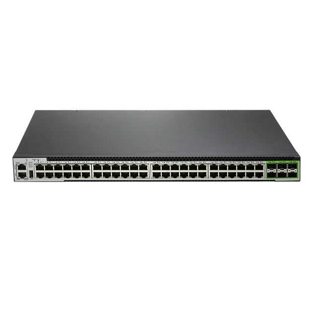
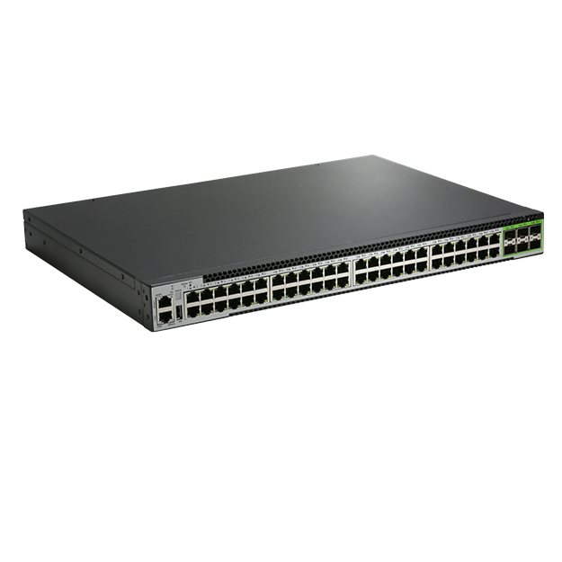
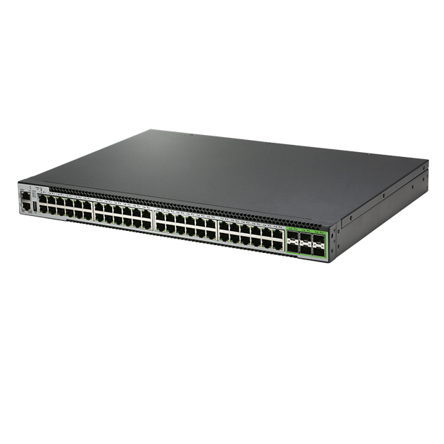
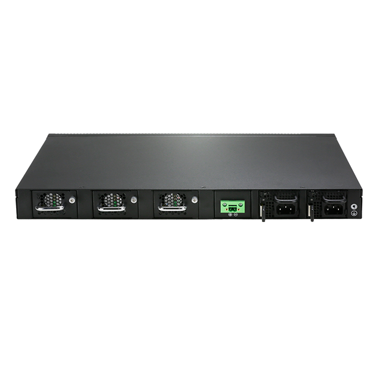

# S3748-6X-EI

> 来源：<https://hohunet.com/product/s3748-6x-ei-24port-gigabit-ethernet-l3-switchwith-481g-baset610g-sfpdual-power-supply-modules3hot-swappable-smart-fan-modules/>（抓取 2026-10-21T04:12:32Z；英文原文照录，中文仅为栏目名）  
> 官网标题：S3748-6X-EI 48Port Gigabit Ethernet L3 Switch,With 48*1G BaseT,6*10G SFP+,Dual Power Supply Modules,3*Hot-Swappable Smart Fan Modules  
> 类目：S3700 1G DOWNLINK 10G UPLINK  
> 端口：48 x 1G BaseT,6 x 10G SFP+；交换容量 216 Gbps (bidirectional)；转发 178 Mpps；电源 2 x 75W CRPS；芯片平台 LightLink

## 产品图





## Highlights（官网短描述）
- User-friendly GUI
- Multiple management modes include CLI, web, and SNMP
- Hot-swappable power module and fan module
- Full L3 features(MPLS, VxLAN, IPran, BGP)
- Highlight Features:
- QinQ
- BGP
- OSPF
- MLAG
- IPv6
- VxLAN
- MPLS
- Layer 3 high-function
- Application Scenarios:
- Enterprise Networks
- Telecommunication Operators Networks
- Campus Networks

## HARDWARE SPECIFICATION
| 项 | 值 |
|---|---|
| Model | S3748-6X-EI |
| Service Ports | 48 x 1G BaseT,6 x 10G SFP+ |
| Management Ports | Console: RJ45 to RS232 Ethernet: 1G Port Storage: USB |
| Power supply | 2 x 75W CRPS |
| Cooling System | 3 x Smart Fan Modules (front-to-back airflow) |
| Memory | eMMc: 8GB |
| Memory | DRAM: 2GB |
| CPU | RISC-V(1.2GHz) |
| Packet Switch capacity | 216 Gbps (bidirectional) |
| Layer 2/Layer 3 Throughput | 178 Mpps |
| Power consumption(Worst case, all Ports used, line-rate traffic) | 52W |
| Typical Power consumption | 40W |
| Acoustic in dBA | TBD |
| Cooling [CFM] | 34.8cfm（±10%） |
| MTBF | ≥90000H |
| Operating altitude | ≤5000m |
| Dimensions | 44 x 4.4 x 32cm |
| Operating temperature | 0ºC to 45ºC |
| Chipset Platform | LightLink |

## License
| Items | Description |
|---|---|
| Software License | EB, Basic L3 software features, Preinstalled |
| Software License | MS, L3 enhance features software license key |
| Software License | MA, MPLS features software license key |
| Software License | ST, Stacking feature software license key |

## Software Specification
见 [software/software-spec-b810b0ee54.md](../software/software-spec-b810b0ee54.md)（289 行，EB / MS / MA 三档）

## Download
- [S3700 Series switches datasheet_V1.3](https://hohunet.com/wp-content/uploads/2026/06/S3700-Series-switches-datasheet_V1.3.pdf) （本地：`data/hohunet_site_raw/datasheets/S3700-Series-switches-datasheet_V1.3.pdf`）
- [HOS Software Features_EN_V2.4](https://hohunet.com/wp-content/uploads/2024/07/HOS-Software-Features_EN_V2.4.pdf) （本地：`data/hohunet_site_raw/datasheets/HOS-Software-Features_EN_V2.4.pdf`）
- [Performance of LightLink Platform_EN_1.0](https://hohunet.com/wp-content/uploads/2026/06/Performance-of-LightLink-Platform_EN_1.0.pdf) （本地：`data/hohunet_site_raw/datasheets/Performance-of-LightLink-Platform_EN_1.0.pdf`）

## Description（原文）
```
Description
Product Overview
The S3700 Series Switch designed on a domestic new generation switch Chip, which called LightLink platform . With 8, 24, 48 GE Downlink, 10G Uplink ports and rich features, these switches will perfectly meets the requirements of Enterprise, Campus and ISP networks.
Key features of The S3700 Switch
Support ZTP(Zero-Touch Provisioning ), which greatly reduces the workload of deployment.
Redundant power input, like 12V battery input for uninterrupted operation.
Visually display the status of stack groups and the location of devices
MLAG which can build an Active-Active system to improve the reliability of the network links from single board grade to device grade.
Precision Timing Protocol.
Support Dying Gasp
Rich L2/L3 features like IPv6, OSPF, BGP, VxLan, PIM, etc.
The S3700 Series Switch support varied management ways, include console port / in-band network ports / out-of-band network port. Support SNMP v1/v2/v3, Support CLI (Command Line Interface), web management, Telnet and FTP connection. Support OAM to make management more convenient, and support SSH2.0, SSL, etc. to ensure security of management. Moreover, leveraging its profound technical expertise and in-depth understanding of campus and enterprise networking needs, Hohunet has launched the Da Hu Cloud Management System (DHCS). It enhances network management and maintenance efficiency, reduces costs, elevates management intelligence, and delivers a faster, smarter, more secure and reliable network to better meet user requirements.
Visual WEB GUI
HOS allows you to quickly configure common configuration items using a visual WEB GUI, which lowers the application threshold for users.
```
