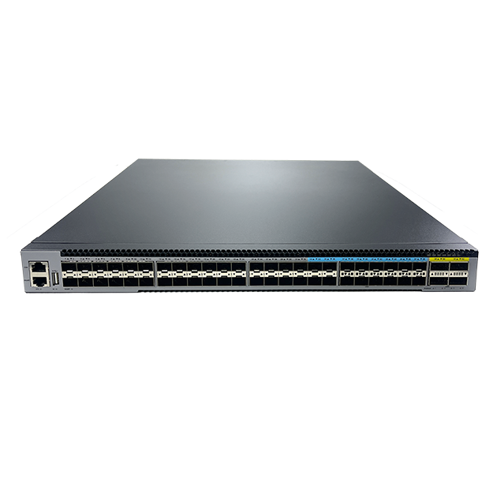

# S4634T-1X2Z-SI

> 来源：<https://hohunet.com/product/s4634t-1x2z-si-l3-managed-switch-with-34-x-100m-1g-2-5g-5g-base-t-1-x-10g-sfp-2-x-100g-qsfp28-4fixed-power-supply/>（抓取 2026-10-21T04:13:43Z；英文原文照录，中文仅为栏目名）  
> 官网标题：S4634T-1X2Z-SI L3+ Managed Switch, with 34 x 100M/1G/2.5G/5G Base-T, 1 x 10G SFP+, 2 x 100G QSFP28, 1 x Fixed Power Supply, 4 x Fixed Fan  
> 类目：Enterprise and Campus Network / S4600 5G Downlink 25G/100G Uplink  
> 端口：34 x 100M/1G/2.5G/5G Base-T, 1 x 10G SFP+, 2 x 100G QSFP28；交换容量 760Gbps (bidirectional)；转发 1130.88 Mpps (bidirectional)；电源 1 x 200W fixed；芯片平台 VastLakes

## 产品图



## Highlights（官网短描述）
- 1 x Fixed Power Supply, 4 x Fixed Fan
- Support Smart Fans
- Support 10M/100M/1G /2.5G /5G Base-T
- QinQ, BGP, Ipv6
- Highlight Features:
- QinQ
- BGP
- OSPF
- MLAG
- IPv6
- VxLan
- MPLS
- Multi-Gigabit
- Layer 3 high-function
- Application Scenarios:
- Enterprise /Campus Networks
- Telecommunication Operators Networks
- E-sports Network

## HARDWARE SPECIFICATION
| 项 | 值 |
|---|---|
| Model | S4634T-1X2Z-SI |
| Service Ports | 34 x 100M/1G/2.5G/5G Base-T, 1 x 10G SFP+, 2 x 100G QSFP28 |
| Management Ports | Console: RJ45 to RS232 Ethernet: 1G Port Storage: USB |
| Power supply | 1 x 200W fixed |
| Cooling System | 4 x Fixed Fan (front-to-back airflow) |
| Memory | eMMc: 8GB DRAM: 2GB |
| CPU | Dual-core processor, ARM A53 |
| Packet Switch capacity | 760Gbps (bidirectional) |
| Layer 2/Layer 3 Throughput | 1130.88 Mpps (bidirectional) |
| Power consumption (Worst case, all ports used, line-rate traffic) | TBD |
| Typical Power consumption | TBD |
| Acoustic in dBA | TBD |
| Cooling [CFM] | 46.48 |
| MTBF | ≥70000h (~8.0 Years) |
| Operating altitude | 0~3km |
| Dimensions | 442×44×408mm |
| Operating temperature | 0ºC to 45ºC |
| Chipset Platform | VastLakes |

## License
| Items | Description |
|---|---|
| Software License | EB, Basic L3 software features, Preinstalled |
| Software License | MS, L3 enhance features software license key |
| Software License | MA, MPLS features software license key |
| Software License | ST, Stacking feature software license key |

## Software Specification
见 [software/software-spec-78b5976690.md](../software/software-spec-78b5976690.md)（283 行，EB / MS / MA 三档）

## Download
- [S4600 Series switches datasheet_EN_V1.2](https://hohunet.com/wp-content/uploads/2026/01/S4600-Series-switches-datasheet_EN_V1.2.pdf) （本地：`data/hohunet_site_raw/downloads/S4600-Series-switches-datasheet_EN_V1.2.pdf`）
- [HOS Software Features_EN_V2.4](https://hohunet.com/wp-content/uploads/2024/07/HOS-Software-Features_EN_V2.4.pdf) （本地：`data/hohunet_site_raw/downloads/HOS-Software-Features_EN_V2.4.pdf`）
- [Performance of VastLakes Platform_EN_3.1](https://hohunet.com/wp-content/uploads/2024/08/Performance-of-VastLakes-Platform_EN_3.1-1.pdf) （本地：`data/hohunet_site_raw/downloads/Performance-of-VastLakes-Platform_EN_3.1-1.pdf`）

## Description（原文）
```
Description
Product Overview
The S4600 series switches are designed with the domestically produced new generation switch chip VastLakes Series Chip platform. They support ports of various speeds, provide full Gigabit access (PoE, non-PoE) and flexible uplink data interaction capabilities, support a variety of switch layer 3 features, ensure network security, high efficiency and energy saving, and are suitable for access scenarios such as e-sports networks and SMBs.
Key Features of the S4600 Series Switches
*Support 5G Multi-Gigatbit ports and various uplink ports to meet different network requirements.
*PoE++ provide max 90W power of ports.
*Rich L2/L3 features such as VLAN, IGMP Snooping, LACP, OSPF, VRRP, ACL, DHCP etc.
*Support CLI/WEB/SNMP/SSH for flexible operation.
The S4600 Series switches support varied management ways, include console port / in-band network ports / out-of-band network port. Support SNMP v1/v2/v3, Support CLI (Command Line Interface), web management, Telnet and FTP connection. Support OAM to make management more convenient, and support SSH2.0, SSL, etc. to ensure security of management. Moreover, leveraging its profound technical expertise and in-depth understanding of campus and enterprise networking needs, Hohunet has launched the Da Hu Cloud Management System (DHCS). It enhances network management and maintenance efficiency, reduces costs, elevates management intelligence, and delivers a faster, smarter, more secure and reliable network to better meet user requirements.
Visual WEB GUI
The S4600 series allows you to quickly configure common configuration items using a visual WEB GUI, which lowers the application threshold for users.
```
