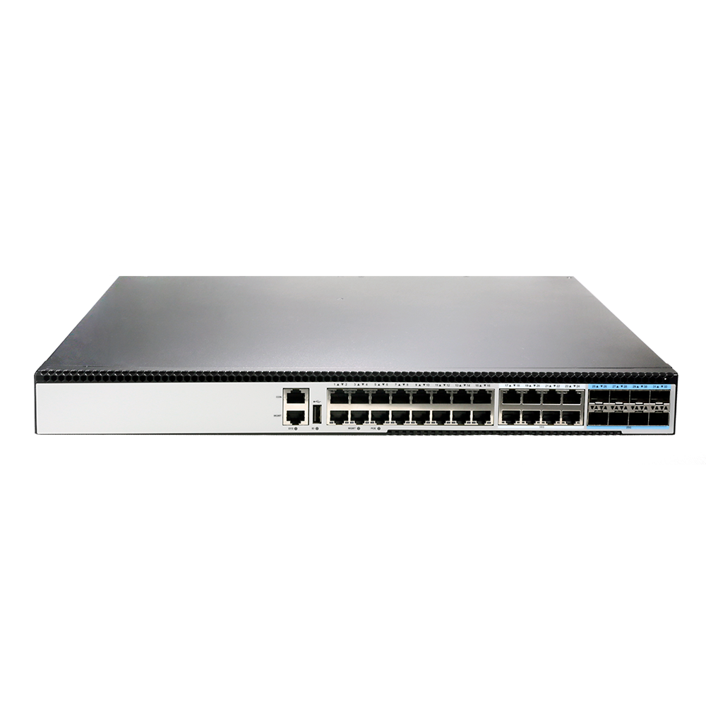
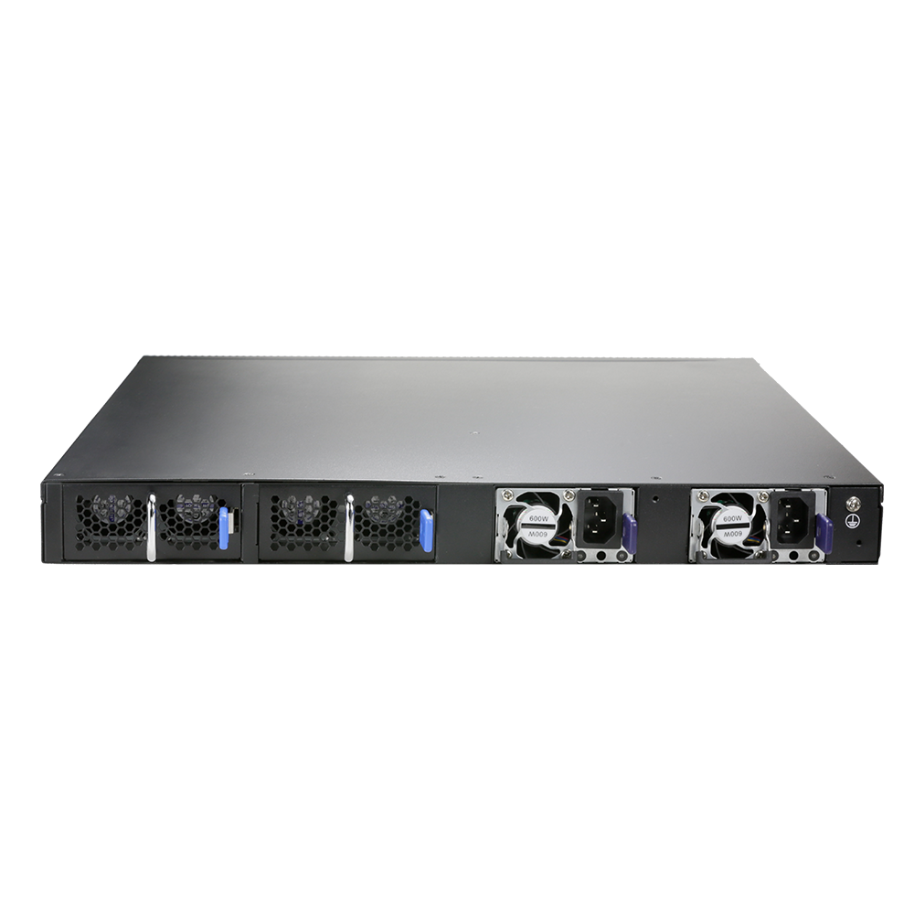
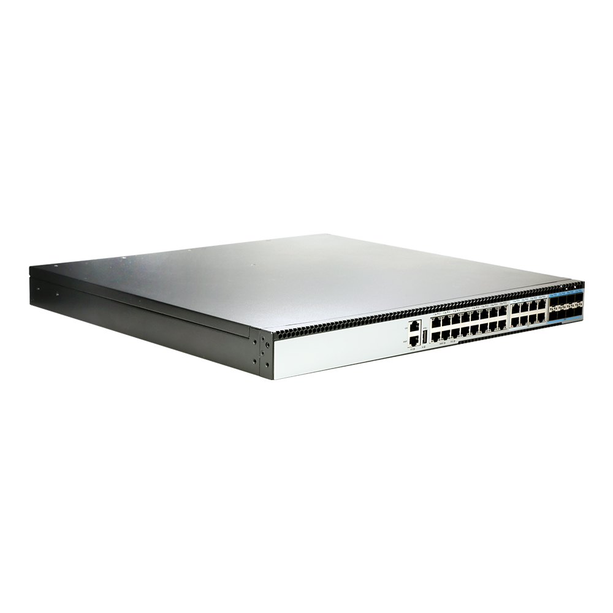
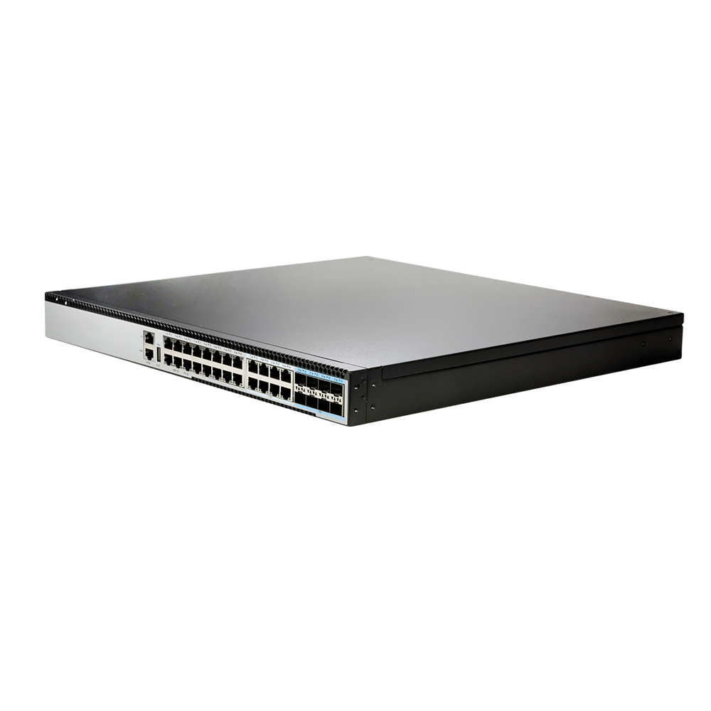

# S5016P-8T8N-EI

> 来源：<https://hohunet.com/product/s5016p-8t8n-ei-l3-managed-switch-with-16-x-100m-1g-2-5g-base-tpoe90w-8-x-10g-base-tpoe90w-8-x-25g-10g-sfp28/>（抓取 2026-10-21T04:13:30Z；英文原文照录，中文仅为栏目名）  
> 官网标题：S5016P-8T8N-EI L3+ Managed Switch, with 16 x 100M/1G/2.5G Base-T(PoE++90W), 8 x 10G Base-T(PoE++90W), 8 x 25G/10G SFP28  
> 类目：S5000 2.5G Downlink 25G/40G Uplink / Enterprise and Campus Network  
> 端口：16 x 100M/1G/2.5G Base-T(PoE++90W), 8 x 10G Base-T(PoE++90W), 8 x 25G/10G SFP28；交换容量 640Gbps；转发 952.32Mbps (bidirectional)；电源 2 x 600W CRPS；芯片平台 VastLakes

## 产品图





## Highlights（官网短描述）
- 16 x 100M/1G/2.5G Base-T(PoE++90W), 8 x 10G Base-T(PoE++90W), 8 x 25G/10G SFP28
- Support Smart Fans, auto-adapted speed as running temperture
- Support QinQ, BGP, MLAG
- Support Ipv6
- Highlight Features:
- QinQ
- BGP
- OSPF
- MLAG
- IPv6
- VxLAN
- MPLS
- Layer 3 high-function
- Application Scenarios:
- Enterprise /Campus Networks
- Telecommunication Operators Networks
- Data Center Networks

## HARDWARE SPECIFICATION
| 项 | 值 |
|---|---|
| Model | S5016P-8T8N-EI |
| Service Ports | 16 x 100M/1G/2.5G Base-T(PoE++90W), 8 x 10G Base-T(PoE++90W), 8 x 25G/10G SFP28 |
| Management Ports | Console: RJ45 to RS232 Ethernet: 1G Port Storage: USB |
| Power supply | 2 x 600W CRPS |
| Cooling System | 2 x Fan modules (front-to-back airflow) |
| Memory | eMMc: 8GB DRAM: 2GB |
| CPU | Dual-core processor, ARM A53 |
| Packet Switch capacity | 640Gbps |
| Layer 2/Layer 3 Throughput | 952.32Mbps (bidirectional) |
| Power consumption (Worst case, all ports used, line-rate traffic) | 98.78W |
| Typical Power consumption | TBD |
| Acoustic in dBA | TBD |
| Cooling [CFM] | 46.48 |
| MTBF | ≥90000H |
| Operating altitude | ≤5000m |
| Dimensions | 442*44*420mm |
| Operating temperature | 0ºC to 40ºC |
| Chipset Platform | VastLakes |

## License
| Items | Description |
|---|---|
| Software License | MS, L3 enhance features software license key, Preinstalled on EI models |
| Software License | MA, MPLS features software license key |
| Software License | ST, Stacking feature software license key |

## Software Specification
见 [software/software-spec-78b5976690.md](../software/software-spec-78b5976690.md)（283 行，EB / MS / MA 三档）

## Download
- [S5000 Series switches datasheet_EN_V1.3](https://hohunet.com/wp-content/uploads/2021/11/S5000-Series-switches-datasheet_EN_V1.3.pdf) （本地：`data/hohunet_site_raw/downloads/S5000-Series-switches-datasheet_EN_V1.3.pdf`）
- [HOS Software Features_EN_V2.4](https://hohunet.com/wp-content/uploads/2024/07/HOS-Software-Features_EN_V2.4.pdf) （本地：`data/hohunet_site_raw/downloads/HOS-Software-Features_EN_V2.4.pdf`）
- [Performance of VastLakes Platform_EN_3.1](https://hohunet.com/wp-content/uploads/2024/08/Performance-of-VastLakes-Platform_EN_3.1-1.pdf) （本地：`data/hohunet_site_raw/downloads/Performance-of-VastLakes-Platform_EN_3.1-1.pdf`）

## Description（原文）
```
Description
Product Overview
S5000 series switches, high-performance layer 3 Ethernet switch, which are designed based on high-performance hardware platform VastLakes Series Chip platform, with various ports, compact 1U form factor. S5000 series switches provide complete Layer 3 network features to meet the requirement of Metro/Enterprise/HCI networks.
Key Features of the S5000 Series Switches
*Support MPLS features (L2/L3 VPN) to build a unified and converged network platform.
*2.5G downlink ports and various uplink ports to meet different network requirements.
*Rich L2/L3 features such as IPv6, OSPF, BGP, PIM etc.
*Support CLI/WEB/SNMP/SSH for flexible operation.
The S5000 series switches support varied management ways, include console, and support SNMP v1/v2/v3, Support CLI (Command Line Interface), web management, Telnet and FTP connection. Support OAM to make management more convenient, and support SSH2.0, etc. to ensure security of management. Moreover, leveraging its profound technical expertise and in-depth understanding of campus and enterprise networking needs, Hohunet has launched the Da Hu Cloud Management System (DHCS). It enhances network management and maintenance efficiency, reduces costs, elevates management intelligence, and delivers a faster, smarter, more secure and reliable network to better meet user requirements.
Visual WEB GUI
The S5000 series allows you to quickly configure common configuration items using a visual WEB GUI, which lowers the application threshold for users.
```
