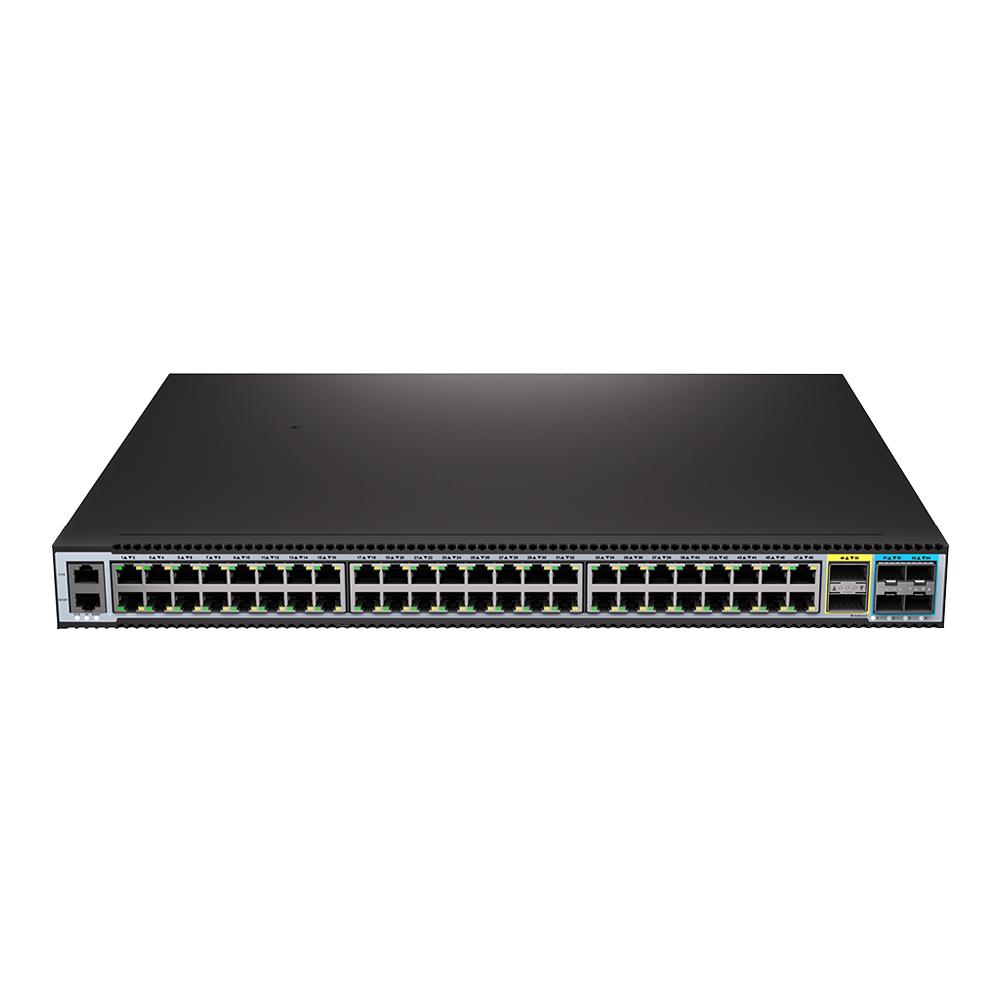
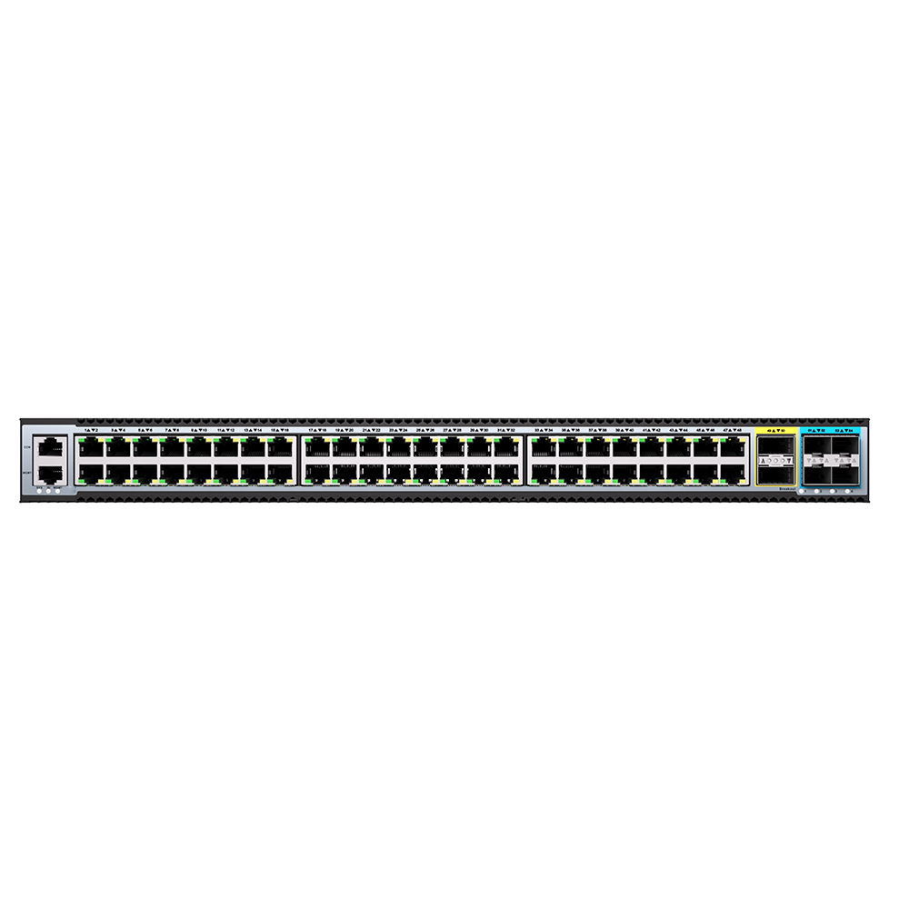
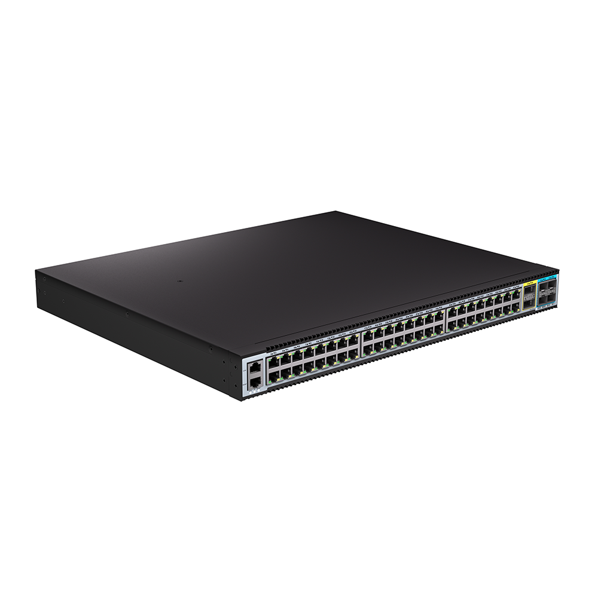
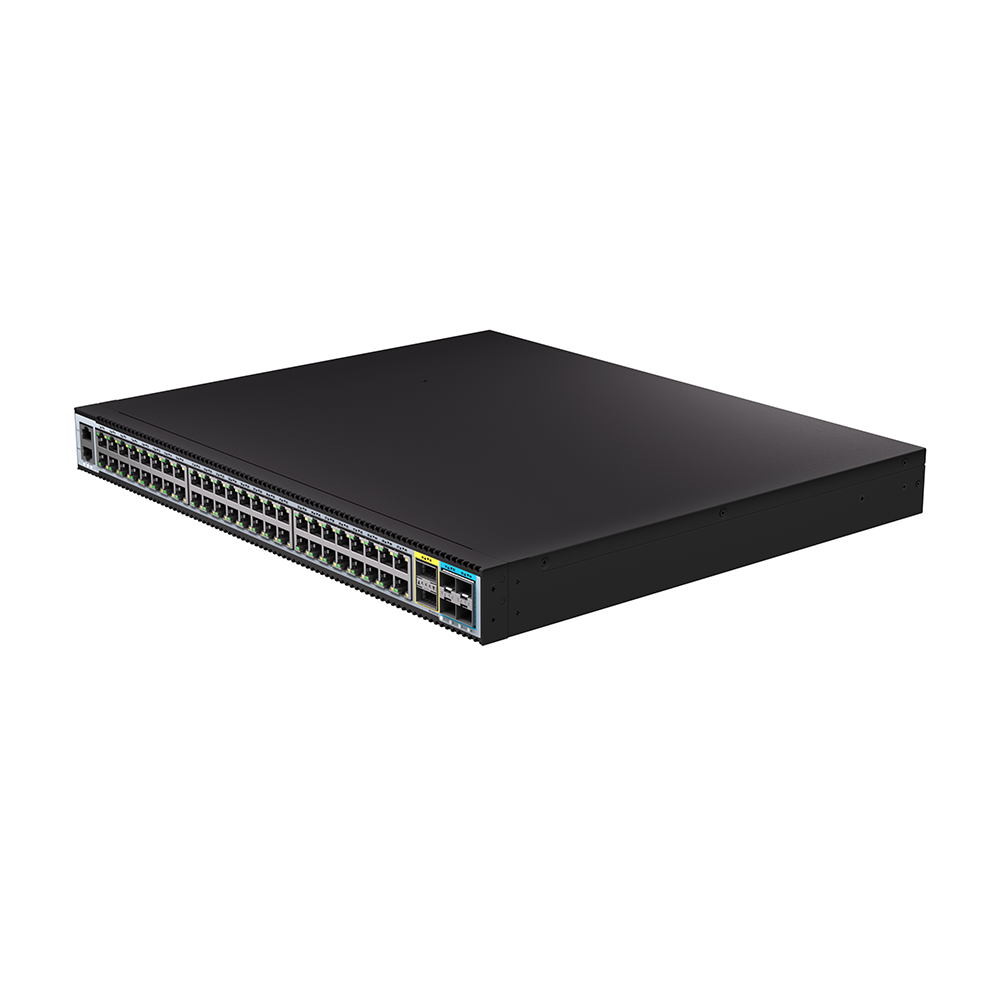
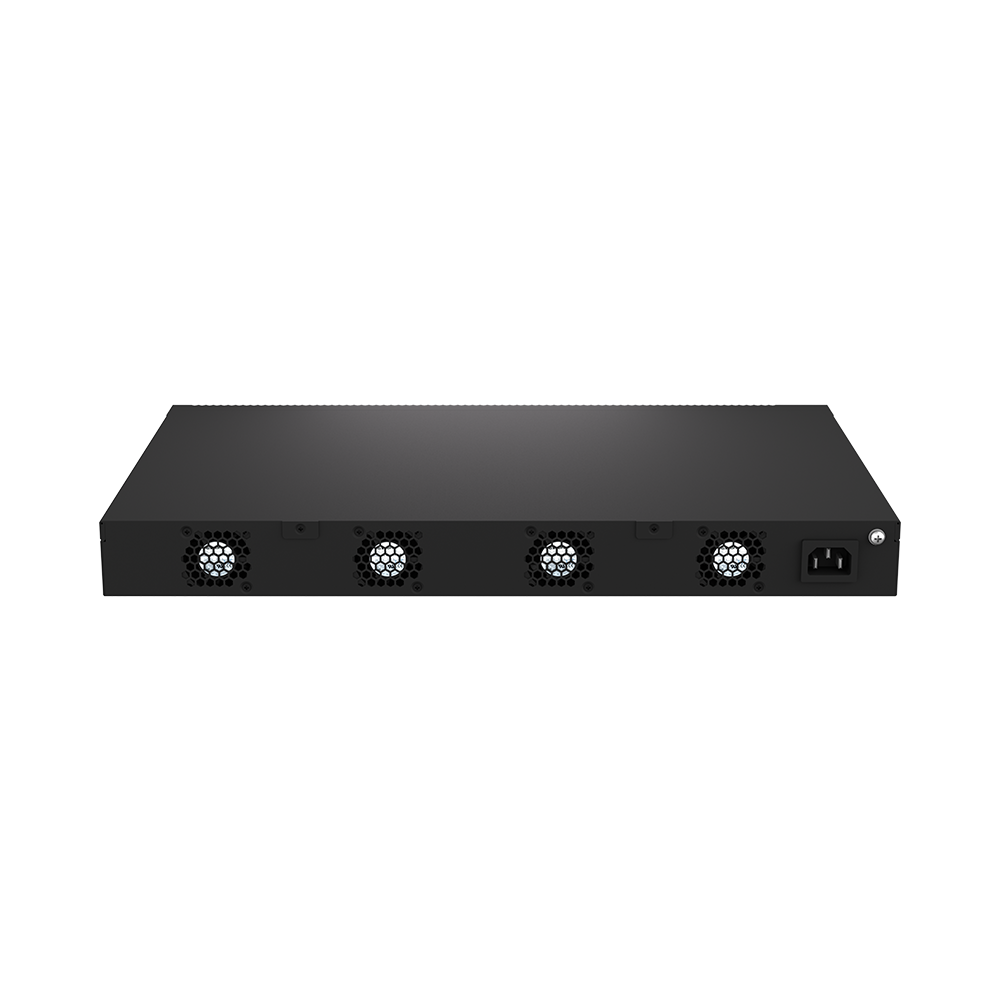

# S5548-2Q4X-SI

> 来源：<https://hohunet.com/product/s5548-2q4x-si-48-port-10-100-1000m-base-t-l3-managed-ethernet-switch-with-240gb-qsfp-and-425g-10g-uplink-1-96w-fixed-power-4-fixed-fan/>（抓取 2026-10-21T04:13:25Z；英文原文照录，中文仅为栏目名）  
> 官网标题：S5548-2Q4X-SI 48 Port 10/100/1000M BASE-T L3 Managed Ethernet Switch with 2*40Gb QSFP And 4*25G/10G Uplink, 1* 96W fixed power, 4* Fixed Fan  
> 类目：S5500 1G Downlink 25G/40G Uplink / Enterprise and Campus Network  
> 端口：48 x 10/100/1000Mb BaseT, 4 x 25G SFP28, 2 x 40G QSFP+；交换容量 456Gbps (bidirectional)；转发 678.53Mpps (bidirectional)；电源 1 x Fixed；芯片平台 VastLakes

## 产品图






## Highlights（官网短描述）
- 48 * 10/100/1G BASE-T; – 2*40Gb QSFP; – 4*25G/10G SFP28
- 1* Fixed Power Supply
- 4*Fixed Fans
- QinQ, BGP, Ipv6
- Highlight Features:
- QinQ
- BGP
- OSPF
- MLAG
- IPv6
- VxLan
- MPLS
- Multi-Gigabit
- Layer 3 high-function
- Application Scenarios:
- Enterprise /Campus Networks
- Telecommunication Operators Networks

## HARDWARE SPECIFICATION
| 项 | 值 |
|---|---|
| Model | S5548-2Q4X-SI |
| Service Ports | 48 x 10/100/1000Mb BaseT, 4 x 25G SFP28, 2 x 40G QSFP+ |
| Management Ports | Console: RJ45 RS232 Ethernet: 1G Port |
| Power supply | 1 x Fixed |
| Cooling System | 4 x fixed Fans (Front to Rear airflow) |
| Memory | eMMc: 8GB DRAM: 2GB |
| CPU | Dual-core processor, ARM A53 |
| Packet Switch capacity | 456Gbps (bidirectional) |
| Layer 2/Layer 3 Throughput | 678.53Mpps (bidirectional) |
| Power consumption (Worst case, all ports used, line-rate traffic) | 72W |
| Typical Power consumption | 69W |
| Acoustic in dBA | TBD |
| Cooling [CFM] | 46.48 |
| MTBF | ≥70000h (~8.0 Years) |
| Operating altitude | ≤2000m |
| Dimensions | 44.2 x 4.4 x 32.1cm |
| Operating temperature | 0ºC to 40ºC |
| Chipset Platform | VastLakes |

## License
| Items | Description |
|---|---|
| Software License | EB, Basic L3 software features, Preinstalled |
| Software License | MS, L3 enhance features software license key |
| Software License | MA, MPLS features software license key |
| Software License | ST, Stacking feature software license key |

## Software Specification
见 [software/software-spec-78b5976690.md](../software/software-spec-78b5976690.md)（283 行，EB / MS / MA 三档）

## Download
- [S5500 Series switches datasheet_EN_V1.3](https://hohunet.com/wp-content/uploads/2023/06/S5500-Series-switches-datasheet_EN_V1.3.pdf) （本地：`data/hohunet_site_raw/datasheets/S5500-Series-switches-datasheet_EN_V1.3.pdf`）
- [HOS Software Features_EN_V2.4](https://hohunet.com/wp-content/uploads/2024/07/HOS-Software-Features_EN_V2.4.pdf) （本地：`data/hohunet_site_raw/datasheets/HOS-Software-Features_EN_V2.4.pdf`）
- [Performance of VastLakes Platform_EN_3.1](https://hohunet.com/wp-content/uploads/2024/08/Performance-of-VastLakes-Platform_EN_3.1-1.pdf) （本地：`data/hohunet_site_raw/datasheets/Performance-of-VastLakes-Platform_EN_3.1-1.pdf`）

## Description（原文）
```
Description
Product Overview
The S5500 Series switches designed on a domestic new generation switch Chip, which called VastLakes Series Chip platform . With 48 x 1G or 24 x 1G high speed ports and rich features, these switches will perfectly meets the requirements of Metro, Enterprise and campus networks.
Key features of the S5500 Series Switches
*Support MPLS Features Varied port types support 100M/1G/25G/40G ports to meet different network requirement.
*Implementing Vxlan and BGP protocols to build EVPN applications for Enterprise and Campus scenario.
*Switch-to-switch encryption using MACsec (Media Access Control Security) AES-CMAC.
*Precision Timing Protocol.
*Rich L2/L3 features like IPv6, OSPF, BGP, PIM, etc.
The S5500 Series switches support varied management ways, include console port / in-band network ports / out-of-band network port. Support SNMP v1/v2/v3, Support CLI (Command Line Interface), web management, Telnet and FTP connection. Support OAM to make management more convenient, and support SSH2.0, SSL, etc. to ensure security of management. Moreover, leveraging its profound technical expertise and in-depth understanding of campus and enterprise networking needs, Hohunet has launched the Da Hu Cloud Management System (DHCS). It enhances network management and maintenance efficiency, reduces costs, elevates management intelligence, and delivers a faster, smarter, more secure and reliable network to better meet user requirements.
Visual WEB GUI
HOS allows you to quickly configure common configuration items using a visual WEB GUI, which lowers the application threshold for users.
```
