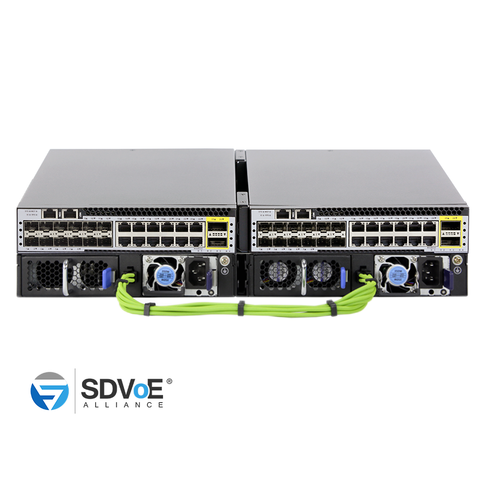
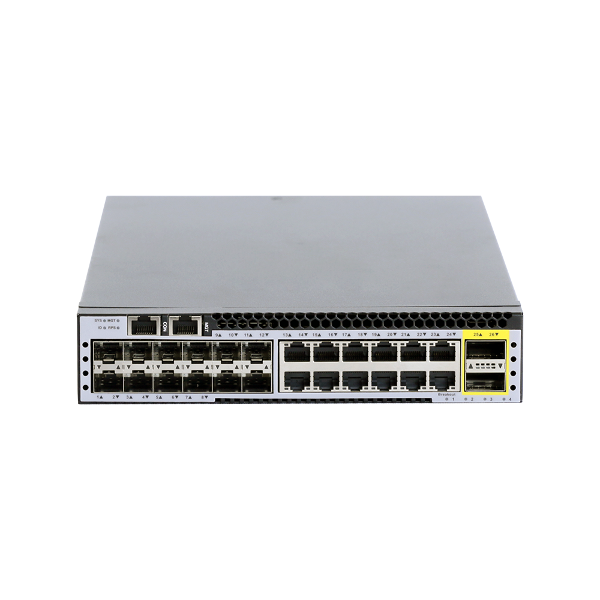
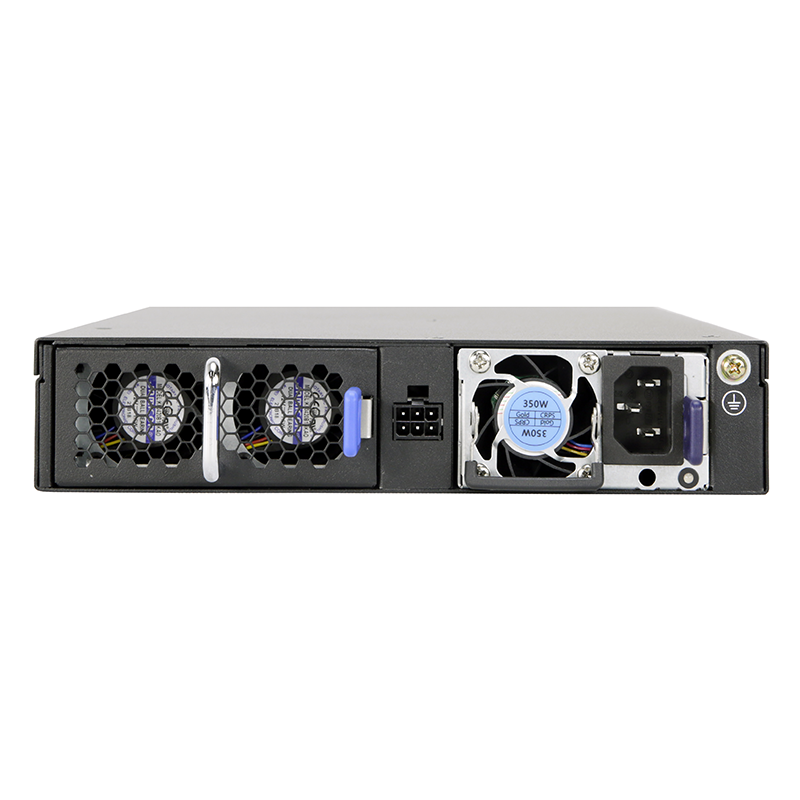
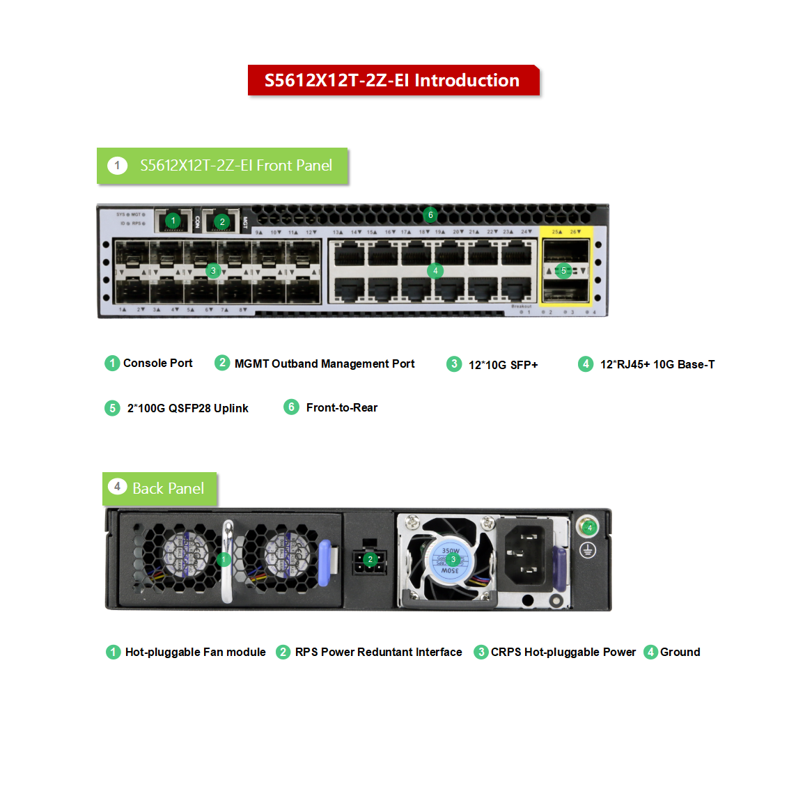
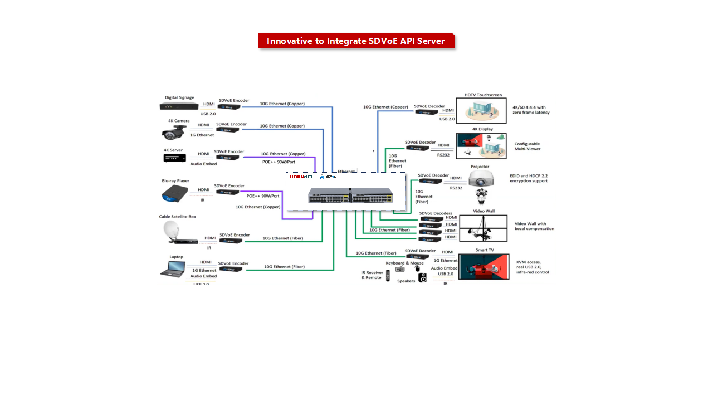
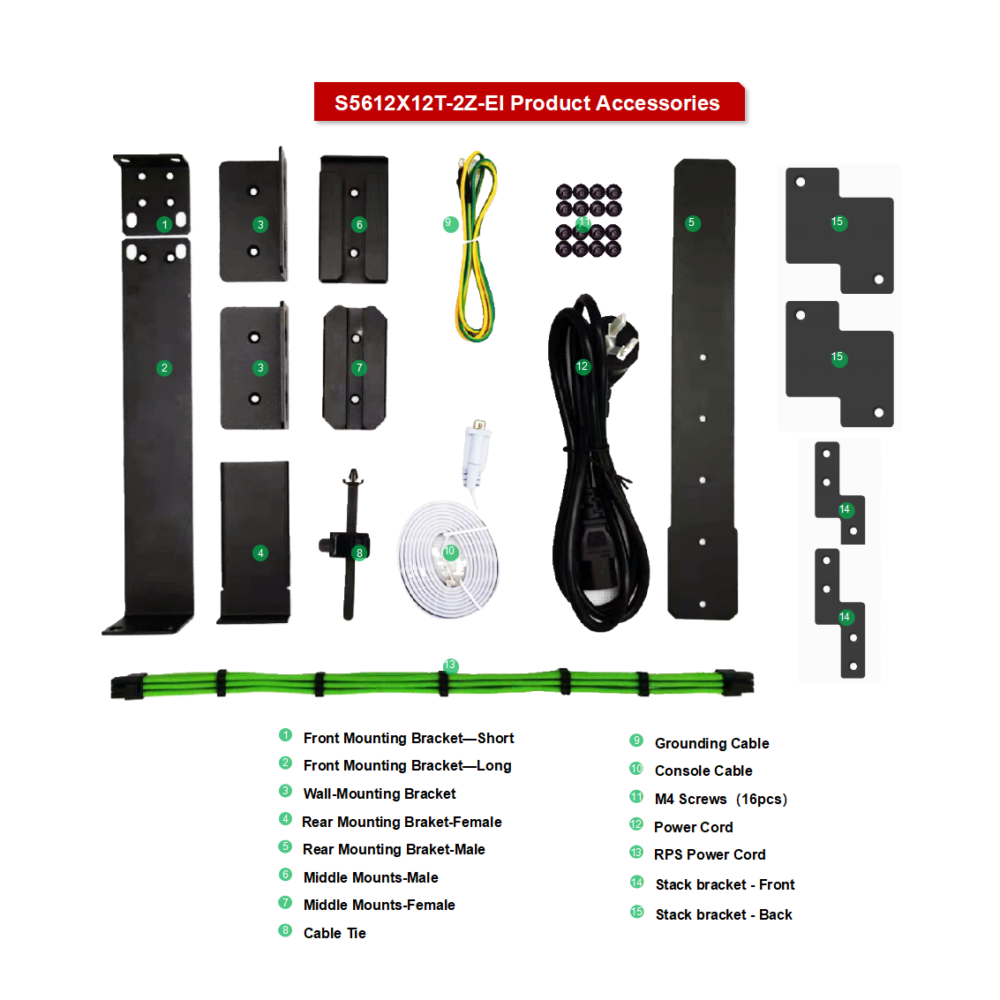

# S5612X12TH-2Z-EI

> 来源：<https://hohunet.com/product/s5612x12t-2z-ei-10g-half-width-sdvoe-switch/>（抓取 2026-10-21T04:13:16Z；英文原文照录，中文仅为栏目名）  
> 官网标题：S5612X12TH-2Z-EI 12*10G SFP+, 12*10G Base-T and 2*100G QSFP28 Half-width Switches, 1*350W CRPS，1*Fan Module, support SDVoE  
> 类目：Enterprise and Campus Network / S5600 10G Downlink 100G/25G Uplink  
> 端口：12 x 10G SFP+, 12 x 10G Base-T, 2 x 100G QSFP28；交换容量 880 Gbps (bidirectional)；转发 1309.44Mpps (bidirectional)；电源 1 x 550W CRPS；芯片平台 VastLakes

## 产品图







## Highlights（官网短描述）
- Support Multiple Hot Backup Protocols
- Support Two-node Power Redundancy
- Innovative to Integrate SDVoE API Server
- Unified WEB GUI Interface
- Hot-swappable Power and Fan Modules
- Full Layer3 Software Features
- Highlight Features:
- QinQ
- BGP
- OSPF
- MLAG
- IPv6
- VxLAN
- SDVoE
- Application Scenarios:
- Enterprise /Campus Networks
- SDVoE Pro AV Networks
- SMB

## HARDWARE SPECIFICATION
| 项 | 值 |
|---|---|
| Model | S5612X12TH-2Z-EI |
| Service Ports | 12 x 10G SFP+, 12 x 10G Base-T, 2 x 100G QSFP28 |
| Management Ports | Console: RJ45 RS232 Ethernet: 1G Port |
| Power supply | 1 x 550W CRPS |
| Cooling System | 1 x hot-swappable Fan Module (front-to-back airflow) |
| Memory | eMMc: 8GB DRAM: 2GB |
| CPU | Dual-core processor, ARM A53 |
| Packet Switch capacity | 880 Gbps (bidirectional) |
| Layer 2/Layer 3 Throughput | 1309.44Mpps (bidirectional) |
| Power consumption (Worst case, all ports used, line-rate traffic) | 81W |
| Typical Power consumption | 77W |
| Acoustic in dBA | 49.4dB |
| Cooling [CFM] | 38.49cfm |
| MTBF | ≥90000H |
| Operating altitude | ≤5000m |
| Dimensions | 21.5×4.4×35.6cm |
| Operating temperature | 0ºC to 40ºC |
| Chipset Platform | VastLakes |

## License
| Items | Description |
|---|---|
| Software License | MS, L3 enhance features software license key, Preinstalled |
| Software License | MA, MPLS features software license key |
| Software License | ST, Stacking feature software license key |

## Software Specification
见 [software/software-spec-78b5976690.md](../software/software-spec-78b5976690.md)（283 行，EB / MS / MA 三档）

## Download
- [DynamicDuo Series switches VastLakes datasheet_EN_V1.4](https://hohunet.com/wp-content/uploads/2025/12/DynamicDuo-Series-switches-VastLakes-datasheet_EN_V1.4.pdf) （本地：`data/hohunet_site_raw/datasheets/DynamicDuo-Series-switches-VastLakes-datasheet_EN_V1.4.pdf`）
- [HOS Software Features_EN_V2.4](https://hohunet.com/wp-content/uploads/2024/07/HOS-Software-Features_EN_V2.4.pdf) （本地：`data/hohunet_site_raw/datasheets/HOS-Software-Features_EN_V2.4.pdf`）
- [Performance of VastLakes Platform_EN_3.1](https://hohunet.com/wp-content/uploads/2024/08/Performance-of-VastLakes-Platform_EN_3.1-1.pdf) （本地：`data/hohunet_site_raw/datasheets/Performance-of-VastLakes-Platform_EN_3.1-1.pdf`）

## Description（原文）
```
Description
Product Overview
The DynamicDuo Series switches designed on a domestic popular switch chip, which called VastLakes and BigFlow Series Chip platform with 10G/25G/40G/100G high speed ports and rich features, these switches will perfectly meets the requirements of Campus, Enterprise, Data Center, and SDVoE networks.
Key features of the DynamicDuo Series Switches
*Built-in SDVoE API Server simplifies user operation steps.
*Supports the implementation of physical dual-machine redundancy in 1U space, reducing the user’s usage cost.
*MLAG which can build an Active-Active system to improve the reliability of the network links from single board grade to device grade.
*Supports Precision Timing Protocol.
*Rich L2/L3 features like IPv6, OSPF, BGP, PIM, etc.
Visual WEB GUI
HOS allows users to quickly configure common configuration items using a visual WEB GUI, which lowers the application threshold for users. Moreover, SDVoE switches built-in SDVoE API Server, users no need to purchase additional SDVoE controller, simplifying the network architecture. The web page is simple and easy to operate, without complicated steps, only the following three simple parts: SDVoE, Multicast, DHCP Server, you can complete the relevant configuration of SDVoE, and reduce the overall time cost and project cost of users.
Outstanding management features
The DynamicDuo Series switches support varied management ways, include console port / in-band network ports / out-of-band network port. Support SNMP v1/v2/v3, Support CLI (Command Line Interface), web management, Telnet and FTP connection. Support OAM to make management more convenient, and support SSH2.0, etc. to ensure security of management. Moreover, leveraging its profound technical expertise and in-depth understanding of campus and enterprise networking needs, Hohunet has launched the Da Hu Cloud Management System (DHCS). It enhances network management and maintenance efficiency, reduces costs, elevates management intelligence, and delivers a faster, smarter, more secure and reliable network to better meet user requirements.
Support MLAG Active-active dual-system hot backup
Support MLAG (Multi-Chassis Link Aggregation) to aggregate links across different devices. MLAG can build an Active-Active system to improve the reliability of the network links from single board grade to device grade. MLAG use a peer link between to devices to aggregate two devices and make them as one device logically. Ports of two different devices join the aggregate ports together and all port can transmit the data traffic. MLAG need to management the device respectively, but the configurations are easier than stacking, reboot is NOT required after MLAG is configured. Forwarding and configuring are processing on local device, in normal condition the traffic do NOT transmit trough the peer link, the bandwidth of peer link is not the bottleneck of the network and the latency is low.
Flexible and Diverse Deployment modes, with 1U for Dual Physical Redundancy
```
