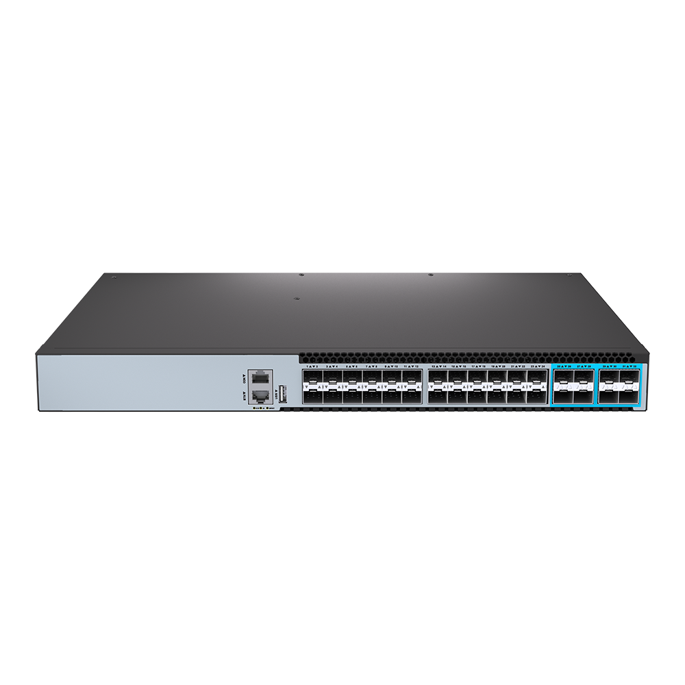
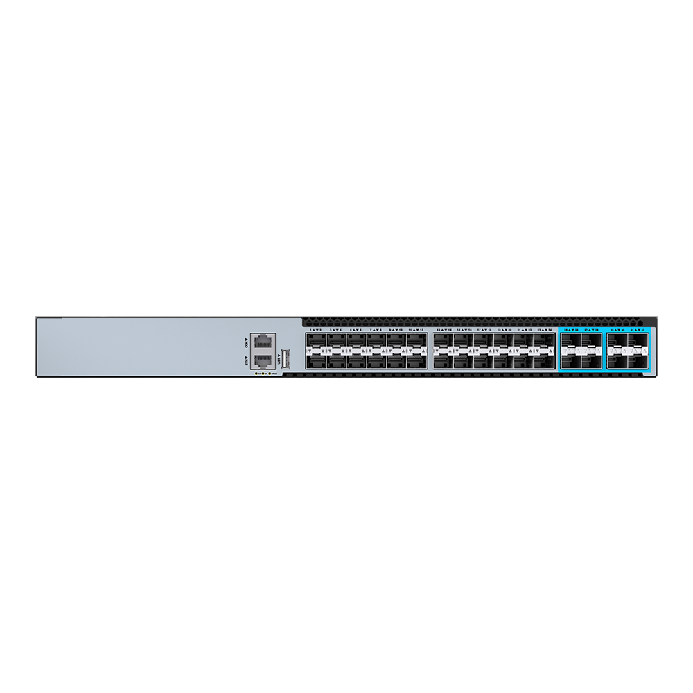
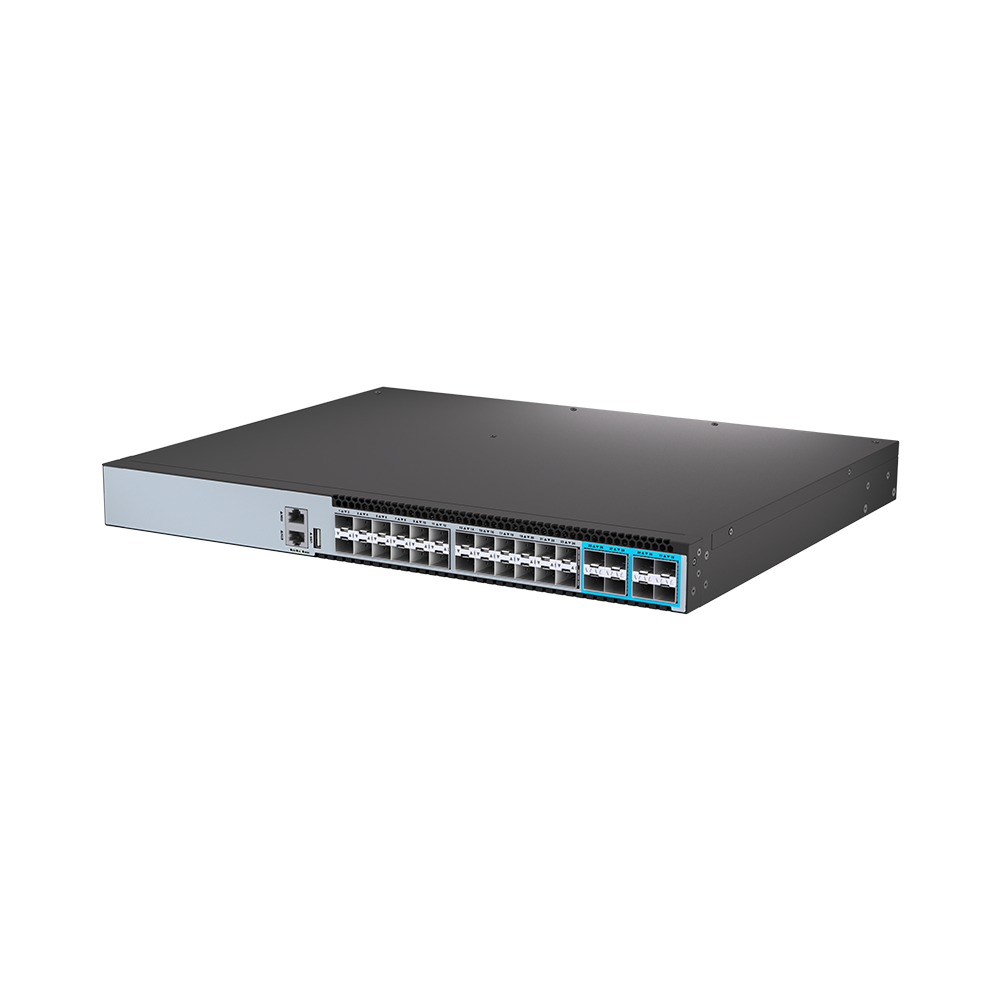
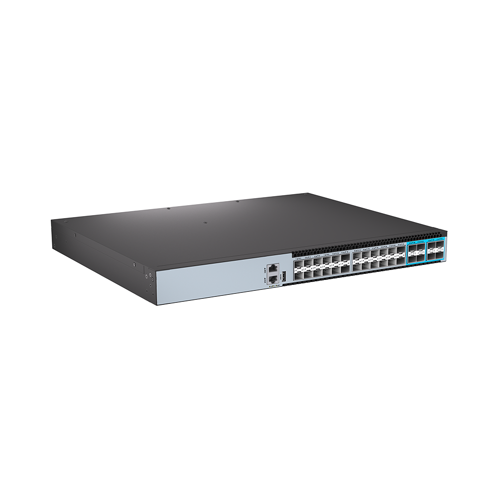
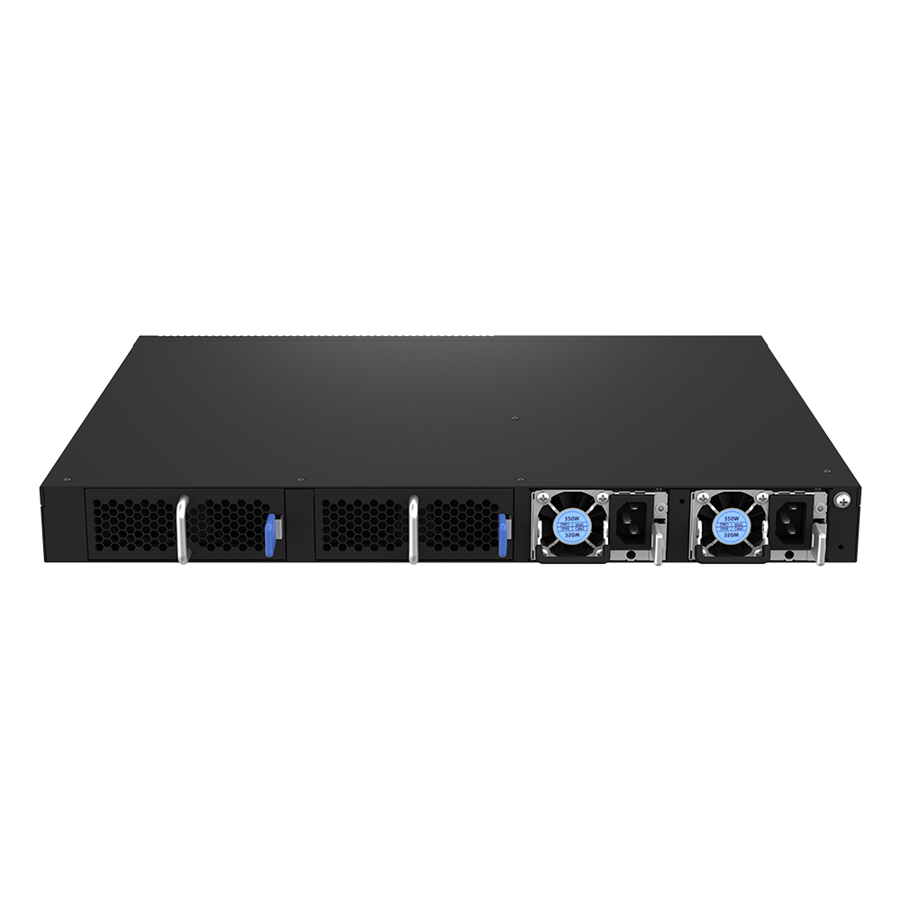

# S5624T-8N-EI

> 来源：<https://hohunet.com/product/s5624t-8n-10g-25g/>（抓取 2026-10-21T04:13:51Z；英文原文照录，中文仅为栏目名）  
> 官网标题：S5624T-8N-EI 10G Enterprise and Campus Network Switch with 24*10G Base-T, 8*25G QSFP28, Dual power supply modules, 2*hot-swap fan modules  
> 类目：S5600 10G Downlink 100G/25G Uplink / Enterprise and Campus Network  
> 端口：24 x 10G Base-T, 8 x 25G QSFP28；交换容量 880Gbps(bidirectional)；转发 1309.44Mpps (bidirectional)；电源 2 x 350W CRPS；芯片平台 VastLakes

## 产品图






## Highlights（官网短描述）
- 1+1 Redundancy PSU
- Support Smart Fans
- Multi-Gigabit Swith with 100M/1000M/2.5G/5G/10G Base-T
- QinQ, BGP, Ipv6
- Highlight Features:
- QinQ
- BGP
- OSPF
- MLAG
- IPv6
- VxLan
- MPLS
- Multi-Gigabit
- Layer 3 high-function
- Application Scenarios:
- Enterprise /Campus Networks
- Telecommunication Operators Networks
- Data Center Networks

## HARDWARE SPECIFICATION
| 项 | 值 |
|---|---|
| Model | S5624T-8N-EI |
| Service Ports | 24 x 10G Base-T, 8 x 25G QSFP28 |
| Management Ports | Console: RJ45 to RS232 Ethernet: 1G Port Storage: USB |
| Power supply | 2 x 350W CRPS |
| Cooling System | 2 x Fan Modules (front-to-back airflow) |
| Memory | eMMc: 8GB DRAM: 2GB |
| CPU | Dual-core processor, ARM A53 |
| Packet Switch capacity | 880Gbps(bidirectional) |
| Layer 2/Layer 3 Throughput | 1309.44Mpps (bidirectional) |
| Power consumption (Worst case, all ports used, line-rate traffic) | TBD |
| Typical Power consumption | TBD |
| Acoustic in dBA | TBD |
| Cooling [CFM] | 68.76cfm |
| MTBF | ≥90000H |
| Operating altitude | ≤5000m |
| Dimensions | 44.2×4.4×35.6cm |
| Operating temperature | 0ºC to 40ºC |
| Chipset Platform | VastLakes |

## License
| Items | Description |
|---|---|
| Software License | MS, L3 enhance features software license key, Preinstalled |
| Software License | MA, MPLS features software license key |
| Software License | ST, Stacking feature software license key |

## Software Specification
见 [software/software-spec-78b5976690.md](../software/software-spec-78b5976690.md)（283 行，EB / MS / MA 三档）

## Download
- [S5600 Series switches datasheet_EN_V1.4](https://hohunet.com/wp-content/uploads/2025/12/S5600-Series-switches-datasheet_EN_V1.4.pdf) （本地：`data/hohunet_site_raw/datasheets/S5600-Series-switches-datasheet_EN_V1.4.pdf`）
- [HOS Software Features_EN_V2.4](https://hohunet.com/wp-content/uploads/2024/07/HOS-Software-Features_EN_V2.4.pdf) （本地：`data/hohunet_site_raw/datasheets/HOS-Software-Features_EN_V2.4.pdf`）
- [Performance of VastLakes Platform_EN_3.1](https://hohunet.com/wp-content/uploads/2024/08/Performance-of-VastLakes-Platform_EN_3.1-1.pdf) （本地：`data/hohunet_site_raw/datasheets/Performance-of-VastLakes-Platform_EN_3.1-1.pdf`）

## Description（原文）
```
Description
Product Overview
The S5600 Series switches are designed with two generations of domestic Switch Chips, namely the widely favored VastLakes Series Chip platform and the high-performance PeakNetX Series Chip platform. The S5600 Series switches have various port options and offer rich L2/L3 features, making them the perfect choice as aggregation or access switches for enterprise, government, specific industry networks.
Key features of the S5600 Series Switches
*POE++ provide max 90W power of ports. Support MPLS features (L2/L3 VPN) to build a unified and converged network platform.
*MLAG which can build an Active-Active system to improve the reliability of the network links from single board grade to device grade.
*Implementing Vxlan and BGP protocols to build EVPN applications for data centers scenario.
*Switch-to-switch encryption using MACsec (Media Access Control Security) AES-CMAC.
*Precision Timing Protocol.
*Rich L2/L3 features like IPv6, OSPF, BGP, PIM, etc.
The S5600 Series switches support varied management ways, include console port / in-band network ports / out-of-band network port. Support SNMP v1/v2/v3, Support CLI (Command Line Interface), web management, Telnet and FTP connection. Support OAM to make management more convenient, and support SSH2.0, SSL, etc. to ensure security of management. Moreover, leveraging its profound technical expertise and in-depth understanding of campus and enterprise networking needs, Hohunet has launched the Da Hu Cloud Management System (DHCS). It enhances network management and maintenance efficiency, reduces costs, elevates management intelligence, and delivers a faster, smarter, more secure and reliable network to better meet user requirements.
Visual WEB GUI
HOS allows you to quickly configure common configuration items using a visual WEB GUI, which lowers the application threshold for users.
```
