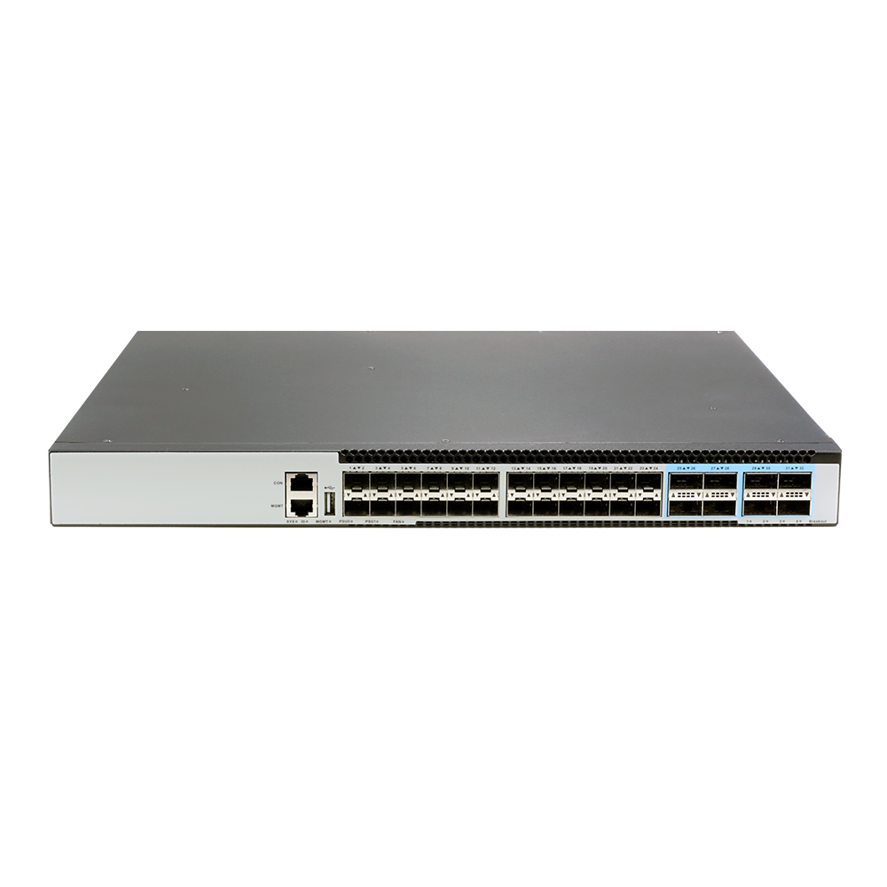
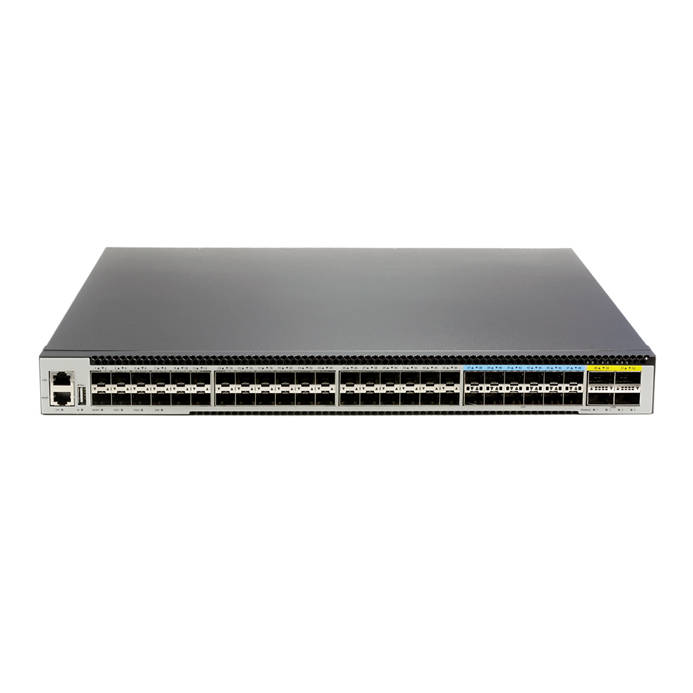

# S5724X-8Z-SI

> 来源：<https://hohunet.com/product/s5724x-8z-si-24x10g-sfp-8x100g-qsfp28-layer-3-switch-with-fixed-power-and-fans-for-enterprise-aggregation/>（抓取 2026-10-21T04:13:01Z；英文原文照录，中文仅为栏目名）  
> 官网标题：S5724X-8Z-SI, 24×10G SFP+, 8×100G QSFP28 Layer 3 Switch with Fixed Power and Fans for Enterprise Aggregation  
> 类目：Enterprise and Campus Network / Data Center Network / S5700 10G Downlink 100G Uplink / S5700 10G Downlink 100G Uplink  
> 端口：24 x 10G SFP+, 8 x 100G QSFP 28；交换容量 2080 Gbps (bidirectional)；转发 3095.04Mpps (bidirectional)；电源 1 x Fixed Power；芯片平台 BigFlow

## 产品图




## Highlights（官网短描述）
- High speed ports, low latency
- IGMP broadcast
- User-friendly GUI
- Full L3 features(MPLS, VxLAN, IPran, BGP)
- Highligh Features:
- QinQ
- BGP
- OSPF
- MLAG
- IPv6
- VxLAN
- MPLS
- Layer 3 high-function
- Application Scenarios:
- Enterprise /Campus Networks
- Telecommunication Operators Networks
- Data Center Networks

## HARDWARE SPECIFICATION
| 项 | 值 |
|---|---|
| Model | S5724X-8Z-SI |
| Service Ports | 24 x 10G SFP+, 8 x 100G QSFP 28 |
| Management Ports | Console: RJ45 to RS232 Ethernet: 1G Port Storage: USB |
| Power supply | 1 x Fixed Power |
| Cooling System | 4 x fixed fans (front-to-back airflow) |
| Memory | eMMc: 8GB DRAM: 2GB |
| CPU | Dual-core processor, ARM A53 |
| Packet Switch capacity | 2080 Gbps (bidirectional) |
| Layer 2/Layer 3 Throughput | 3095.04Mpps (bidirectional) |
| Power consumption (Worst case, all ports used, line-rate traffic) | 98.7W |
| Typical Power consumption | 108.02W |
| Acoustic in dBA | TBD |
| Cooling [CFM] | TBD |
| MTBF | ≥70000H |
| Operating altitude | ≤3000m |
| Dimensions | 44.2×4.4×35.7 cm |
| Operating temperature | 0ºC to 45ºC |
| Chipset Platform | BigFlow |

## License
| Items | Description |
|---|---|
| Software License | EB, Basic L3 software features, Preinstalled |
| Software License | MS, L3 enhance features software license key |
| Software License | MA, MPLS features software license key |
| Software License | ST, Stacking feature software license key |

## Software Specification
见 [software/software-spec-78b5976690.md](../software/software-spec-78b5976690.md)（283 行，EB / MS / MA 三档）

## Download
- [S5700 Series switches datasheet_EN_V1.5](https://hohunet.com/wp-content/uploads/2026/01/S5700-Series-switches-datasheet_EN_V1.5.pdf) （本地：`data/hohunet_site_raw/datasheets/S5700-Series-switches-datasheet_EN_V1.5.pdf`）
- [HOS Software Features_EN_V2.4](https://hohunet.com/wp-content/uploads/2024/07/HOS-Software-Features_EN_V2.4.pdf) （本地：`data/hohunet_site_raw/datasheets/HOS-Software-Features_EN_V2.4.pdf`）
- [Performance of BigFlow Platform_EN_V2.1](https://hohunet.com/wp-content/uploads/2024/08/Performance-of-BigFlow-Platform_EN_V2.1.pdf) （本地：`data/hohunet_site_raw/datasheets/Performance-of-BigFlow-Platform_EN_V2.1.pdf`）

## Description（原文）
```
Description
Product Overview
The S5700 Series switches are designed based on new generations of domestic Switch Chips platform — BigFlow Series Chip platform with outstanding performance and cost effeciency, The S5700 Series switches have various port options and offer rich L2/L3 features, making them the perfect choice as aggregation or access switches for enterprise, government, specific industry networks.
Key features of the S5700 Series Switches
*Support MPLS features (L2/L3 VPN) to build a unified and converged network platform.
*MLAG which can build an Active-Active system to improve the reliability of the network links from single board grade to device grade.
*Implementing Vxlan and BGP protocols to build EVPN applications for data centers scenario.
*Switch-to-switch encryption using MACsec (Media Access Control Security) AES-CMAC.
*Precision Timing Protocol.
*Rich L2/L3 features like IPv6, OSPF, BGP, PIM, etc.
The S5700 Series switches support varied management ways, include console port / in-band network ports / out-of-band network port. Support SNMP v1/v2/v3, Support CLI (Command Line Interface), web management, Telnet and FTP connection. Support OAM to make management more convenient, and support SSH2.0, SSL, etc. to ensure security of management. Moreover, leveraging its profound technical expertise and in-depth understanding of campus and enterprise networking needs, Hohunet has launched the Da Hu Cloud Management System (DHCS). It enhances network management and maintenance efficiency, reduces costs, elevates management intelligence, and delivers a faster, smarter, more secure and reliable network to better meet user requirements.
Visual WEB GUI
HOS allows you to quickly configure common configuration items using a visual WEB GUI, which lowers the application threshold for users.
```
