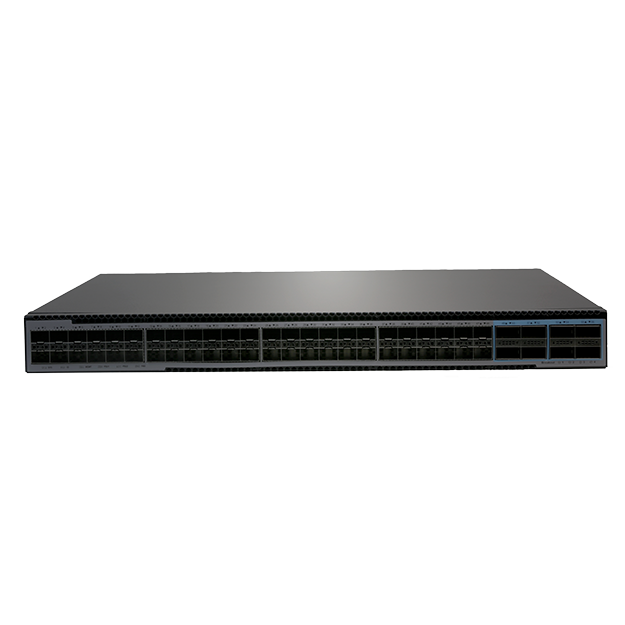
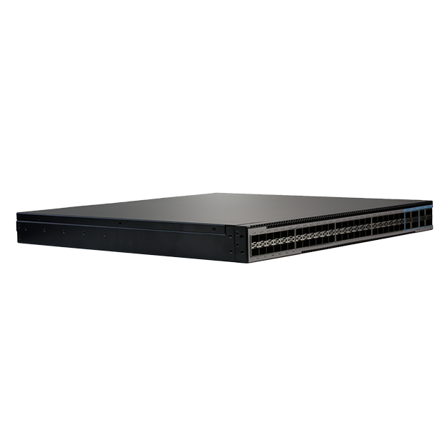
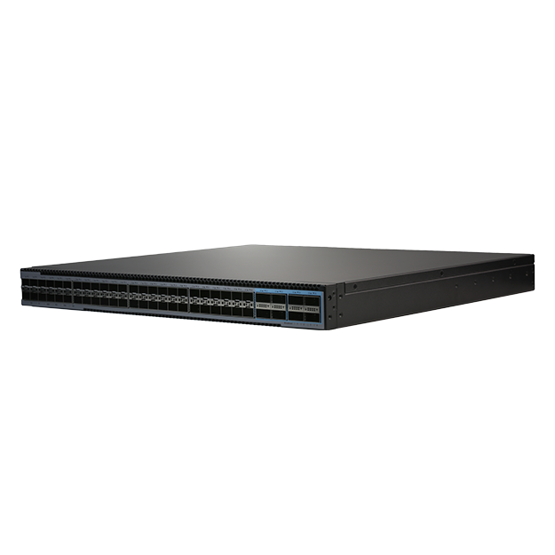
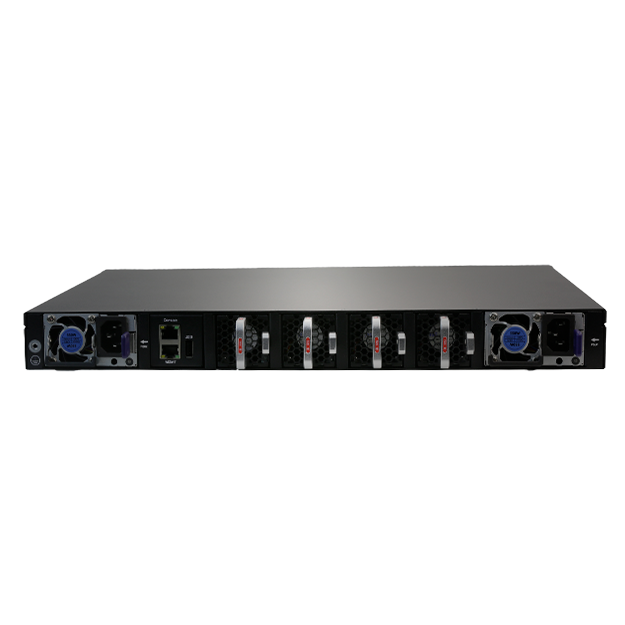

# S7548N-8Z-EI-PLUS

> 来源：<https://hohunet.com/product/s7548n-8z-ei-plus-data-center-switch48-x-25g-sfp288x100g-qsfp28-dual-power-supply-module-4-hot-swappable-intelligent-fan-module/>（抓取 2026-10-21T04:12:40Z；英文原文照录，中文仅为栏目名）  
> 官网标题：S7548N-8Z-EI-PLUS Data Center Switch,48 x 25G SFP28,8x100G QSFP28, Dual Power Supply Module, 4* Hot-Swappable Smart Fan Module  
> 类目：S7500 25G Downlink 100G Uplink / Data Center Network  
> 端口：48×25G + 8×100G；交换容量 —；转发 —；电源 —；芯片平台 —

## 产品图





## Highlights（官网短描述）
- MPLS、IPRAN、MLAG
- QinQ、BGP、IPv6
- 1+1 热插拔电源
- 4个智能风扇模块
- 主要特点：
- 秦Q
- BGP
- OSPF
- MLAG
- IPv6
- VxLAN
- 明尼阿波利斯
- 第 3 层高功能
- 应用场景：
- 企业网络
- 电信运营商网络
- 校园网络

## HARDWARE SPECIFICATION
| 项 | 值 |
|---|---|
| 模型 | S7548N-8Z-EI-PLUS |
| 服务端口 | 48 个 25G SFP28 端口，8 个 100G QSFP28 端口 |
| 管理端口 | 控制台：RJ45 转 RS232 |
| 管理端口 | 以太网：1G 端口 |
| 管理端口 | 存储：USB |
| 电源 | 2 x 800W CRPS |
| 冷却系统 | 4 个风扇模块（前后气流） |
| 记忆 | eMMC：8GB |
| 记忆 | 内存：2GB |
| 中央处理器 | 双核处理器，ARM A53 |
| 分组交换机容量 | 4Tbps（双向） |
| 二层/三层吞吐量 | 1.82 BPPS |
| 功耗（最坏情况，所有端口均已使用，线速流量） | 待定 |
| 典型功耗 | 待定 |
| 声学参数（dBA） | 待定 |
| 制冷量 [CFM] | 待定 |
| 平均故障间隔时间 | ≥90000小时 |
| 运行高度 | ≤5000米 |
| 方面 | 44 x 4.4 x 47厘米 |
| 工作温度 | 0℃至45℃ |
| 芯片组平台 | 电源链接 |

## License
| Items | Description |
|---|---|
| Software License | EB, Basic L3 software features, Preinstalled |
| Software License | MS, L3 enhance features software license key |
| Software License | MA, MPLS features software license key |
| Software License | ST, Stacking feature software license key |

## Software Specification
见 [software/software-spec-6d2462d3cd.md](../software/software-spec-6d2462d3cd.md)（283 行，EB / MS / MA 三档）

## Download
- [S7500 Series switches datasheet_EN_V3.7](https://hohunet.com/wp-content/uploads/2026/06/S7500-Series-switches-datasheet_EN_V3.7-1.pdf) （本地：`data/hohunet_site_raw/downloads/S7500-Series-switches-datasheet_EN_V3.7-1.pdf`）
- [HOS Software Features_EN_V2.4](https://hohunet.com/wp-content/uploads/2024/07/HOS-Software-Features_EN_V2.4.pdf) （本地：`data/hohunet_site_raw/downloads/HOS-Software-Features_EN_V2.4.pdf`）
- [Performance of PowerLink Platform_EN_V1.0](https://hohunet.com/wp-content/uploads/2026/06/Performance-of-PowerLink-Platform_EN_V1.0.pdf) （本地：`data/hohunet_site_raw/downloads/Performance-of-PowerLink-Platform_EN_V1.0.pdf`）

## Description（原文）
```
Description
产品概述
S7500系列交换机采用国产新一代交换芯片，包括Powerlink芯片平台、PeakNetX芯片平台和BigFlow芯片平台。该系列交换机配备48个或24个25G高速端口，功能丰富，能够完美满足城域网、企业级网络、数据中心和超融合基础架构（HCI）等各种网络环境的需求。
S7500系列交换机的主要特点
MPLS（基于标签交换）融合了 IP 的灵活性和面向连接的可靠性，能够实现隔离的多业务承载和精确的流量调度，以满足多场景的高效需求。
MLAG 可以构建主动-主动系统，从而提高从单板级到器件级的网络链路可靠性。
实现 Vxlan 和 BGP 协议，为数据中心场景构建 EVPN 应用。
使用 MACsec（媒体访问控制安全）AES-CMAC 进行交换机到交换机的加密。
精确计时协议。
针对数据中心场景的丰富功能。
S7500系列交换机支持多种管理方式，包括控制台端口、带内网络端口和带外网络端口。支持SNMP v1/v2/v3，支持CLI（命令行界面）、Web管理、Telnet和FTP连接。支持OAM，使管理更加便捷；同时支持SSH2.0、SSL等协议，确保管理安全。此外，凭借深厚的技术实力和对园区及企业网络需求的深刻理解，浩瀚网络推出了大湖云管理系统（DHCS）。该系统能够提升网络管理和维护效率，降低成本，增强管理智能化，并提供更快、更智能、更安全、更可靠的网络，更好地满足用户需求。
可视化 Web 图形用户界面
HOS 允许您使用可视化的 WEB GUI 快速配置常用配置项，从而降低了用户的应用门槛。
```
