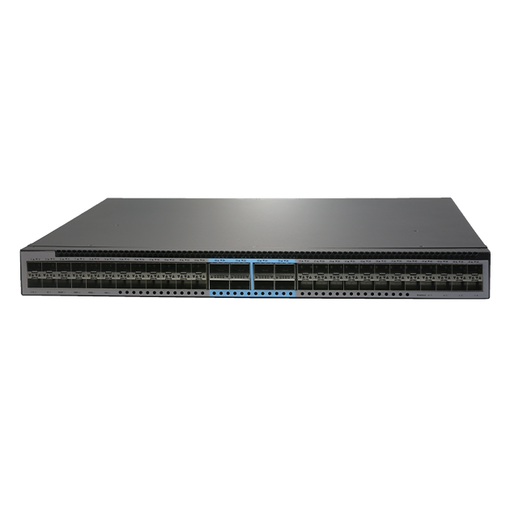
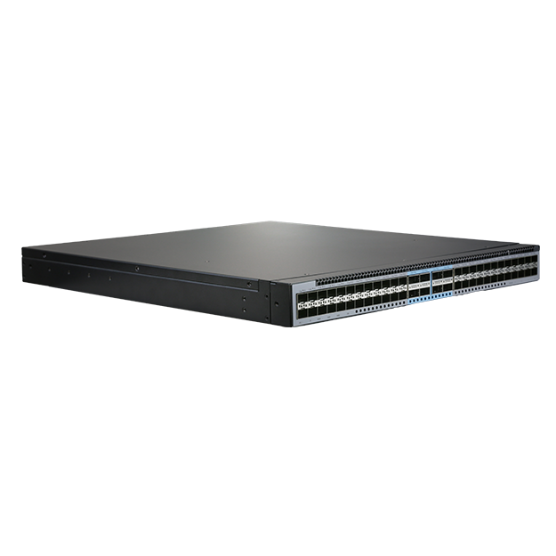
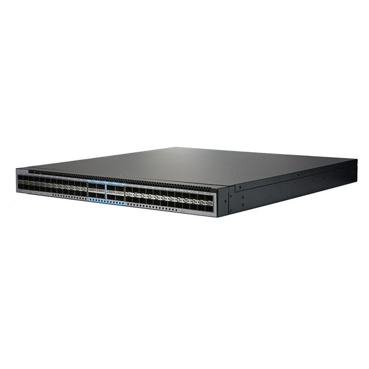
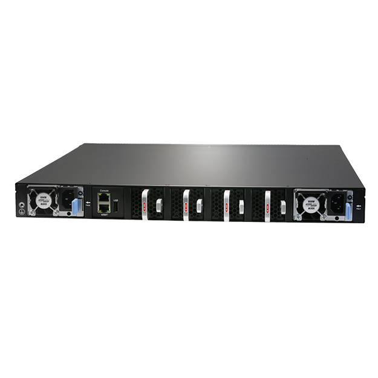

# S7648-8B-EI

> 来源：<https://hohunet.com/product/s7648-8b-ei-data-center-switch48-x-50g-sfp568x100g-qsfp28-dual-power-supply-module-4-hot-swappable-smart-fan-module/>（抓取 2026-10-21T04:12:48Z；英文原文照录，中文仅为栏目名）  
> 官网标题：S7648-8B-EI Data Center Switch,48 x 50G SFP56,8x100G QSFP28, Dual Power Supply Module, 4* Hot-Swappable Smart Fan Module  
> 类目：Data Center Network / S7600 50GDownlink100GUplink  
> 端口：48 x 50G SFP56 8 x 100G QSFP28；交换容量 6.4Tbps (bidirectional)；转发 1.82 BPPS；电源 2 x 800W CRPS；芯片平台 Powerlink

## 产品图





## Highlights（官网短描述）
- MPLS, IPRAN, MLAG
- QinQ, BGP, Ipv6
- 1+1 Hot-Swappable Power Supplies
- 4 Smart Fan Modules
- Highlight Features:
- QinQ
- BGP
- OSPF
- MLAG
- IPv6
- VxLAN
- MPLS
- Layer 3 high-function
- Application Scenarios:
- Enterprise Networks
- Telecommunication Operators Networks
- Campus Networks

## HARDWARE SPECIFICATION
| 项 | 值 |
|---|---|
| Model | S7648-8B-EI |
| Service Ports | 48 x 50G SFP56 8 x 100G QSFP28 |
| Management Ports | Console: RJ45 to RS232 |
| Management Ports | Ethernet: 1G Port |
| Management Ports | Storage: USB |
| Power supply | 2 x 800W CRPS |
| Cooling System | 4 x Fan Modules (front-to-back airflow) |
| Memory | eMMc: 8GB |
| Memory | DRAM: 2GB |
| CPU | Dual-core processor, ARM A53 |
| Packet Switch capacity | 6.4Tbps (bidirectional) |
| Layer 2/Layer 3 Throughput | 1.82 BPPS |
| Power consumption(Worst case, all ports used, line-rate traffic) | TBD |
| Typical Power consumption | TBD |
| Acoustic in dBA | TBD |
| Cooling [CFM] | TBD |
| MTBF | ≥90000H |
| Operating altitude | ≤5000m |
| Dimensions | 44 x 4.4 x 47cm |
| Operating temperature | 0ºC to 45ºC |
| Chipset Platform | Powerlink |

## License
| Items | Description |
|---|---|
| Software License | EB, Basic L3 software features, Preinstalled |
| Software License | MS, L3 enhance features software license key |
| Software License | MA, MPLS features software license key |
| Software License | ST, Stacking feature software license key |

## Software Specification
见 [software/software-spec-78b5976690.md](../software/software-spec-78b5976690.md)（283 行，EB / MS / MA 三档）

## Description（原文）
```
Description
Product Overview
The S7600 Series switches designed on a domestic new generation switch Chip, which called Powerlink Chip platform .With 48 x 50G high speed ports and rich features, these switches will perfectly meets the requirements of Metro, Enterprise, Data Center, and Hyper converged infrastructure (HCI) networks.
Key features of the S7600 Series Switches
MPLS (label-switching-based) integrates IP flexibility and connection-oriented reliability, enabling isolated multi-service bearing, precise traffic scheduling to meet multi-scenario efficient needs.
MLAG which can build an Active-Active system to improve the reliability of the network links from single board grade to device grade.
Implementing Vxlan and BGP protocols to build EVPN applications for data centers scenario.
Switch-to-switch encryption using MACsec (Media Access Control Security) AES-CMAC.
Precision Timing Protocol.
Rich features for Datacenter scenario.
The S7600 Series switches support varied management ways, include console port / in-band network ports / out-of-band network port. Support SNMP v1/v2/v3, Support CLI (Command Line Interface), web management, Telnet and FTP connection. Support OAM to make management more convenient, and support SSH2.0, SSL, etc. to ensure security of management. Moreover, leveraging its profound technical expertise and in-depth understanding of campus and enterprise networking needs, Hohunet has launched the Da Hu Cloud Management System (DHCS). It enhances network management and maintenance efficiency, reduces costs, elevates management intelligence, and delivers a faster, smarter, more secure and reliable network to better meet user requirements.
Visual WEB GUI
HOS allows you to quickly configure common configuration items using a visual WEB GUI, which lowers the application threshold for users.
```
