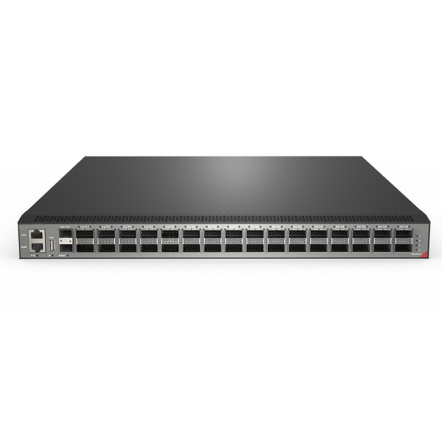
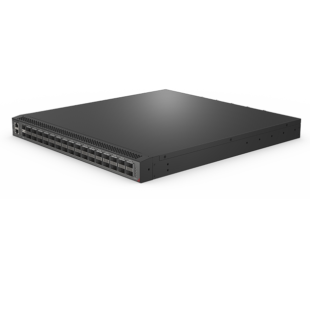
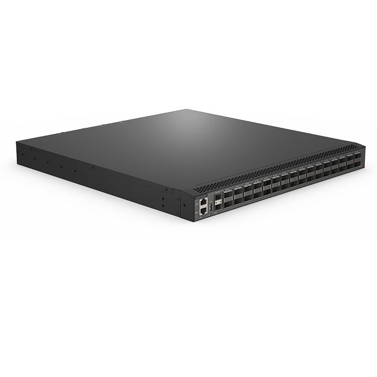
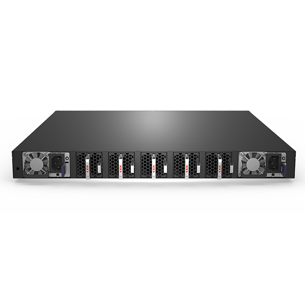

# S8232-2X-EI

> 来源：<https://hohunet.com/product/s8232-2x-ei-data-center-switch48-x-25g-sfp288x100g-qsfp28-dual-power-supply-module-5-hot-swappable-smart-fan-module/>（抓取 2026-10-21T04:12:41Z；英文原文照录，中文仅为栏目名）  
> 官网标题：S8232-2X-EI Data Center Switch,32 x 200G QSFP56, 2 x 10G SFP+,Dual Power Supply Module, 5* Hot-Swappable Smart Fan Module  
> 类目：Data Center Network / S8200 200G  
> 端口：32 x 200G QSFP56；交换容量 12.8Tbps (bidirectional)；转发 1.82 BPPS；电源 2 x 800W CRPS；芯片平台 Powerlink

## 产品图





## Highlights（官网短描述）
- MPLS, IPRAN, MLAG
- QinQ, BGP, Ipv6
- 1+1 Hot-Swappable Power Supplies
- 5 Smart Fan Modules
- Highlight Features:
- QinQ
- BGP
- OSPF
- MLAG
- IPv6
- VxLAN
- MPLS
- Layer 3 high-function
- Application Scenarios:
- Enterprise Networks
- Telecommunication Operators Networks
- Campus Networks

## HARDWARE SPECIFICATION
| 项 | 值 |
|---|---|
| Model | S8232-2X-EI |
| Service Ports | 32 x 200G QSFP56 |
| Management Ports | Console: RJ45 to RS232 |
| Management Ports | Ethernet: 1G Port |
| Management Ports | Storage: USB |
| Power supply | 2 x 800W CRPS |
| Cooling System | 5 x Fan Modules (front-to-back airflow) |
| Memory | eMMc: 8GB |
| Memory | DRAM: 2GB |
| CPU | Dual-core processor, ARM A53 |
| Packet Switch capacity | 12.8Tbps (bidirectional) |
| Layer 2/Layer 3 Throughput | 1.82 BPPS |
| Power consumption(Worst case, all ports used, line-rate traffic) | TBD |
| Typical Power consumption | TBD |
| Acoustic in dBA | TBD |
| Cooling [CFM] | TBD |
| MTBF | ≥90000H |
| Operating altitude | ≤5000m |
| Dimensions | 44 x 4.4 x 47cm |
| Operating temperature | 0ºC to 45ºC |
| Chipset Platform | Powerlink |

## License
| Items | Description |
|---|---|
| Software License | EB, Basic L3 software features, Preinstalled |
| Software License | MS, L3 enhance features software license key |
| Software License | MA, MPLS features software license key |
| Software License | ST, Stacking feature software license key |

## Software Specification
见 [software/software-spec-78b5976690.md](../software/software-spec-78b5976690.md)（283 行，EB / MS / MA 三档）

## Description（原文）
```
Description
Product Overview
The S8200 Series switches designed on a domestic new generation switch Chip, which called PowerLink Series Chip platform. With 32*200G QSFP56 high speed ports and rich features, these switches will perfectly meets the requirements of Metro, Enterprise, Data Center, and Hyper converged infrastructure (HCI) networks.
Key features of the S8200 Switch
MPLS technology, with label switching as its core, combines the flexibility of IP networks and the reliability of connection-oriented networks, enabling isolated bearing of multiple services, precise traffic scheduling, and fast fault self-healing while reducing the deployment and operation costs of complex networking, thus adapting to the efficient networking needs of governments, enterprises, operators and other multi-scenarios.
MLAG which can build an Active-Active system to improve the reliability of the network links from single board grade to device grade.
Implementing Vxlan and BGP protocols to build EVPN applications for data centers scenario.
Switch-to-switch encryption using MACsec (Media Access Control Security) AES-CMAC.
Precision Timing Protocol.
Rich L2/L3 features like IPv6, OSPF, BGP, PIM, etc.
The S8200 Series switches support varied management ways, include console port / in-band network ports / out-of-band network port. Support SNMP v1/v2/v3, Support CLI (Command Line Interface), web management, Telnet and FTP connection. Support OAM to make management more convenient, and support SSH2.0, SSL, etc. to ensure security of management. Moreover, leveraging its profound technical expertise and in-depth understanding of campus and enterprise networking needs, Hohunet has launched the Da Hu Cloud Management System (DHCS). It enhances network management and maintenance efficiency, reduces costs, elevates management intelligence, and delivers a faster, smarter, more secure and reliable network to better meet user requirements.
Visual WEB GUI
HOS allows you to quickly configure common configuration items using a visual WEB GUI, which lowers the application threshold for users.
```
