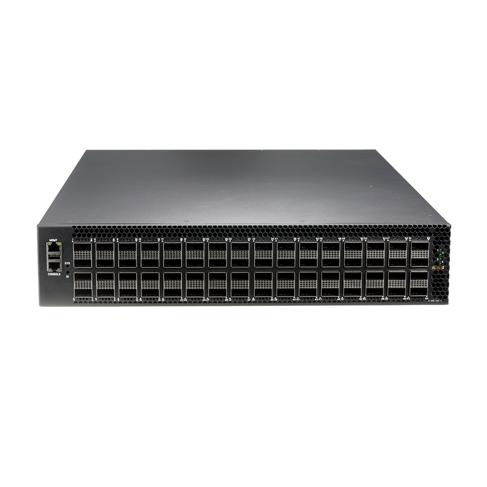

# S8564-EI

> 来源：<https://hohunet.com/product/s8564-ei-data-center-switch-data-center-computing-ai/>（抓取 2026-10-21T04:11:42Z；英文原文照录，中文仅为栏目名）  
> 官网标题：64×400G QSFP112 High-Density L3 Managed Data Center Ethernet Switch with Dual Power Modules, 4*Smart Fan Modules  
> 类目：Data Center Network / S8500 400G  
> 端口：64 x 400G QSFP 112；交换容量 51.2 Tbps (bidirectional)；转发 76.18 Tbps (bidirectional)；电源 2 x 3200W CRPS；芯片平台 SerdesX

## 产品图



## Highlights（官网短描述）
- High-Port Density: 64×400G QSFP112 ports
- High reliability: Redundant hot-swappable power supplies and fans
- Cloud-managed: Centralized visibility and automated operations
- Advanced L3 features: VXLAN, EVPN, BGP, MacSec, PFC/ECN/DCBX, MLAG
- Support SNMP v1/v2c/v3, CLI, Telnet, SSH
- Highligh Features:
- VXLAN
- EVPN
- BGP
- MacSec
- IPv6
- PFC/ECN/DCBX
- MLAG
- Application Scenarios:
- Data Center Networks
- Supercomputing
- AI interconnection

## HARDWARE SPECIFICATION
| 项 | 值 |
|---|---|
| Model | S8564-EI |
| Service Ports | 64 x 400G QSFP 112 |
| Management Ports | Console: RJ45 to RS232 Ethernet: 1G Port Storage: USB |
| Power supply | 2 x 3200W CRPS |
| Cooling System | 4 x hot-swappable Fan Module (front-to-back airflow) |
| Memory | eMMc: 8GB DRAM: 4GB |
| CPU | 4-core processor, ARM A53（1GHz） |
| Packet Switch capacity | 51.2 Tbps (bidirectional) |
| Layer 2/Layer 3 Throughput | 76.18 Tbps (bidirectional) |
| Power consumption (Worst case, all ports used, line-rate traffic) | TBD |
| Typical Power consumption | TBD |
| Acoustic in dBA | TBD |
| Cooling [CFM] | 618.72 |
| MTBF | ≥90000h (~10.3 Years) |
| Operating altitude | ≤5000m |
| Dimensions | 44.2 x 8.8 x 62cm |
| Operating temperature | 0ºC to 45ºC |
| Chipset Platform | SerdesX |

## License
| Items | Description |
|---|---|
| Software License | MS, L3 enhance features software license key, Preinstalled |
| Software License | MA, MPLS features software license key |
| Software License | ST, Stacking feature software license key |

## Software Specification
见 [software/software-spec-78b5976690.md](../software/software-spec-78b5976690.md)（283 行，EB / MS / MA 三档）

## Download
- [S8500 Series switches datasheet_EN_V1.2](https://hohunet.com/wp-content/uploads/2024/04/S8500-Series-switches-datasheet_EN_V1.2.pdf) （本地：`data/hohunet_site_raw/downloads/S8500-Series-switches-datasheet_EN_V1.2.pdf`）
- [HOS Software Features_EN_V2.4](https://hohunet.com/wp-content/uploads/2024/07/HOS-Software-Features_EN_V2.4.pdf) （本地：`data/hohunet_site_raw/downloads/HOS-Software-Features_EN_V2.4.pdf`）
- [Performance of SerdesX Platform_EN_V3.1](https://hohunet.com/wp-content/uploads/2024/07/Performance-of-SerdesX-Platform_EN_V3.1.pdf) （本地：`data/hohunet_site_raw/downloads/Performance-of-SerdesX-Platform_EN_V3.1.pdf`）

## Description（原文）
```
Description
Product Overview
The S8500 series switch designed on a domestic new generation switch Chip, which called SerdesX Series Chip platform. With 32/64 x 400G high speed ports and rich features, these switches will perfectly meets the requirements of Metro, Enterprise, Data Center, and Hyper converged infrastructure (HCI) networks.
Key features of the S8500 Series Switch
*Support MPLS features (L2/L3 VPN) to build a unified and converged network platform.
*MLAG which can build an Active-Active system to improve the reliability of the network links from single board grade to device grade.
*Implementing Vxlan and BGP protocols to build EVPN applications for data centers scenario.
*Switch-to-switch encryption using MACsec (Media Access Control Security) AES-CMAC.
*Precision Timing Protocol.
*Rich L2/L3 features like IPv6, OSPF, BGP, PIM, etc.
The S8500 Series switches support varied management ways, include console port / in-band network ports / out-of-band network port. Support SNMP v1/v2/v3, Support CLI (Command Line Interface), web management, Telnet and FTP connection. Support OAM to make management more convenient, and support SSH2.0, SSL, etc. to ensure security of management. Moreover, leveraging its profound technical expertise and in-depth understanding of campus and enterprise networking needs, Hohunet has launched the Da Hu Cloud Management System (DHCS). It enhances network management and maintenance efficiency, reduces costs, elevates management intelligence, and delivers a faster, smarter, more secure and reliable network to better meet user requirements.
Visual WEB GUI
HOS allows you to quickly configure common configuration items using a visual WEB GUI, which lowers the application threshold for users.
```
