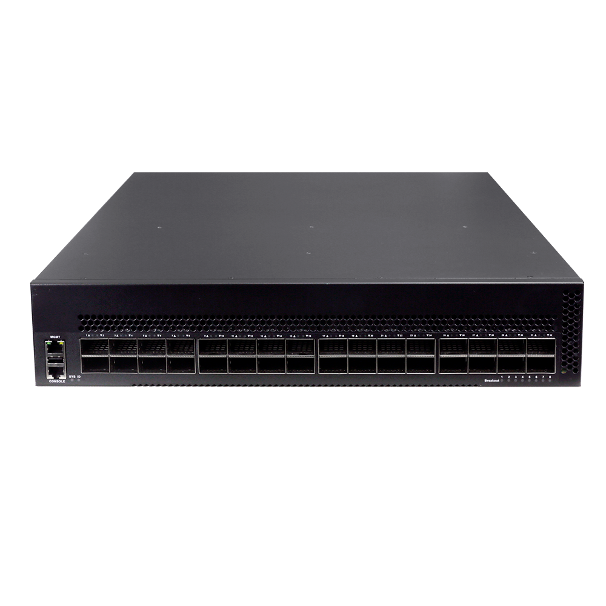

# S9532-EI

> 来源：<https://hohunet.com/product/s9532-data-center-switch-with-32-800g-osfp-data-center-switch/>（抓取 2026-10-21T04:11:37Z；英文原文照录，中文仅为栏目名）  
> 官网标题：S9532-EI Data Center Switch, with 32*800G OSFP, Dual Power Modules, 4*Smart Fan Modules, 2U  
> 类目：Data Center Network / S9500 800G  
> 端口：32 x 800G OSFP；交换容量 51.2 Tbps；转发 76.19 Gpps；电源 2 x 3200W CRPS；芯片平台 SerdesX

## 产品图



## Highlights（官网短描述）
- High-density 800G switch, 32*800G OSFP
- Redundant hot-swappable power and fans ensure continuous stability
- Support VXLAN/EVPN tunnel technology, unlimited data transmission
- RDMA end-to-end data forwarding, build a lossless network without packet loss
- Support MLAG, cross-device link aggregation technology
- Highligh Features:
- EVPN
- BGP
- OSPF
- MLAG
- IPv6
- VxLAN
- RDMA
- Application Scenarios:
- Supercomputing
- Data Center Networks
- AI/ML Networks

## HARDWARE SPECIFICATION
| 项 | 值 |
|---|---|
| Model | S9532-EI |
| Service Ports | 32 x 800G OSFP |
| Management Ports | Console: RJ45 to RS232 Ethernet: 1G Port |
| Power supply | 2 x 3200W CRPS |
| Cooling System | 4 x Fan Modules (front-to-back airflow) |
| Memory | eMMc: 8GB DRAM: 4GB |
| CPU | Four-core processor, ARM A53 |
| Packet Switch capacity | 51.2 Tbps |
| Layer 2/Layer 3 Throughput | 76.19 Gpps |
| Power consumption (Worst case, all ports used, line-rate traffic) | TBD |
| Typical Power consumption | TBD |
| Acoustic in dBA | TBD |
| Cooling [CFM] | TBD |
| MTBF | ≥90000H |
| Operating altitude | ≤5000m |
| Dimensions | 44.2*8.8*58.8cm |
| Operating temperature | 0ºC to 40ºC |
| Chipset Platform | SerdesX |

## License
| Items | Description |
|---|---|
| Software License | MS, L3 enhance features software license key, Preinstalled on EI models |
| Software License | MA, MPLS features software license key |
| Software License | ST, Stacking feature software license key |

## Software Specification
见 [software/software-spec-78b5976690.md](../software/software-spec-78b5976690.md)（283 行，EB / MS / MA 三档）

## Download
- [S9500 Series switches datasheet_EN_V1.2](https://hohunet.com/wp-content/uploads/2024/04/S9500-Series-switches-datasheet_EN_V1.2.pdf) （本地：`data/hohunet_site_raw/datasheets/S9500-Series-switches-datasheet_EN_V1.2.pdf`）
- [HOS Software Features_EN_V2.4](https://hohunet.com/wp-content/uploads/2024/07/HOS-Software-Features_EN_V2.4.pdf) （本地：`data/hohunet_site_raw/datasheets/HOS-Software-Features_EN_V2.4.pdf`）
- [Performance of SerdesX Platform_EN_V3.1](https://hohunet.com/wp-content/uploads/2024/07/Performance-of-SerdesX-Platform_EN_V3.1.pdf) （本地：`data/hohunet_site_raw/datasheets/Performance-of-SerdesX-Platform_EN_V3.1.pdf`）

## Description（原文）
```
Description
Product Overview
The S9500 Series switches designed on a domestic new generation switch Chip, which called SerdesX Series Chip platform. With 32 x 800G high speed ports and rich features, these switches will perfectly meets the requirements of supercomputing, Data Center, and AI/ML Networks.
Key features of the S9500 Series switches
* High-density 800G switch, 32*800G OSFP
*Redundant hot-swappable power and fans ensure continuous stability
*Support VXLAN/EVPN tunnel technology, unlimited data transmission
*RDMA end-to-end data forwarding, build a lossless network without packet loss*Support MLAG, cross-device link aggregation technology
The S9500 Series switches support varied management ways, include console port / in-band network ports / out-of-band network port. Support SNMP v1/v2/v3, Support CLI (Command Line Interface), web management, Telnet and FTP connection. Support OAM to make management more convenient, and support SSH2.0, SSL, etc. to ensure security of management. Moreover, leveraging its profound technical expertise and in-depth understanding of campus and enterprise networking needs, Hohunet has launched the Da Hu Cloud Management System (DHCS). It enhances network management and maintenance efficiency, reduces costs, elevates management intelligence, and delivers a faster, smarter, more secure and reliable network to better meet user requirements.
Visual WEB GUI
HOS allows you to quickly configure common configuration items using a visual WEB GUI, which lowers the application threshold for users.
```
